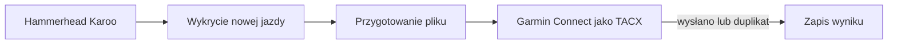

# Hammerhead → Garmin (TACX)

## Co to jest

QBot sprawdza nowe aktywności z Hammerheada (Karoo) i przesyła je do Garmina jako TACX (typ aktywności używany w tym mostku; [słowniczek](../slowniczek.md#tacx)). Status jest widoczny na stronie Status.

## Po co

Pomaga przenieść dane między usługą a QBotem i sprawdzić, czy przepływ działa.

## Skąd dane

Aktywności Hammerhead i Garmin. Stan przetwarzania jest zapisywany w pliku stanu QBota, a log zawiera wynik uruchomień.

## Jak liczone

1. Automat sprawdza Hammerheada, czy czeka nowa aktywność rowerowa.
2. Znaleziony plik jest przygotowywany do przyjęcia przez Garmin Connect i wysyłany jako TACX (format aktywności stosowany dla tego mostka; [słowniczek](../slowniczek.md#tacx)).
3. Automat zapisuje wynik, żeby nie wysłać tej samej jazdy ponownie. Odpowiedź „Duplicate Activity” oznacza, że Garmin już ma jazdę i nie jest liczona jako awaria.
4. Crontab z 18.10.2026 ma cztery wpisy co 10 minut: jeden ogólny i trzy profile użytkowników. Plik profilu jest argumentem, więc są to osobne konta.

Nie wyliczam przykładu dystansu: nie odczytywałem rekordu aktywności Hammerhead. To ograniczenie bazy w tym haśle, nie brak potwierdzenia samego harmonogramu.

Zrzut Status pokazuje ostatnią jazdę przesłaną 18.10.2026 o 13:10 oraz sprawdzenie o 15:40. Bieżący crontab potwierdza wpisy co 10 minut. Kontrola w `qbot_status_checks.py` również uznaje brak sprawdzenia przez godzinę za awarię i duplikat za poprawny wynik.

## Gdzie to widać

SETUP > Połączenia zawiera ramki Stravy, Komoot i Hammerhead/Karoo. Wybrane stany integracji pokazuje SETUP > Połączenia > Status. Szczegóły danego przepływu podano powyżej.

## Jak czytać

Jeśli sprawdzenie było świeże, ale nie ma nowej jazdy, stan nadal może być zielony. Zielony stan nie znaczy, że każda jazda Karoo została rozpoznana. Wiersz Status rozdziela czas ostatniego wysłania od czasu ostatniej kontroli.

## Decyzje i historia

Decyzja z 07.07.2026 ustala rolę Hammerheada jako mostka, nie równoległego źródła treningów QBota. Aktywny crontab z 18.10.2026 potwierdza 10-minutowe uruchomienia, w tym oddzielne profile.

## Ograniczenia i pułapki

Usunięcie jazdy z Garmina nie resetuje automatycznie lokalnego oznaczenia „przetworzona”. W historii decyzji opisano, że poprawioną wersję wcześniej wysłanej jazdy trzeba było wgrać ręcznie. To ważne przy korektach błędnego pliku.

## Wpływa na

- [Połączenia i dane](index.md)
- [Status i automaty](../system/automaty.md)
- [Garmin](garmin.md)

## Zależy od

- Dostępu do wskazanej usługi oraz uruchomienia automatu.
- Zapisów w tabelach/plikach wymienionych poniżej.

## Powiązane hasła

- [Garmin](garmin.md)
- [Harmonogram importów](harmonogram-importow.md)
- [Połączenia i dane](index.md)
- [Raport jazdy](../raport-jazdy/index.md)

## Zrodla

- `qbot_status_checks.py` — `hammerhead`; `scripts/run_hammerhead_garmin_sync.sh`; `docs/STATUS.md`
- `state/processed_hammerhead_activities.json`; `logs/hammerhead-garmin-sync.log`
