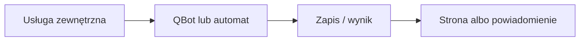

# Hammerhead → Garmin (TACX)

## Co to jest

QBot sprawdza nowe aktywności z Hammerheada (Karoo) i przesyła je do Garmina jako aktywności typu TACX. Status jest widoczny na stronie Status.

## Po co

Pomaga przenieść dane między usługą a QBotem i sprawdzić, czy przepływ działa.

## Skąd dane

Aktywności Hammerhead i Garmin. Stan przetwarzania jest zapisywany w pliku stanu QBota, a log zawiera wynik uruchomień.

## Jak liczone

Program uruchamia się co 10 minut. Odpowiedź Garmina „Duplicate Activity” oznacza, że aktywność już istnieje i status liczy ją jako poprawną.

STATUS.md podaje harmonogram root cron. Kod checku potwierdza oczekiwany odstęp i obsługę duplikatu; sam harmonogram systemowy nie został w tej sesji odczytany.

## Gdzie to widać

SETUP > Połączenia zawiera ramki Stravy, Komoot i Hammerhead/Karoo. Wybrane stany integracji pokazuje SETUP > Połączenia > Status. Szczegóły danego przepływu podano powyżej.

## Jak czytać

Status opisuje świeżość i powodzenie pracy automatu, a nie gwarantuje kompletności wszystkich danych u dostawcy. Brak osobnego checku nie przesądza o braku integracji.

## Decyzje i historia

STATUS.md podaje harmonogram root cron. Kod checku potwierdza oczekiwany odstęp i obsługę duplikatu; sam harmonogram systemowy nie został w tej sesji odczytany.

## Ograniczenia i pułapki

Nie zakładaj, że każda pozycja oznacza bieżący, poprawny import. Częstotliwości wymagają potwierdzenia w aktywnym harmonogramie.

## Wpływa na

- [Połączenia i dane](index.md)
- [Status i automaty](../system/automaty.md)

## Zależy od

- Dostępu do wskazanej usługi oraz uruchomienia automatu.
- Zapisów w tabelach/plikach wymienionych poniżej.

## Powiązane hasła

- [Garmin](garmin.md)
- [Harmonogram importów](harmonogram-importow.md)
- [Raport jazdy](../raport-jazdy/index.md)

## Zrodla

- `qbot_status_checks.py` — `hammerhead`; `scripts/run_hammerhead_garmin_sync.sh`; `docs/STATUS.md`
- `state/processed_hammerhead_activities.json`; `logs/hammerhead-garmin-sync.log`
