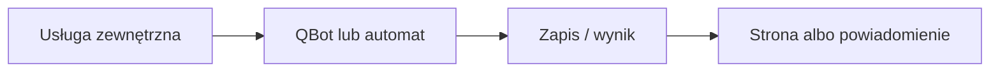

# Harmonogram importów

## Co to jest

Automaty pobierają lub przekazują dane bez ręcznego uruchamiania. Strona Status pokazuje wybrane ostatnie uruchomienia i błędy; sama deklaracja częstotliwości w kodzie nie potwierdza, że harmonogram rzeczywiście działa.

## Po co

Pomaga przenieść dane między usługą a QBotem i sprawdzić, czy przepływ działa.

## Skąd dane

Stan usług, logi i pliki stanu poszczególnych integracji.

## Jak liczone

Sprawdzony kod zakłada: Garmin — sprawdzanie co 10 minut, import przy zmianie lub w cyklu bezpieczeństwa do 3 godzin; Hammerhead — sprawdzanie co 10 minut; Komoot — kontrola statusu oczekuje interwału 5 minut. Status Withings ostrzega przy nieświeżym stanie ponad 72 godziny. Rzeczywiste crony/timery nie zostały tu odczytane.

Dokument STATUS.md ma datę 15.10.2026. Weryfikacja kodu potwierdziła warunki checków, lecz nie aktywne crontaby ani timery.

## Gdzie to widać

SETUP > Połączenia zawiera ramki Stravy, Komoot i Hammerhead/Karoo. Wybrane stany integracji pokazuje SETUP > Połączenia > Status. Szczegóły danego przepływu podano powyżej.

## Jak czytać

Status opisuje świeżość i powodzenie pracy automatu, a nie gwarantuje kompletności wszystkich danych u dostawcy. Brak osobnego checku nie przesądza o braku integracji.

## Decyzje i historia

Dokument STATUS.md ma datę 15.10.2026. Weryfikacja kodu potwierdziła warunki checków, lecz nie aktywne crontaby ani timery.

## Ograniczenia i pułapki

Nie zakładaj, że każda pozycja oznacza bieżący, poprawny import. Częstotliwości wymagają potwierdzenia w aktywnym harmonogramie.

## Wpływa na

- [Połączenia i dane](index.md)
- [Status i automaty](../system/automaty.md)

## Zależy od

- Dostępu do wskazanej usługi oraz uruchomienia automatu.
- Zapisów w tabelach/plikach wymienionych poniżej.

## Powiązane hasła

- [Garmin](garmin.md)
- [Harmonogram importów](harmonogram-importow.md)
- [Raport jazdy](../raport-jazdy/index.md)

## Zrodla

- `qbot_status_checks.py` — `garmin_import`, `hammerhead`, `withings`, `komoot`; `docs/STATUS.md`; `docs/SETUP.md`
- Pliki stanu Garmin, Hammerhead i Withings; usługa `qbot-komoot-watch.service`.
