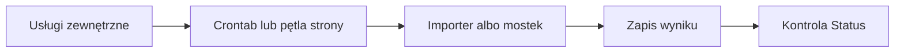

# Harmonogram importów

## Co to jest

Automaty pobierają lub przekazują dane bez ręcznego uruchamiania. Strona Status pokazuje wybrane ostatnie uruchomienia i błędy; sama deklaracja częstotliwości w kodzie nie potwierdza, że harmonogram rzeczywiście działa.

## Po co

Pomaga przenieść dane między usługą a QBotem i sprawdzić, czy przepływ działa.

## Skąd dane

Stan usług, logi i pliki stanu poszczególnych integracji.

## Jak liczone

1. **Hammerhead → Garmin:** aktywne wpisy w crontabie uruchamiają mostek co 10 minut. Oprócz wpisu ogólnego są trzy osobne profile.
2. **Garmin → QBot:** aktywny strażnik uruchamia się co 15 minut. Check Status w kodzie nadal oczekuje kontroli co 10 minut, więc może pokazać rozjazd harmonogramu z deklarowanym interwałem.
3. **Withings → Garmin:** aktywny wpis działa co 15 minut. Check stanu alarmuje, gdy zapis stanu jest starszy niż 72 godziny.
4. **Komoot:** kod i dokument Status oczekują sprawdzenia co 5 minut. Aktywnego timera Komoot nie odczytano.
5. **Xert:** aktywny crontab pobiera migawkę raz dziennie o 00:15.
6. **Strava:** automat publikacji uruchamia się z usługą strony; kod podaje 20 minut między 06:00 i 23:59. Nie jest to wpis crona.
7. **intervals.icu:** kod importera istnieje, lecz aktywnego harmonogramu i świeżego rekordu wellness z tego źródła nie potwierdzono.

Przykład różnicy: Strażnik Garmin ma uruchomienia co 15 minut, podczas gdy statusowy komunikat „co 10 min” opisuje oczekiwany interwał checku. Te dwie liczby odpowiadają różnym mechanizmom.

Odczyt crontaba z 18.10.2026 potwierdził aktywne interwały Hammerhead, Garmin, Withings i Xert. Wpisy importu treningów i wellness Garmina ze starszej ścieżki są zakomentowane. Timer Komoot nie został sprawdzony.

## Gdzie to widać

SETUP > Połączenia zawiera ramki Stravy, Komoot i Hammerhead/Karoo. Wybrane stany integracji pokazuje SETUP > Połączenia > Status. Szczegóły danego przepływu podano powyżej.

## Jak czytać

Interwał w checku Status to próg oceny świeżości, nie zawsze harmonogram uruchomienia programu. Gdy w dwóch miejscach widzisz różne liczby, porównuj najpierw nazwę automatu i rodzaj kontroli. Status na zrzucie jest migawką z 18.10.2026, a nie bieżącą gwarancją działania.

## Decyzje i historia

Rozbieżność Garmin (cron 15 min, check 10 min) pozostaje rozjazdem serwisu; opis wiki nie koryguje kodu. Dokument STATUS.md zawiera starsze zestawienie. Hammerhead co 10 min, Withings co 15 min oraz Xert o 00:15 są potwierdzone aktywnym crontabem.

## Ograniczenia i pułapki

Sama obecność wpisu nie potwierdza, że ostatnie uruchomienie się powiodło. Do tego służą godziny, komunikaty błędów i liczniki na Status. Strava działa w pętli programu, a webhook RWGPS reaguje na zdarzenie — nie przypisuj im na siłę minutowego wpisu crona.

## Wpływa na

- [Połączenia i dane](index.md)
- [Status i automaty](../system/automaty.md)

## Zależy od

- Dostępu do wskazanej usługi oraz uruchomienia automatu.
- Zapisów w tabelach/plikach wymienionych poniżej.

## Powiązane hasła

- [Garmin](garmin.md)
- [Garmin — sekcja Hammerhead/Karoo](garmin.md#hammerheadkaroo--garmin-tacx)
- [Withings → Garmin](withings.md)
- [Komoot](komoot.md)
- [Strava](strava.md)
- [intervals.icu](intervals-icu.md)
- [Xert](xert.md)
- [Harmonogram importów](harmonogram-importow.md)
- [Raport jazdy](../raport-jazdy/index.md)

## Zrodla

- `qbot_status_checks.py` — `garmin_import`, `hammerhead`, `withings`, `komoot`; `docs/STATUS.md`; `docs/SETUP.md`
- Pliki stanu Garmin, Hammerhead i Withings; usługa `qbot-komoot-watch.service`.
