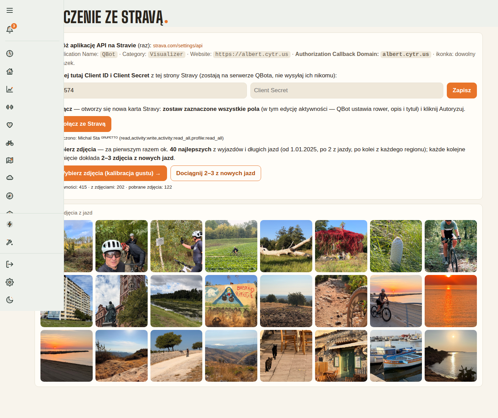
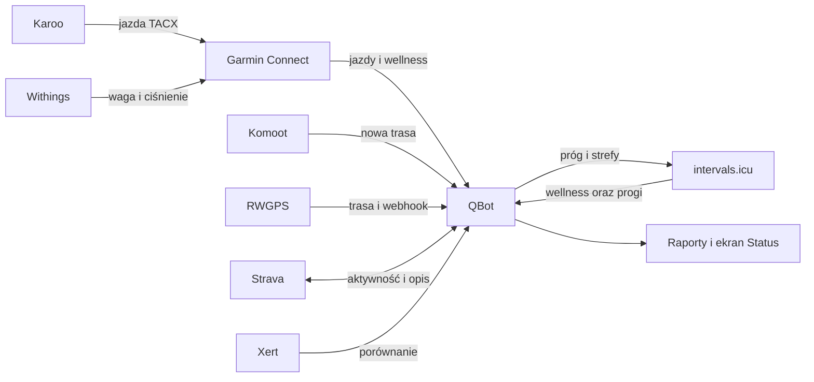

# Połączenia i dane

Ten dział wyjaśnia, którędy do QBota trafiają jazdy, pomiary i trasy oraz które dane QBot przekazuje dalej. Najważniejsze połączenie treningowe biegnie z Karoo przez Hammerhead do Garmina, a potem do QBota. Nie każda integracja działa w tym samym kierunku.

Na zrzucie widać ekran konfiguracji Stravy: po lewej ustawienia i przycisk połączenia, niżej przyciski pobierania zdjęć i galerię. Widok jest częściowo zasłonięty lewym menu. Wartości widoczne przy galerii (415 aktywności, 202 ze zdjęciami, 122 pobrane) opisują licznik galerii, a nie status synchronizacji treningów. Zrzut: [indeks ekranów](../img/ekrany/indeks.md).

## Droga danych

## Co widzisz na ekranie → hasło

| Co widzisz | Wyjaśnienie |
|---|---|
| Autoryzacja, Client ID i Client Secret Stravy | [Strava](strava.md) |
| Galeria i liczniki zdjęć | [Strava](strava.md); to osobna funkcja zdjęć |
| Zielona kropka i czas ostatniego importu Garmina | [Garmin](garmin.md) |
| Hammerhead → Garmin (TACX) | [Hammerhead → Garmin](hammerhead-garmin.md) |
| Ostatnia waga lub ciśnienie z Withings | [Withings → Garmin](withings.md) |
| Ostatnia kontrola nowych tras | [Komoot](komoot.md) |
| Połączenie profilu i próg wysyłany na Karoo | [intervals.icu](intervals-icu.md) |
| Trasa z serwisu rowerowego | [RWGPS](rwgps.md) |
| Porównanie parametrów treningowych | [Xert](xert.md) |
| Godzina sprawdzenia automatu | [Harmonogram importów](harmonogram-importow.md) |

## Jak czytać Status

Zrzut pokazuje „Wszystko działa” oraz osobne wiersze dla usług QBota, importu Garmina, Hammerheada, Withings, Komoot i kopii bazy. Wiersz Stravy, intervals.icu, RWGPS ani Xert nie jest tu pokazany jako osobny check. Kropka pusta przy Bramce oznacza świadome wyłączenie; nie należy utożsamiać jej z awarią.

Status mówi o tym, co sprawdza jego kontrola i kiedy ostatnio widziała pracę. Zielony stan nie dowodzi, że każda aktywność lub każdy pomiar u dostawcy został pobrany. Szczegóły i dokładne progi opisuje [Status systemu](../system/status.md).

## Wpływa na / Zależy od

- Dane Garmina zasilają [Formę](../forma/index.md), [Zdrowie](../zdrowie/index.md), [ModelQ](../modelq/index.md) i [raport jazdy](../raport-jazdy/index.md).
- Komoot i RWGPS dostarczają trasy do [Analizy tras](../trasy/analiza-trasy.md).
- Raport jazdy może przygotować [opis Stravy](../raport-jazdy/opis-strava.md).
- Importy zależą od dostępu do kont zewnętrznych oraz działających automatów.

## Powiązane hasła
- [Usługi zewnętrzne](uslugi-zewnetrzne.md)

- [Status systemu](../system/status.md)
- [Raport jazdy](../raport-jazdy/index.md)
- [Analiza trasy](../trasy/analiza-trasy.md)
- [Słowniczek](../slowniczek.md)

## Zrodla

- `docs/SETUP.md` — sekcja Połączenia.
- `docs/STATUS.md`; `qbot_status_checks.py` — lista i znaczenie kontroli.
- `docs/STRAVA_PUBLISH.md`; `qbot_strava_publish.py` — publikacja aktywności.
- `docs/DECISIONS.md` — decyzje o połączeniach Garmin, Withings, intervals.icu i Xert.
