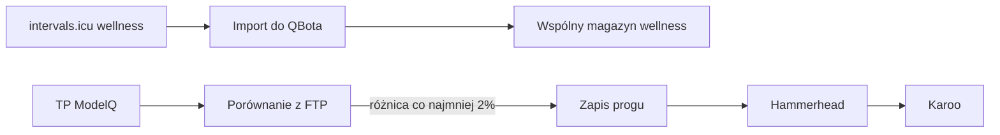

# intervals.icu

## Co to jest

intervals.icu jest w tym systemie zarówno źródłem wellness, jak i miejscem, do którego QBot przekazuje wybrane progi treningowe. To nie jest tylko historyczne połączenie: kod zawiera odczyt wellness, import do QBota oraz synchronizację progu mocy i progu tętna.

## Po co

Połączenie pozwala QBotowi odczytać pomiary z intervals.icu. Osobny proces publikuje tam próg mocy wyznaczony przez ModelQ, a Hammerhead pobiera ustawienia z intervals.icu do Karoo.

## Skąd dane

QBot pobiera z usługi dzienne wpisy wellness. Dostępne w kodzie pola obejmują masę, HRV (zmienność rytmu serca; [słowniczek](../slowniczek.md#hrv)), puls spoczynkowy i czas snu. Import zapisuje wellness ze źródłem `intervals`. Połączenie progów jest osobną drogą i nie oznacza, że wszystkie dane treningowe są kopiowane. Usługa udostępnia QBotowi interfejs do automatycznego odczytu wellness i zapisu progów.

## Jak liczone

1. Kontrola wellness pyta o najnowszy wpis. Jeżeli wpis jest starszy niż dziś, wynik mówi, że usługa odpowiada, ale brakuje dzisiejszych danych.
2. Import wellness pobiera zakres dat wskazany przez uruchomienie i zapisuje wartości do wspólnego magazynu wellness. Podgląd może działać bez zapisu.
3. Odczyt trzech najnowszych dni z 18.10.2026 pokazał wyłącznie źródło Garmin. Nie było więc przykładu bieżącego wellness z intervals.icu, który można uczciwie przeliczyć lub pokazać.
4. Synchronizacja progu porównuje TP (próg mocy; [słowniczek](../modelq/tp.md)) ModelQ z FTP (pole progu mocy w intervals.icu; [słowniczek](../slowniczek.md#ftp-w-intervalsicu)). Aktualizacja następuje przy różnicy co najmniej 2%; zapis jest potem odczytywany kontrolnie.
5. Osobna synchronizacja LTHR (próg tętna; [słowniczek](../slowniczek.md#lthr)) aktualizuje próg i strefy tętna, gdy spełniony jest warunek zmiany.

Wzór

Zmiana progu mocy jest potrzebna, gdy `|TP − FTP intervals| / FTP intervals ≥ 0,02`. Wartości i warunek pochodzą z bieżącego kodu synchronizacji.

Nie uruchamiałem synchronizacji ani nie odpytano API dostawcy. Aktywnego crona wellness nie potwierdzono. Progi 2% i sposób zapisu wynikają z kodu, lecz nie są dowodem, że poświadczenia obecnie działają.

## Gdzie to widać

Status połączenia można sprawdzić narzędziem stanu integracji Alberta. Stan nie jest osobnym wierszem na zrzucie głównej strony Status. Progi można zobaczyć po stronie intervals.icu i na Karoo po synchronizacji Hammerhead. Ekran Stravy nie pokazuje ustawień intervals.icu.

## Jak czytać

Jeżeli po stronie intervals.icu nie widać świeżego pomiaru wellness, sprawdź osobno odpowiedź usługi i sam import; brak dzisiejszego wpisu nie jest równoznaczny z błędem klucza. W synchronizacji progu kierunek jest odwrotny: wartość z ModelQ trafia do intervals.icu. Przykład różnicy Xerta lub Garmina nie zastępuje pomiaru intervals.

## Decyzje i historia

Decyzja z 04.10.2026 wskazuje intervals.icu jako pośrednika dla progu z ModelQ do Hammerhead/Karoo. Decyzja z 08.10.2026 dodaje próg tętna i strefy. Starsza notatka o intervals.icu jako „martwym od 05.2026” dotyczy wcześniejszego przepływu wagi, nie obecnego zapisu progów.

## Ograniczenia i pułapki

Weryfikacja bazy nie znalazła źródła intervals w trzech najnowszych dniach wellness. Nie wiadomo więc, czy importer jest aktywnie uruchamiany. Zakres pól, które trafiają do dalszych ekranów, zależy od właściwości poszczególnych pomiarów.

> DO SPRAWDZENIA: nie potwierdzono aktywnego harmonogramu importu wellness ani działających poświadczeń intervals.icu.

## Wpływa na

- [Gotowość](../forma/gotowosc.md) i [Wellness](../forma/index.md) mogą korzystać ze wspólnego magazynu pomiarów.
- [Hammerhead → Garmin](hammerhead-garmin.md) opisuje odrębne przekazanie aktywności.
- [ModelQ](../modelq/index.md) dostarcza próg mocy do synchronizacji.

## Zależy od

- Ustawionego dostępu API i działania połączenia.
- Harmonogramu, który uruchamia import; jego bieżącej instalacji nie zweryfikowano.

## Powiązane hasła

- [Garmin](garmin.md)
- [Harmonogram importów](harmonogram-importow.md)
- [TP](../modelq/tp.md)
- [Hammerhead → Garmin](hammerhead-garmin.md)
- [Słowniczek](../slowniczek.md)

## Zrodla

- `qbot_integration_tools.py` — `_tool_qbot_intervals_wellness_status`.
- `qbot_wellness_store.py` — `_intervals_import_wellness`, `_tool_qbot_intervals_wellness_import_execute`.
- `fitmodel/threshold_sync.py` — `run`, `run_lthr`, `HYSTERESIS`.
- `scripts/run_wellness_imports.py` — wybór źródła i zakres dat.
- `docs/DECISIONS.md` — decyzje z 04.10.2026 i 08.10.2026.
