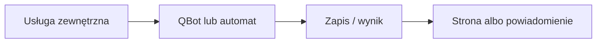

# Komoot

## Co to jest

QBot monitoruje Komoot pod kątem nowych tras. Nowa trasa może przejść do osobnej analizy, którą można zatwierdzić w Telegramie.

## Po co

Pomaga przenieść dane między usługą a QBotem i sprawdzić, czy przepływ działa.

## Skąd dane

Nowe trasy Komoot i zapisany stan monitorowania.

## Jak liczone

Kod strony Status ocenia świeżość usługi `qbot-komoot-watch.service`; konfiguracja checku zakłada uruchamianie co 5 minut. Szczegółowe filtry nowych tras nie zostały tu zweryfikowane.

Nie sprawdzono aktywnego timera/usługi ani aktualnego ekranu po zalogowaniu. Częstotliwość jest interwałem oczekiwanym przez check, a nie dowodem pracy crona.

## Gdzie to widać

SETUP > Połączenia zawiera ramki Stravy, Komoot i Hammerhead/Karoo. Wybrane stany integracji pokazuje SETUP > Połączenia > Status. Szczegóły danego przepływu podano powyżej.

## Jak czytać

Status opisuje świeżość i powodzenie pracy automatu, a nie gwarantuje kompletności wszystkich danych u dostawcy. Brak osobnego checku nie przesądza o braku integracji.

## Decyzje i historia

Nie sprawdzono aktywnego timera/usługi ani aktualnego ekranu po zalogowaniu. Częstotliwość jest interwałem oczekiwanym przez check, a nie dowodem pracy crona.

## Ograniczenia i pułapki

Nie zakładaj, że każda pozycja oznacza bieżący, poprawny import. Częstotliwości wymagają potwierdzenia w aktywnym harmonogramie.

## Wpływa na

- [Połączenia i dane](index.md)
- [Status i automaty](../system/automaty.md)

## Zależy od

- Dostępu do wskazanej usługi oraz uruchomienia automatu.
- Zapisów w tabelach/plikach wymienionych poniżej.

## Powiązane hasła

- [Garmin](garmin.md)
- [Harmonogram importów](harmonogram-importow.md)
- [Raport jazdy](../raport-jazdy/index.md)

## Zrodla

- `qbot_status_checks.py` — `komoot`; `komoot_watch.py`; `qbot_api.py` — `_komoot_cb_worker`; `docs/SETUP.md`
- Usługa systemd `qbot-komoot-watch.service`
