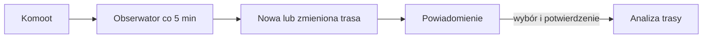

# Komoot

## Co to jest

QBot monitoruje Komoot pod kątem nowych tras. Nowa trasa może przejść do osobnej analizy, którą można zatwierdzić w Telegramie.

## Po co

Pomaga przenieść dane między usługą a QBotem i sprawdzić, czy przepływ działa.

## Skąd dane

Nowe trasy Komoot i zapisany stan monitorowania.

## Jak liczone

1. Usługa obserwuje Komoot co 5 minut i zapamiętuje nowe lub zmienione trasy.
2. Sam obserwator jedynie powiadamia. Nie rozpoczyna pełnej analizy i nie wysyła jej automatycznie.
3. Analiza trasy może zostać wybrana osobno, a dalszy przepływ prosi o potwierdzenie w Telegramie.
4. Przykład z bazy: `komoot-2251353307` ma artefakt trasy zapisany 17.10.2026 o 23:30, ze statusem `ok`. To dowód przygotowania pliku, nie dowód konkretnego powiadomienia.

Aktywny timer/usługa nie został odczytany. Interwał pięciu minut wynika z konfiguracji sprawdzania oraz decyzji o timerze, nie jest dowodem, że ten timer wykonał każde uruchomienie.

## Gdzie to widać

SETUP > Połączenia zawiera ramki Stravy, Komoot i Hammerhead/Karoo. Wybrane stany integracji pokazuje SETUP > Połączenia > Status. Szczegóły danego przepływu podano powyżej.

## Jak czytać

Status ocenia świeżość procesu obserwującego, a nie jakość każdej analizy. Gdy trasa zmieni się pod tym samym identyfikatorem, watcher porównuje podpis geometrii i oznacza zmianę; późniejsza analiza jest osobnym krokiem.

## Decyzje i historia

Decyzja z 06.10.2026 opisuje watcher jako powiadamiający, a pełną analizę jako działanie po wyborze. Dokumentacja Status podaje oczekiwany interwał 5 minut. W tym etapie nie sprawdzono logu ostatniego uruchomienia usługi.

## Ograniczenia i pułapki

Utworzony artefakt z 17.10 nie mówi, czy właściciel zatwierdził analizę. Osobno sprawdź Telegram lub status precompute, jeśli chcesz ustalić dalszy ciąg danej trasy.

> DO SPRAWDZENIA: ostatni wynik usługi i aktywny timer Komoot nie zostały sprawdzone.

## Wpływa na

- [Połączenia i dane](index.md)
- [Status i automaty](../system/automaty.md)

## Zależy od

- Dostępu do wskazanej usługi oraz uruchomienia automatu.
- Zapisów w tabelach/plikach wymienionych poniżej.

## Powiązane hasła

- [RWGPS](rwgps.md)
- [Harmonogram importów](harmonogram-importow.md)
- [Analiza trasy](../trasy/analiza-trasy.md)
- [Potwierdzenia tras w Telegramie](../trasy/potwierdzenia-telegram.md)
- [Garmin](garmin.md)
- [Raport jazdy](../raport-jazdy/index.md)

## Zrodla

- `qbot_status_checks.py` — `komoot`; `komoot_watch.py`; `qbot_api.py` — `_komoot_cb_worker`; `docs/SETUP.md`
- Usługa systemd `qbot-komoot-watch.service`
