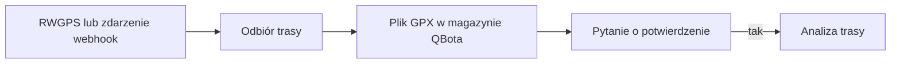

# RWGPS

## Co to jest

RWGPS dostarcza trasy, które QBot zapisuje i analizuje. Wskazany zestaw dokumentów nie opisuje RWGPS, dlatego kierunek potwierdzono w kodzie obsługi webhooka i narzędziach tras.

## Po co

Pomaga przenieść dane między usługą a QBotem i sprawdzić, czy przepływ działa.

## Skąd dane

Trasa RWGPS oraz plik GPX używany jako artefakt wejściowy dalszej analizy.

## Jak liczone

1. Po odebraniu trasy QBot przygotowuje lokalny plik GPX (zapis śladu trasy) do dalszej pracy.
2. Przepływ może poprosić w Telegramie o potwierdzenie analizy. Samo odebranie trasy nie oznacza, że analiza została zatwierdzona.
3. Baza zawiera artefakt `komoot-2251353307`, pochodzący z RWGPS, zapisany 17.10.2026 o 23:30 ze stanem `ok`. Pokazuje to, że rekord przechowuje źródło trasy w magazynie RWGPS; identyfikator z prefiksem Komoot wskazuje trasę pochodzącą z monitorowania Komoot.
4. Dalsze obliczenia, wersje i potwierdzenia opisują hasła [Analiza trasy](../trasy/analiza-trasy.md) oraz [Potwierdzenia tras w Telegramie](../trasy/potwierdzenia-telegram.md).

Przykładowy artefakt odczytano z bazy. Nie sprawdzono bieżącej konfiguracji webhooka u dostawcy ani konkretnego zdarzenia webhooka. Wiersz Status z dostarczonego zrzutu nie zawiera osobnej pozycji RWGPS.

## Gdzie to widać

SETUP > Połączenia zawiera ramki Stravy, Komoot i Hammerhead/Karoo. Wybrane stany integracji pokazuje SETUP > Połączenia > Status. Szczegóły danego przepływu podano powyżej.

## Jak czytać

Brak osobnej pozycji RWGPS na zrzucie Status nie oznacza, że trasy nie są przyjmowane. Przy konkretnej trasie sprawdź, czy powstał artefakt, a potem czy został potwierdzony start analizy.

## Decyzje i historia

Historia decyzji z 2026 opisuje odbiór webhooka i przeniesienie startu workera do ścieżki potwierdzenia. Sam artefakt z 17.10 potwierdza zapis trasy, ale nie aktualną konfigurację po stronie serwisu RWGPS.

## Ograniczenia i pułapki

Webhook nie jest harmonogramem cyklicznego sprawdzania; zdarzenie uruchamia się po stronie dostawcy. Nie udało się potwierdzić jego obecnych ustawień. Nie wyciągaj wniosku o bieżącej sprawności tylko z historycznego artefaktu.

> DO SPRAWDZENIA: bieżąca konfiguracja webhooka u dostawcy i ostatnie zdarzenie nie zostały odczytane.

## Wpływa na

- [Połączenia i dane](index.md)
- [Status i automaty](../system/automaty.md)

## Zależy od

- Dostępu do wskazanej usługi oraz uruchomienia automatu.
- Zapisów w tabelach/plikach wymienionych poniżej.

## Powiązane hasła

- [Analiza trasy](../trasy/analiza-trasy.md)
- [Potwierdzenia tras w Telegramie](../trasy/potwierdzenia-telegram.md)
- [Komoot](komoot.md)
- [Połączenia i dane](index.md)
- [Garmin](garmin.md)
- [Harmonogram importów](harmonogram-importow.md)
- [Raport jazdy](../raport-jazdy/index.md)

## Zrodla

- `qbot_api.py` — `rwgps_webhook`; `scripts/route_precompute_trigger.py`; `tools/rwgps/client.py`; `docs/TELEGRAM_ROUTE_CONFIRM.md`
- Magazyn artefaktów tras RWGPS; stan tras w bazie QBot.
