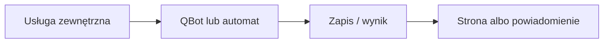

# RWGPS

## Co to jest

RWGPS dostarcza trasy, które QBot zapisuje i analizuje. Wskazany zestaw dokumentów nie opisuje RWGPS, dlatego kierunek potwierdzono w kodzie obsługi webhooka i narzędziach tras.

## Po co

Pomaga przenieść dane między usługą a QBotem i sprawdzić, czy przepływ działa.

## Skąd dane

Trasa RWGPS oraz plik GPX używany jako artefakt wejściowy dalszej analizy.

## Jak liczone

Webhook może uruchomić przygotowanie artefaktu i poprosić o potwierdzenie analizy. Dalsze obliczenia i wersjonowanie opisuje osobno hasło [Analiza trasy](../trasy/analiza-trasy.md).

Nie pobrano przykładowego rekordu z bazy ani nie sprawdzono konfiguracji webhooka u dostawcy.

## Gdzie to widać

SETUP > Połączenia zawiera ramki Stravy, Komoot i Hammerhead/Karoo. Wybrane stany integracji pokazuje SETUP > Połączenia > Status. Szczegóły danego przepływu podano powyżej.

## Jak czytać

Status opisuje świeżość i powodzenie pracy automatu, a nie gwarantuje kompletności wszystkich danych u dostawcy. Brak osobnego checku nie przesądza o braku integracji.

## Decyzje i historia

Nie pobrano przykładowego rekordu z bazy ani nie sprawdzono konfiguracji webhooka u dostawcy.

## Ograniczenia i pułapki

Nie zakładaj, że każda pozycja oznacza bieżący, poprawny import. Częstotliwości wymagają potwierdzenia w aktywnym harmonogramie.

## Wpływa na

- [Połączenia i dane](index.md)
- [Status i automaty](../system/automaty.md)

## Zależy od

- Dostępu do wskazanej usługi oraz uruchomienia automatu.
- Zapisów w tabelach/plikach wymienionych poniżej.

## Powiązane hasła

- [Garmin](garmin.md)
- [Harmonogram importów](harmonogram-importow.md)
- [Raport jazdy](../raport-jazdy/index.md)

## Zrodla

- `qbot_api.py` — `rwgps_webhook`; `scripts/route_precompute_trigger.py`; `tools/rwgps/client.py`; `docs/TELEGRAM_ROUTE_CONFIRM.md`
- Magazyn artefaktów tras RWGPS; stan tras w bazie QBot.
