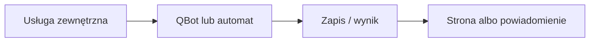

# Strava

## Co to jest

QBot pobiera aktywności Stravy, łączy je z jazdami QBota, a osobny automat może uzupełnić rower i opis aktywności. Strona Połączenia w SETUP zawiera ramkę Stravy.

## Po co

Pomaga przenieść dane między usługą a QBotem i sprawdzić, czy przepływ działa.

## Skąd dane

Strava API, aktywności i zdjęcia; dane jazd QBota i raport jazdy. Powiązanie aktywności z jazdą wyszukuje start w oknie ±15 minut.

## Jak liczone

Kod startuje pętlę publikacji wraz z routerem Stravy w qbot-web. Automat publikacji sprawdza aktywności co 20 minut między 06:00 a 23:59. Wybór roweru bierze pod uwagę czujniki; gdy ich brak, QBot pyta w Telegramie zamiast zgadywać. Opis jest nadpisywany.

Dokument STRAVA_PUBLISH.md z 09.10.2026 zgadza się z kodem co do pętli publikacji i zakresu od 09.10.2026. Nie sprawdzono obecnych uprawnień OAuth, danych konkretnej aktywności ani działania widoku WWW.

## Gdzie to widać

SETUP > Połączenia zawiera ramki Stravy, Komoot i Hammerhead/Karoo. Wybrane stany integracji pokazuje SETUP > Połączenia > Status. Szczegóły danego przepływu podano powyżej.

## Jak czytać

Status opisuje świeżość i powodzenie pracy automatu, a nie gwarantuje kompletności wszystkich danych u dostawcy. Brak osobnego checku nie przesądza o braku integracji.

## Decyzje i historia

Dokument STRAVA_PUBLISH.md z 09.10.2026 zgadza się z kodem co do pętli publikacji i zakresu od 09.10.2026. Nie sprawdzono obecnych uprawnień OAuth, danych konkretnej aktywności ani działania widoku WWW.

## Ograniczenia i pułapki

Nie zakładaj, że każda pozycja oznacza bieżący, poprawny import. Częstotliwości wymagają potwierdzenia w aktywnym harmonogramie.

## Wpływa na

- [Połączenia i dane](index.md)
- [Status i automaty](../system/automaty.md)

## Zależy od

- Dostępu do wskazanej usługi oraz uruchomienia automatu.
- Zapisów w tabelach/plikach wymienionych poniżej.

## Powiązane hasła

- [Garmin](garmin.md)
- [Harmonogram importów](harmonogram-importow.md)
- [Raport jazdy](../raport-jazdy/index.md)

## Zrodla

- `qbot_strava.py` — `build_router`, `run_sync`; `qbot_strava_publish.py` — `run_publish`, `start_loop`; `docs/STRAVA_PUBLISH.md`; `docs/SETUP.md`
- `qbot_v2.strava_activity`; `qbot_v2.strava_publish`; `qbot_v2.activity_device`; `qbot_v2.strava_gear_map`
