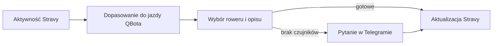

# Strava

## Co to jest

QBot pobiera aktywności Stravy, łączy je z jazdami QBota, a osobny automat może uzupełnić rower i opis aktywności. Strona Połączenia w SETUP zawiera ramkę Stravy.

## Po co

Pomaga przenieść dane między usługą a QBotem i sprawdzić, czy przepływ działa.

## Skąd dane

Interfejs Stravy, aktywności i zdjęcia; dane jazd QBota i raport jazdy. Powiązanie aktywności z jazdą wyszukuje start w oknie ±15 minut. Autoryzacja OAuth (zgoda użytkownika na dostęp; [słowniczek](../slowniczek.md#oauth)) umożliwia QBotowi wykonanie dozwolonych działań.

## Jak liczone

1. QBot łączy aktywność Stravy z jazdą QBota po czasie startu, w oknie ±15 minut.
2. Automat publikacji sprawdza ostatnie 3 dni co 20 minut w godzinach 06:00–23:59. Zmienia tylko jazdy od 09.10.2026.
3. Rower ustala z czujników. Gdy sama głowica Karoo nie zapisała czujników, QBot nie zgaduje roweru; wysyła pytanie w Telegramie.
4. Przykład z bazy: jazda `24766557671` z 18.10.2026 została powiązana z aktywnością `20633303993`; publikacja ma stan `ok`, rower Grail i jedną próbę.
5. Opis aktywności jest nadpisywany. To przyjęta decyzja właściciela, nie dopisywanie do wcześniejszego tekstu.

Odczyt bazy potwierdza przykład publikacji z 18.10.2026. Zrzut strony Stravy pokazuje konfigurację aplikacji i galerię: 415 aktywności, 202 z zdjęciami i 122 pobrane. Te trzy liczniki dotyczą zdjęć, nie liczby zsynchronizowanych treningów. Nie potwierdzono aktualnych uprawnień przez zewnętrzny ekran.

## Gdzie to widać

SETUP > Połączenia zawiera ramki Stravy, Komoot i Hammerhead/Karoo. Wybrane stany integracji pokazuje SETUP > Połączenia > Status. Szczegóły danego przepływu podano powyżej.

## Jak czytać

Jeśli aktywność ma już rower i opis z QBotem, a status publikacji jest `ok`, automat zakończył próbę. Status nie potwierdza, że każda jazda pojawi się od razu: może czekać na raport lub czujniki. Na zrzucie ekranu Stravy szukaj pól Client ID / Client Secret u góry, przycisku połączenia pośrodku, a liczników zdjęć pod przyciskami galerii.

## Decyzje i historia

18.10.2026 dodano rozpoznawanie rodzaju jazdy „Poligon w Rembertowie” na podstawie nazwy aktywności oraz możliwość nadpisania tytułu zaczynającego się od `[Qbot]`.

Decyzja z 09.10.2026 wprowadza ustawianie roweru i opisu z QBota; aktualizacja z 14.10 obsługuje brak czujników, a z 18.10 pozwala poprawiać domyślne nazwy zaczynające się od `[Qbot]`. Kod publikacji sprawdza zakres ostatnich 3 dni, a nie całą historię.

## Ograniczenia i pułapki

Strava nie ma osobnego wiersza w pokazanym panelu Status. Brak takiego wiersza nie dowodzi awarii ani poprawnego połączenia. Widoczna galeria jest osobną funkcją i jej liczniki nie opisują automatycznej publikacji.

> DO SPRAWDZENIA: bieżących uprawnień udzielonych aplikacji nie da się wyczytać z widoku strony QBota ani z przykładowego rekordu publikacji.

## Wpływa na

- [Połączenia i dane](index.md)
- [Status i automaty](../system/automaty.md)

## Zależy od

- Dostępu do wskazanej usługi oraz uruchomienia automatu.
- Zapisów w tabelach/plikach wymienionych poniżej.

## Powiązane hasła

- [Opis jazdy na Stravie](../raport-jazdy/opis-strava.md)
- [Harmonogram importów](harmonogram-importow.md)
- [Połączenia i dane](index.md)
- [Garmin](garmin.md)
- [Raport jazdy](../raport-jazdy/index.md)

## Zrodla

- `qbot_strava.py` — `build_router`, `run_sync`; `qbot_strava_publish.py` — `run_publish`, `start_loop`; `docs/STRAVA_PUBLISH.md`; `docs/SETUP.md`
- `qbot_v2.strava_activity`; `qbot_v2.strava_publish`; `qbot_v2.activity_device`; `qbot_v2.strava_gear_map`
