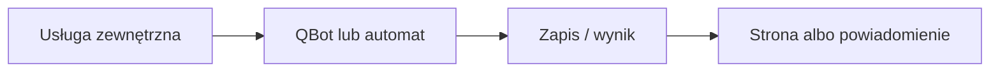

# Pozostałe usługi zewnętrzne

## Co to jest

QBot korzysta też z usług mapowych, pogodowych i geograficznych podczas analizy tras. To hasło zbiera odnośniki; nie jest pełnym katalogiem wszystkich połączeń.

## Po co

Pomaga przenieść dane między usługą a QBotem i sprawdzić, czy przepływ działa.

## Skąd dane

Dane odpowiedzi usług używanych przez konkretne funkcje.

## Jak liczone

Usługi należy opisywać w kontekście funkcji, która je wywołuje. Szczegółowy przepływ pogody opisuje [dział Pogoda](../pogoda/index.md), a danych mapowych [Analiza tras](../trasy/analiza-trasy.md).

Nie sporządzono pełnej listy usług ani nie sprawdzono harmonogramów ich zapytań.

## Gdzie to widać

SETUP > Połączenia zawiera ramki Stravy, Komoot i Hammerhead/Karoo. Wybrane stany integracji pokazuje SETUP > Połączenia > Status. Szczegóły danego przepływu podano powyżej.

## Jak czytać

Status opisuje świeżość i powodzenie pracy automatu, a nie gwarantuje kompletności wszystkich danych u dostawcy. Brak osobnego checku nie przesądza o braku integracji.

## Decyzje i historia

Nie sporządzono pełnej listy usług ani nie sprawdzono harmonogramów ich zapytań.

## Ograniczenia i pułapki

Nie zakładaj, że każda pozycja oznacza bieżący, poprawny import. Częstotliwości wymagają potwierdzenia w aktywnym harmonogramie.

## Wpływa na

- [Połączenia i dane](index.md)
- [Status i automaty](../system/automaty.md)

## Zależy od

- Dostępu do wskazanej usługi oraz uruchomienia automatu.
- Zapisów w tabelach/plikach wymienionych poniżej.

## Powiązane hasła

- [Garmin](garmin.md)
- [Harmonogram importów](harmonogram-importow.md)
- [Raport jazdy](../raport-jazdy/index.md)

## Zrodla

- `docs/CONTEXT.md`; `docs/SETUP.md`; `tools/rwgps/`
- > DO SPRAWDZENIA: pełna lista usług i ich częstotliwości.
