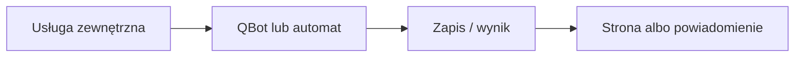

# Withings → Garmin

## Co to jest

Program przekazuje pomiary Withings do Garmina. Sprawdzony kod statusu wymienia wagę, skład ciała i ciśnienie; weryfikuje też, czy przesyłanie nie zgłosiło alarmu.

## Po co

Pomaga przenieść dane między usługą a QBotem i sprawdzić, czy przepływ działa.

## Skąd dane

Pomiary z Withings i pliki stanu integracji zapisane lokalnie przez QBota.

## Jak liczone

Status wybiera ostatnie poprawne wysłanie pomiarów wagi i ciśnienia. Jeśli istnieje plik alarmu, wynik jest zły; jeśli stan nie odświeżył się przez ponad 72 godziny, wynik ostrzega.

Nie sprawdzono aktualnego crona ani przykładowego pomiaru z bazy. STATUS.md i kod kontrolny wskazują zgodne nazwy plików i kierunek przesyłania.

## Gdzie to widać

SETUP > Połączenia zawiera ramki Stravy, Komoot i Hammerhead/Karoo. Wybrane stany integracji pokazuje SETUP > Połączenia > Status. Szczegóły danego przepływu podano powyżej.

## Jak czytać

Status opisuje świeżość i powodzenie pracy automatu, a nie gwarantuje kompletności wszystkich danych u dostawcy. Brak osobnego checku nie przesądza o braku integracji.

## Decyzje i historia

Nie sprawdzono aktualnego crona ani przykładowego pomiaru z bazy. STATUS.md i kod kontrolny wskazują zgodne nazwy plików i kierunek przesyłania.

## Ograniczenia i pułapki

Nie zakładaj, że każda pozycja oznacza bieżący, poprawny import. Częstotliwości wymagają potwierdzenia w aktywnym harmonogramie.

## Wpływa na

- [Połączenia i dane](index.md)
- [Status i automaty](../system/automaty.md)

## Zależy od

- Dostępu do wskazanej usługi oraz uruchomienia automatu.
- Zapisów w tabelach/plikach wymienionych poniżej.

## Powiązane hasła

- [Garmin](garmin.md)
- [Harmonogram importów](harmonogram-importow.md)
- [Raport jazdy](../raport-jazdy/index.md)

## Zrodla

- `qbot_status_checks.py` — `withings`; `docs/STATUS.md`
- `state/processed_withings_measures.json`; `state/withings_sync_alert_state.json`
