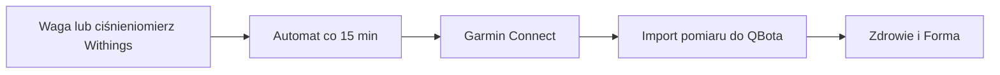

# Withings → Garmin

## Co to jest

Program przekazuje pomiary Withings do Garmina. Sprawdzony kod statusu wymienia wagę, skład ciała i ciśnienie; weryfikuje też, czy przesyłanie nie zgłosiło alarmu.

## Po co

Pomaga przenieść dane między usługą a QBotem i sprawdzić, czy przepływ działa.

## Skąd dane

Pomiary z Withings i pliki stanu integracji zapisane lokalnie przez QBota.

## Jak liczone

1. Waga Withings przekazuje pomiar przez mostek do Garmin Connect. Status wymienia też skład ciała i ciśnienie.
2. Automat zapisuje, które pomiary wysłał lub rozpoznał jako duplikaty. Crontab uruchamia go co 15 minut.
3. Na zrzucie Status z 18.10.2026 ostatnia waga to 08:15, a ciśnienie 00:15. To godziny wysłania podane przez ekran.
4. W bazie pomiar masy z 18.10 wynosi 103,04 kg; źródło w rekordzie to Garmin. Sama wartość nie dowodzi, że pochodziła z Withings, bo ostatnim krokiem mostka jest Garmin.

Kontrola ostrzega, jeśli plik stanu nie odświeża się ponad 72 godziny, i zgłasza błąd, gdy istnieje plik alarmu.

Crontab i rekord wagi z 18.10.2026 zostały odczytane. Wiersz Withings na zrzucie pokazuje ostatnią wagę 08:15 i ciśnienie 00:15. Nie ma w bazie dowodu, który przypisywałby konkretny rekord z tego dnia do źródła Withings, więc nie łączę wartości 103,04 kg z widoczną godziną.

## Gdzie to widać

SETUP > Połączenia zawiera ramki Stravy, Komoot i Hammerhead/Karoo. Wybrane stany integracji pokazuje SETUP > Połączenia > Status. Szczegóły danego przepływu podano powyżej.

## Jak czytać

Jeśli rano nie widzisz nowej wagi, sprawdź godzinę ostatniej poprawnej wysyłki i status automatu. Próg 72 godzin jest progiem ostrzeżenia o stanie integracji, a nie dopuszczalnym opóźnieniem pomiaru.

## Decyzje i historia

Decyzja z 18.10.2026 opisuje Garmin Connect jako pośrednika: Withings → Garmin → import do QBota. Starsza decyzja z września opisuje zastąpienie płatnego SmartScaleSync. Bieżący crontab uruchamia skrypt Withings→Garmin co 15 minut.

## Ograniczenia i pułapki

Liczba widoczna jako „ostatnia waga” opisuje wysyłkę na Garmin, nie koniecznie czas pomiaru na wadze. Status nie potwierdza, że wszystkie dodatkowe pola składu ciała dotarły do bazy QBota.

## Wpływa na

- [Połączenia i dane](index.md)
- [Status i automaty](../system/automaty.md)

## Zależy od

- Dostępu do wskazanej usługi oraz uruchomienia automatu.
- Zapisów w tabelach/plikach wymienionych poniżej.

## Powiązane hasła

- [Garmin](garmin.md)
- [Harmonogram importów](harmonogram-importow.md)
- [Połączenia i dane](index.md)
- [Raport jazdy](../raport-jazdy/index.md)

## Zrodla

- `qbot_status_checks.py` — `withings`; `docs/STATUS.md`
- `state/processed_withings_measures.json`; `state/withings_sync_alert_state.json`
