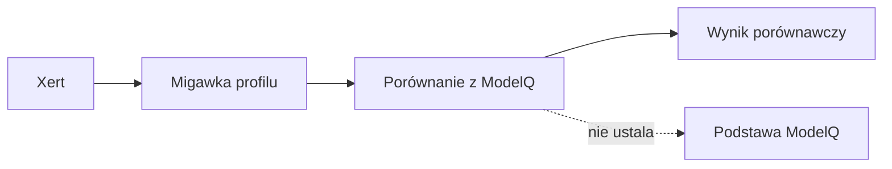

# Xert

## Co to jest

Xert jest zewnętrznym punktem porównania dla ModelQ. Zabezpieczenia w kodzie zabraniają używania go jako podstawy parametrów QBota.

## Po co

Pomaga przenieść dane między usługą a QBotem i sprawdzić, czy przepływ działa.

## Skąd dane

Zewnętrzne dane Xert zapisane jako migawki profilu lub w tabeli porównawczej ModelQ.

## Jak liczone

1. QBot pobiera migawkę profilu Xerta do porównania. Crontab uruchamia ten odczyt raz dziennie o 00:15.
2. Oddzielny krok porównuje wartości z ModelQ i Xerta. Xert pozostaje benchmarkiem; jego dane nie wyznaczają podstawowych wartości QBota.
3. Przykład z 18.10.2026: migawka Xerta zawiera TP (próg mocy; [słowniczek](../slowniczek.md#tp-próg)) 230,22 W, LTP (długookresowy próg mocy; [słowniczek](../slowniczek.md#ltp)) 170,09 W, W′ (rezerwa pracy ponad próg; [słowniczek](../slowniczek.md#w-prime-w-prime)) 24,0 kJ i PP (moc szczytowa; [słowniczek](../slowniczek.md#pp)) 1090,45 W.
4. Tabela porównawcza tego dnia zaokrągla TP do 230 W, LTP do 170,09 W, W′ do 24,0 kJ i PP do 1090 W. Różnica to format prezentacji, nie inne źródło.

Wzór

W tym haśle nie ma wzoru oceniającego formę. To są odczytane wartości Xerta przeznaczone do porównania z niezależnym ModelQ.

Odczyt bazy z 18.10.2026 potwierdził migawkę i wiersz tabeli porównawczej. Crontab ma aktywny codzienny wpis o 00:15.

## Gdzie to widać

SETUP > Połączenia zawiera ramki Stravy, Komoot i Hammerhead/Karoo. Wybrane stany integracji pokazuje SETUP > Połączenia > Status. Szczegóły danego przepływu podano powyżej.

## Jak czytać

Na przykładzie z 18.10 tabela porównawcza pokazuje całe waty, a migawka przechowuje wartości dokładniejsze. Przy porównaniu zachowaj tę samą datę; nie zestawiaj migawki z jednego dnia z pomiarem ModelQ z innego dnia.

## Decyzje i historia

Decyzja z 15.10.2026 ustala Xert wyłącznie jako punkt odniesienia; jego liczby nie stanowią podstawy żadnych wyników QBota. Cron z 18.10 oraz oba odczytane rekordy potwierdzają, że benchmark jest dalej odświeżany.

## Ograniczenia i pułapki

Wartości benchmarku mogą różnić się od ModelQ, ponieważ są liczone przez osobną usługę. Taka różnica sama w sobie nie oznacza awarii importu. Nie przenoś wartości Xerta do TP lub innych podstawowych liczb QBota.

## Wpływa na

- [Połączenia i dane](index.md)
- [Status i automaty](../system/automaty.md)

## Zależy od

- Dostępu do wskazanej usługi oraz uruchomienia automatu.
- Zapisów w tabelach/plikach wymienionych poniżej.

## Powiązane hasła

- [ModelQ](../modelq/index.md)
- [Xert w ModelQ](../modelq/xert.md)
- [Harmonogram importów](harmonogram-importow.md)
- [Garmin](garmin.md)
- [Raport jazdy](../raport-jazdy/index.md)

## Zrodla

- `qbot3/connectors/import_xert_profile_snapshot.py`; `fitmodel/xert_bench.py`; `fitmodel/xert_daily_bench.py`; `tests/test_no_xert_basis.py`; `tests/test_xert_isolation.py`
- `qbot_v2.xert_profile_snapshots`; `qbot_v2.modelq2_xert_bench`
