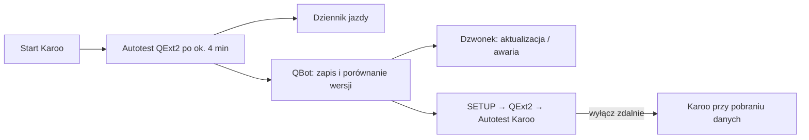

# Autotest Karoo

## Co to jest

Część funkcji QExt2 działa dzięki nieoficjalnym „sztuczkom” w Karoo: tło ekranu startowego, ciemne menu (razem z automatycznym zatwierdzaniem okna debugowania), przełączanie trybu lampy i budzenie hotspotu iPhone'a. Hammerhead może je zepsuć aktualizacją bez ostrzeżenia. Autotest sprawdza je po każdym starcie QExt2 i daje znać, gdy coś przestało działać.

## Po co

Żeby po aktualizacji Karoo od razu wiedzieć, co przestało działać, zanim wyjdzie to w trasie. Żeby zepsuta funkcja nie wywróciła pól i nawigacji. Żeby dało się ją wyłączyć z QBota bez nowego buildu i bez kabla.

## Jak działa

1. Około 4 min po starcie Karoo, nigdy w czasie nagrywania jazdy, QExt2 (od 0.4.19) wykonuje testy. Niczego przy tym nie zmienia, a lampę sprawdza tylko przez połączenie z usługą, bez zmiany trybu.
2. Sprawdza siedem rzeczy: połączenie z Karoo, świeżość danych z QBota (do 6 h), uprawnienie do ustawień systemu, tło ekranu startowego, ciemne menu, usługę zatwierdzającą okno debugowania i sterowanie lampą. Wynik każdej to „działa”, „nie działa” albo „nie sprawdzono” (np. brak Wi-Fi od startu).
3. QExt2 zapisuje też wersję Karoo: system, wersję ekranu startowego i wersję usługi czujników. Wynik trafia do dziennika jazdy (wpis `KAROO_HEALTH`) i do QBota.
4. QBot porównuje wersję Karoo z poprzednim raportem. Po zmianie dodaje do dzwonka wpis „Karoo zaktualizowane — QExt2 działa” albo „… — nie działa: …”. Jeśli coś nie działa, osobny wpis wisi w dzwonku, dopóki kolejny autotest nie wyjdzie czysty.

## Bezpieczniki

Każda z czterech funkcji (ciemne menu, tło, lampa, hotspot) może zostać wyłączona na Karoo z trzech powodów:

- **zdalnie**: zaznaczona w SETUP → QExt2 → Autotest Karoo → „Wyłącz zdalnie”. Karoo dostaje listę przy najbliższym pobraniu danych z QBota i po każdym autoteście;
- **po 3 błędach**: trzy błędy techniczne z rzędu (np. wyjątek). Blokada trwa do nowego buildu QExt2 albo nowej wersji Karoo. Brak Wi-Fi nie jest błędem;
- **pętla padania**: usługa QExt2 wystartowała co najmniej 5 razy w 5 min, jak przy 0.4.7. Wtedy wszystkie cztery funkcje są wyłączone do restartu Karoo.

Pola, nawigacja i reszta QExt2 działają dalej. Wyłączona lampa po tapnięciu pokazuje „sterowanie wył.”.

## Gdzie to widać

SETUP → QExt2 (Karoo) → sekcja „Autotest Karoo” nad dziennikami jazdy. Są w niej trzy rzeczy: ostatni wynik z datą, wersją Karoo i buildem QExt2, przełączniki „Wyłącz zdalnie” oraz historia wersji Karoo z buildami QExt2, które na nich działały. Wpisy w dzwonku należą do kategorii „Karoo / QExt2 — autotest” (grupa System).

## Ograniczenia

Test tła sprawdza, czy ustawienie tła na Karoo wskazuje obrazek QBota. Nie widzi ekranu, więc nie wykryje sytuacji, w której Karoo przestało czytać to ustawienie, a wartość została. Wtedy pomoże tylko zrzut ekranu. Test ciemnego menu sprawdza wynik próby w tym uruchomieniu Karoo. Bez Wi-Fi od startu wynik to „nie sprawdzono”. Raport idzie przez telefon albo Wi-Fi; bez połączenia czeka do następnego startu usługi.

## Źródła

- `qext2_health.py`: zapis raportu, wykrycie aktualizacji, dzwonek, wyłącznik zdalny, widok SETUP.
- `mcp_server.py`: `_qext2_karoo_health`, lista `qext2Disable` w `ride_readiness`.
- `qbot_web.py`: `/api/setup/qext2/health` (odczyt i zapis wyłącznika).
- `web/public/setup.html`: `q2Health`, `q2HealthDraw`.
- QExt2: `health/KarooHealth.kt`, `health/FeatureGuard.kt` (repozytorium QExt2).
