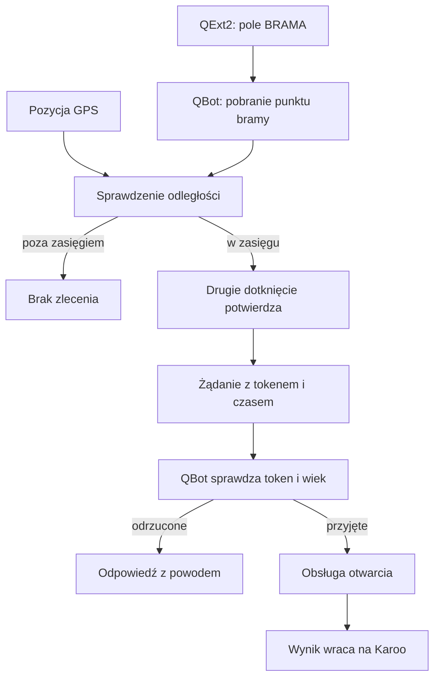

# Brama z Karoo

## Co to jest

Pole BRAMA w QExt2 pozwala zlecić QBotowi otwarcie bramy. Karoo wysyła położenie GPS ([system satelitarny ustalający pozycję](../slowniczek.md#gps)) i czas, a QBot sprawdza token, odległość i ograniczenia przed przekazaniem polecenia do obsługi bramy.

## Po co

Można uruchomić otwarcie z ekranu Karoo, kiedy urządzenie jest w pobliżu zapisanej bramy.

## Skąd dane

Karoo pobiera z QBota zapisany punkt i promień działania. Przy zleceniu otwarcia wysyła czas, położenie geograficzne oraz token bramy. Punkt może pochodzić z ustawień serwera.

## Jak liczone

1. QExt2 pokazuje pole aktywne tylko przy dostępnej pozycji i w zasięgu bramy.
2. Pierwsze dotknięcie uzbraja prośbę, a kolejne ją wysyła.
3. QBot sprawdza token i położenie względem punktu bramy.
4. Jeśli warunki są spełnione, QBot wywołuje skonfigurowaną obsługę bramy i zwraca wynik.

Kod serwera przyjmuje tylko jedną próbę na 15 sekund i odrzuca zlecenie starsze niż 20 sekund. Promień domyślny wynosi 300 m, o ile konfiguracja go nie zmieni.

Przykład z dziennika QBota: 16.10.2026 o 14:07 odnotowano wynik „ok” z odległości 26 m, a o 15:32 kolejny wynik „ok” z odległości 17 m. O 15:32 zapisano też próbę odrzuconą przez ograniczenie częstotliwości (kod 429). Dziennik pokazuje lokalny adres serwera (`127.0.0.1`), więc potwierdza odpowiedzi usługi, lecz sam nie rozstrzyga, czy te wywołania pochodziły z Karoo, czy z lokalnego testu.

W tym samym dzienniku 16.10.2026 o 13:46 jest też nieudana próba: usługa sterująca nie przyjęła żądania (kod 405), a QBot zapisał błąd 503 po 368 ms, z odległości 47 m. Późniejsze wpisy w dzienniku mają stan „ok”. Wszystkie te zapisy pochodzą z lokalnego adresu serwera; ich klienta nie da się ustalić.

## Gdzie to widać

W polu BRAMA na Karoo. Ostatni stan próby można też odczytać w QBocie.

## Jak czytać

Szare pole oznacza brak warunków do wysłania prośby. Przy gotowości pole prosi o potwierdzenie przed wysłaniem. Wynik błędu może oznaczać między innymi brak sieci, tokenu lub uprawnień albo przekroczenie limitu czasu.

## Decyzje i historia

Odczyt położenia jest oddzielony od żądania otwarcia. Samo pobranie punktu bramy jej nie otwiera.

## Ograniczenia i pułapki

- Otwarcie zależy także od dostępności skonfigurowanego urządzenia i jego usługi.
- Odległość oraz czas są sprawdzane po stronie serwera, a nie tylko na ekranie Karoo.
- Hasło opisuje działanie integracji. Nie wykonano żadnego polecenia otwarcia.

## Jak przebiega próba

1. Karoo pobiera położenie zapisanej bramy i promień działania. W kodzie promień domyślny wynosi 300 m, jeśli ustawienia nie podają innej wartości.
2. Pole na liczniku porównuje bieżącą lokalizację z tym punktem i wymaga dwóch dotknięć, żeby uniknąć przypadkowego zlecenia.
3. Żądanie niesie położenie, czas i token. Serwer odrzuca żądanie starsze niż 20 sekund oraz ogranicza kolejne próby do jednej na 15 sekund.
4. Dopiero zaakceptowana prośba trafia do skonfigurowanej obsługi bramy. Odpowiedź o powodzeniu lub błędzie wraca do pola.

W dzienniku są historyczne wyniki z odległościami, ale nie ma oznaczenia klienta, które pozwalałoby przypisać je do konkretnego licznika. Powyższych wpisów nie przedstawiam jako potwierdzenia próby z Karoo.

## Jak rozpoznać problem

- Jeśli Karoo nie pokazuje pola jako gotowego, sprawdź pozycję GPS i odległość od zapisanej bramy.
- Jeśli pole jest gotowe, ale odpowiedź nie wraca, możliwą przyczyną jest brak sieci lub usługi sterującej.
- Odrzucenie żądania przez QBot oznacza, że nie spełniło warunków tokenu, czasu, odległości albo ograniczenia prób. Sam status na liczniku nie zastępuje potwierdzenia wyniku.
- Polecenie otwarcia jest działaniem fizycznym. W tej pracy nie wysyłano żądania i nie otwierano bramy.
- Dziennik nie zapisuje tokenu ani współrzędnych; zachowuje status, czas, czas obsługi, odległość i ewentualny powód.

## Ilustracja

Na dostępnym zrzucie SETUP QBota widać zakładkę QExt2 (Karoo), ale nie ekran bramy. Ilustracja pokazuje jedynie miejsce ustawień integracji w serwisie; nie przedstawia statusu bramy ani jej adresu.

## Wpływa na

- Wynik widoczny w polu BRAMA Karoo.
- Stan próby jest dostępny w odczycie statusu i dzienniku bramy.

## Zależy od

- Tokena bramy, pozycji GPS, punktu bramy oraz dostępności usługi sterującej.

## Powiązane hasła

- [QExt2 i Karoo](index.md)
- [Przepływ danych podczas jazdy](przeplyw-jazdy.md)

## Zrodla

- `/opt/qbot/app/qbot_qlab_server.py` — `gate_open_route`, `gate_home_route`, `gate_open`, `_gate_home`.
- `/opt/qbot/qext2_deploy/docs/BRAMA.md` — dwuetapowe potwierdzenie na Karoo i obsługa odpowiedzi.
- `/opt/qbot/qext2_deploy/app/src/main/kotlin/com/qext2/primary/gate/GateController.kt` — stan pola na Karoo.
- `/opt/qbot/app/qbot_qlab_server.py` — bezpieczny zapis prób bez tokenu i współrzędnych.
- `/opt/qbot/artifacts/gate_log.jsonl` — wpisy z 16.10.2026 o 14:07 i 15:32; źródło `127.0.0.1` nie rozróżnia Karoo od lokalnego testu.

## Aktualizacja 20.10.2026

Wyniki dotknięć pola BRAMA trafiają do QBota razem z [dziennikiem jazdy z Karoo](dziennik-jazdy.md) (QExt2 0.4.4+). Dzięki temu widać także próby, które nie dotarły do serwera — np. 18.10.2026 o 13:05 Karoo nie miało internetu i prośba nie wyszła. Status → Bramka ostrzega o takiej próbie.
