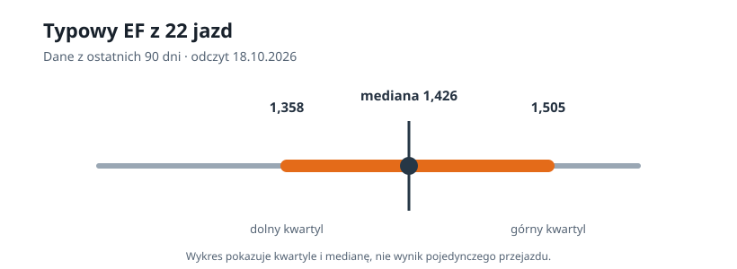
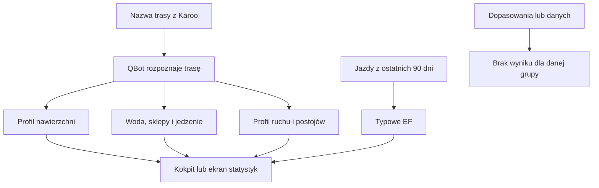

# Dane trasy przekazywane Karoo

## Co to jest

Podczas jazdy QExt2 może pobrać z QBota kilka uzupełniających danych dla zaplanowanej trasy: nawierzchnię odcinkami, punkty z wodą i jedzeniem oraz profil przewidywanego czasu jazdy. Osobno pobiera też typowy [EF](../slowniczek.md#ef) (współczynnik efektywności, czyli moc znormalizowana podzielona przez średnie tętno) używany w widoku statystyk. To cztery różne odpowiedzi; brak jednej nie oznacza, że pozostałe nie działają.

## Po co

Karoo może dzięki temu pokazać, co zbliża się na trasie, gdzie można uzupełnić wodę albo ile czasu ruchu i postojów model zakłada na kolejnych kilometrach. Typowa relacja mocy do tętna jest punktem porównania dla bieżącego wysiłku. Dane te QBot przygotowuje wcześniej lub na żądanie, a QExt2 wyświetla na liczniku.

## Skąd dane

- **Nawierzchnia:** najnowszy gotowy profil nawierzchni przypisany do rozpoznanej trasy.
- **Punkty logistyczne:** aktywne punkty wody, sklepy i miejsca z jedzeniem. QBot ogranicza wynik do punktów leżących najwyżej 500 m od trasy i zwraca maksymalnie 300 pozycji.
- **Plan czasu:** model QBota tworzy profil co około 1 km. Dla każdego punktu rozdziela przewidywany czas ruchu i postoje. Wynik używa trybu normalnego, jest przechowywany w pamięci podręcznej do godziny, a Karoo może ponowić pobranie po błędzie.
- **Typowe EF:** mediana [NP](../slowniczek.md#np) podzielonej przez średnie tętno w odpowiednio dobranych jazdach. Do zestawu wchodzą jazdy z ostatnich 90 dni, co najmniej 60 minut, ze średnią prędkością powyżej 2,8 m/s (10,08 km/h) i intensywnością [IF](../slowniczek.md#if) od 0,60 do 0,80. Przy mniej niż 5 jazdach QBot zwraca brak typowej wartości.

Nazwy i kategorie punktów logistycznych wyjaśnia też hasło [punkty na trasie](../trasy/punkty-na-trasie.md).

## Jak liczone

1. Karoo prosi o dane dla nazwy bieżącej trasy. QBot próbuje dopasować nazwę do zapisanej trasy.
2. Dla trasy Rembertów z 17.10.2026 baza ma gotowy profil z 42 odcinkami źródłowymi. Ich łączna długość wynosi 53,659 km; początkowe odcinki to 100 m drogi gruntowej, 3 800 m asfaltu i 50 m kostki. To zawartość profilu w bazie przed połączeniem sąsiednich odcinków w odpowiedzi.
3. Dla tej trasy baza ma 62 aktywne punkty spełniające filtry odpowiedzi. Pierwsze dwa są przy 2,698 km i 3,563 km; na ekranie QExt2 wartości są zaokrąglane do 2,70 km i 3,56 km. Odpowiedź nie może przekroczyć 300 pozycji.
4. Dla planu czasu QBot zwraca próbki mniej więcej co 1 km, osobno dla ruchu i postojów. Nie pobrałem odpowiedzi z planem czasu tej trasy, więc nie podaję przewidywanych minut.
5. Dla typowego EF odczyt z 18.10.2026 znalazł 22 jazdy spełniające filtry z ostatnich 90 dni. Mediana wynosiła 1,4262295; odpowiedź zaokrągla ją do 1,426. Dolny i górny kwartyl po zaokrągleniu to 1,358 i 1,505. Jeżeli jest mniej niż 5 jazd, QBot nie przedstawia typowej wartości.

Kwartyle obejmują środkową połowę wybranych jazd. Nie są to progi dobrego lub złego wyniku; pokazują tylko, jak szeroko rozkładały się te 22 wartości.

To są przykłady z bazy QBota, nie potwierdzenie, że aktywne Karoo pobrało te odpowiedzi. Nie udało się przechwycić odpowiedzi urządzenia ani potwierdzić, co pojawiło się na jego ekranie.

Wzór

Typowe EF = mediana z wartości NP / średnie tętno dla jazd spełniających filtry. Mediana wybiera środkowy wynik po uporządkowaniu jazd, więc pojedyncza bardzo wysoka lub niska wartość ma mniejszy wpływ niż przy zwykłej średniej.

## Gdzie to widać

Nawierzchnia i punkty mogą pojawić się w pasku nawigacyjnym KOKPIT 2. Profil czasu jest używany w widoku statystyk QExt2, a typowe EF jest pobierane przez rozszerzenie dla porównania wysiłku. Dostępny zrzut WIKI przedstawia stronę SETUP QBota, nie ekran jazdy Karoo.

## Jak czytać

- Brak profilu nawierzchni oznacza, że QBot nie ma gotowego profilu dla rozpoznanej trasy; nie oznacza automatycznie braku samej trasy.
- Punktów może nie być, jeśli nie znaleziono trasy albo żaden aktywny punkt nie spełnia kryteriów odległości i kategorii.
- Plan czasu rozdziela ruch i postoje. Nie jest obietnicą dokładnej godziny przyjazdu.
- Typowe EF to punkt odniesienia z wcześniejszych jazd, a nie ocena zdrowia ani prognoza mocy.

## Ograniczenia

- Dopasowanie odbywa się po nazwie trasy, która może być niejednoznaczna.
- Profil nawierzchni i lista punktów zależą od aktualnych danych trasowych.
- Typowe EF nie filtruje po rowerze, ponieważ dane źródłowe jazd nie mają w tej ścieżce sprawdzonego powiązania z rowerem.
- > DO SPRAWDZENIA: dokładny ekran, na którym aktywna wersja QExt2 prezentuje plan czasu i typowe EF.
- > DO SPRAWDZENIA: nie pobrano przykładowej odpowiedzi profilu czasu dla Rembertowa; baza nie potwierdza, że aktywny licznik pobrał nawierzchnię, punkty lub EF.

## Wpływa na / Zależy od

- Dane nawierzchni i punktów wpływają na podpowiedzi nawigacyjne.
- Profil czasu wpływa na porównanie planowanego czasu z ruchem i postojami w trakcie jazdy.
- Typowe EF jest osobnym tłem porównawczym w statystykach; nie zmienia obliczeń ModelQ w QBocie.
- Wszystkie odpowiedzi zależą od poprawnego rozpoznania trasy lub dostępności wystarczającej liczby jazd.

## Powiązane hasła

- [QExt2 i Karoo](index.md)
- [Przepływ jazdy](przeplyw-jazdy.md)
- [Komunikaty KOKPIT 2](komunikaty.md)
- [Punkty na trasie](../trasy/punkty-na-trasie.md)
- [Czas przejazdu](../trasy/czas-przejazdu.md)
- [Słowniczek](../slowniczek.md)

## Zrodla

- `/opt/qbot/app/qbot_api.py` — `/api/surface/by-name`, `/api/poi/by-name`, `/api/plan/by-name`, `/api/ef/typical`, `_qext2_plan_route`.
- `/opt/qbot/app/qext2_config.py` — komunikat nawierzchni i punktów, domyślne zasięgi.
- `/opt/qbot/qext2_deploy/app/src/main/kotlin/com/qext2/primary/surface/SurfaceProfileCache.kt` — pobranie nawierzchni i punktów.
- `/opt/qbot/qext2_deploy/app/src/main/kotlin/com/qext2/primary/statsv2/PlanProfile.kt` — profil czasu.
- `/opt/qbot/qext2_deploy/app/src/main/kotlin/com/qext2/primary/statsv2/RideWindows.kt` — typowe EF.
- `qbot_v2.route_surface_profiles`, `qbot_v2.route_surface_segments` — profil Rembertowa z 17.10.2026, 42 odcinki, 53,659 km.
- `qbot_v2.route_poi_layer` — 62 aktywne punkty na tym samym odcinku trasy.
- `qbot_v2.training_sessions` — 22 jazdy do typowego EF odczytane 18.10.2026.
