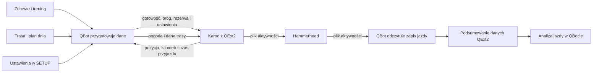

# QExt2 i Karoo

QExt2 to rozszerzenie na liczniku Karoo, które podczas jazdy korzysta z danych QBota i odsyła część pomiarów po zakończeniu jazdy. Ten dział opisuje tylko stronę QBota: co udostępnia, co odbiera i jak te dane trafiają do analizy.

## Po co

Połączenie daje Karoo kontekst wyliczony przez QBot: próg mocy, rezerwę, gotowość, plan, ustawienia komunikatów oraz pogodę. Z kolei QBot może zapisać w podsumowaniu jazdy część liczb obliczanych na Karoo. Dzięki temu da się później porównać to, co licznik widział podczas jazdy, z analizą po jej zakończeniu.

## Główna droga danych

## Co widać na stronie

Na zrzucie ekranu SETUP w górnym pasku znajduje się zakładka „QExt2 (Karoo)”, obok Powiadomień, Treningu, Połączeń, Dostępów i Kontaktów. Zrzut pokazuje otwartą zakładkę Powiadomienia, a nie zawartość QExt2. Dlatego nie da się z niego odczytać ustawień komunikatów ani kolorów.

Po otwarciu zakładki QExt2 można zmieniać komunikaty i kolory pól KOKPIT 2. Zapisane wybory QBot przekazuje Karoo razem z danymi gotowości. Szczegóły działania ustawień opisuje [KOKPIT 2](kokpit2.md).

## Hasła w tym dziale

- [Przepływ jazdy](przeplyw-jazdy.md) — kolejność pobierania danych, sygnału jazdy i późniejszego pliku z jazdą.
- [KOKPIT 2 i ustawienia](kokpit2.md) — wiadomości, ich kolejność i kolory.
- [Komunikaty KOKPIT 2](komunikaty.md) — lista komunikatów oraz ich domyślne progi i kolejność.
- [Dane trasy przekazywane Karoo](dane-trasy.md) — nawierzchnia, punkty, profil czasu i typowe EF ([współczynnik efektywności](../slowniczek.md#ef)).
- [Pole dynamiczne](pole-dynamiczne.md) — wartości wyświetlane zależnie od wybranego wariantu pola.
- [Tryb AUTO](tryb-auto.md) — zmiana zachowania tempa na podstawie bieżących warunków.
- [Pacing](pacing.md) — pułap mocy i jego oznaczenia podczas jazdy.
- [Pogoda INFO](pogoda-info.md) — prognoza dla trasy albo bieżącego miejsca.
- [Brama](brama.md) — odczyt położenia i dwuetapowe zlecenie otwarcia.
- [Pola FIT QExt2](pola-fit.md) — liczby, które QBot odczytuje z zapisanego pliku jazdy.

## Co widzisz na ekranie → hasło

| Element widoczny lub używany | Gdzie go szukać | Hasło |
|---|---|---|
| Zakładka „QExt2 (Karoo)” | Górny pasek strony SETUP QBota; na dostępnym zrzucie zakładka jest zamknięta | [KOKPIT 2 i ustawienia](kokpit2.md) |
| Komunikaty i reguły kolorów | Po otwarciu zakładki QExt2 w SETUP; zawartość nie jest widoczna na dołączonym zrzucie | [KOKPIT 2 i ustawienia](kokpit2.md) |
| Wiadomości o deszczu, zmroku, podjeździe i rezerwie | Pasek komunikatów KOKPIT 2 podczas jazdy | [Komunikaty KOKPIT 2](komunikaty.md) |
| Zmiana nawierzchni oraz punkty z wodą i jedzeniem | Pasek nawigacyjny Karoo, gdy są dane dla trasy | [Dane trasy](dane-trasy.md) |
| Profil czasu i typowe EF | Statystyki QExt2; brak zrzutu tej zakładki w indeksie ekranów | [Dane trasy](dane-trasy.md) |
| Pole dynamiczne: DYNAMIC lub AERO | Ekran jazdy KOKPIT 2 na Karoo; brak zrzutu urządzenia w indeksie ekranów | [Pole dynamiczne](pole-dynamiczne.md) |
| Pułap i kolor mocy | KOKPIT 2 podczas jazdy | [Pacing](pacing.md) |
| Wybrana strategia AUTO | Ustawienia QExt2 na Karoo; jej skutek widać w pułapie mocy | [Tryb AUTO](tryb-auto.md) |
| Prognoza INFO | Pole INFO na Karoo; brak zrzutu urządzenia w indeksie ekranów | [Pogoda INFO](pogoda-info.md) |
| Status prośby o otwarcie | Pole BRAMA na Karoo; nie ma go na dołączonym zrzucie | [Brama](brama.md) |
| Podsumowanie wartości po jeździe | Historia i analiza QBota po odebraniu FIT; brak osobnego kafla na zrzucie SETUP | [Pola FIT QExt2](pola-fit.md) |

## Jak czytać przykłady liczbowe

Przykłady w tym dziale pochodzą z zapisanych podsumowań jazd. Na przykład wpis z 16.10.2026 zawierał 4 026 próbek z rozszerzenia; najniższa zapisana rezerwa wyniosła 40%, a końcowa 83%. Wpis z 18.10.2026 zawierał 8 743 próbki kontroli wiatru; zapisany środkowy pomiar wiatru wynosił 2,4 m/s, a udział próbek oznaczonych jako wiatr w twarz wynosił 11,4%. To dane z konkretnych jazd, a nie stałe parametry systemu. FIT to format pliku aktywności (wyjaśnienie w [słowniczku](../slowniczek.md#fit)); ETA to przewidywany czas przyjazdu ([słowniczek](../slowniczek.md#eta)).

## Po co patrzeć na pochodzenie danych

Liczby z Karoo i liczby obliczane później przez QBot mogą mieć podobne nazwy, ale nie zawsze są tym samym wynikiem. Plik z jazdy jest zapisem tego, co rozszerzenie raportowało w danej chwili. Analiza QBota może liczyć wybrane wielkości ponownie z próbek jazdy. Przy porównaniu warto sprawdzić datę jazdy oraz to, czy patrzysz na pomiar z urządzenia, czy na późniejsze obliczenie.

## Ograniczenia

- Wysłanie danych wymaga połączenia sieciowego i poprawnego dostępu Karoo do QBota.
- Pogoda na trasie wymaga rozpoznania trasy; bez niej QExt2 korzysta z prognozy dla bieżącego miejsca.
- Dane z jazdy pojawią się w podsumowaniu tylko wtedy, gdy plik zawiera pola rozszerzenia, a QBot potrafi je odczytać.
- W kodzie istnieje kilka pól i usług pomocniczych. Ten dział opisuje te widoczne dla właściciela i związane z pytaniem: co QBot przekazuje na Karoo i co odbiera.

## Wpływa na / Zależy od

- QExt2 korzysta z gotowości, progu, rezerwy, planu, konfiguracji i prognozy przygotowanych przez QBot.
- QBot może wykorzystać zapisane pomiary QExt2 w podsumowaniu i wybranych częściach [analizy jazdy](../raport-jazdy/analiza-jazdy.md).
- Szczegóły przepływu między dziedzinami pokazuje [mapa zależności](../zaleznosci.md).

## Powiązane hasła

- [Pogoda](../pogoda/index.md)
- [Raport jazdy](../raport-jazdy/index.md)
- [ModelQ](../modelq/index.md)
- [Słowniczek](../slowniczek.md)

## Zrodla

- `/opt/qbot/app/mcp_server.py` — `ride_readiness`, `_qext2_ping`, przekazanie ustawień i przyjęcie sygnału jazdy.
- `/opt/qbot/app/qbot_api.py` — `/ride-readiness`, `/api/weather/by-name`, `/api/weather/point`, odświeżanie pogody w trybie jazdy.
- `/opt/qbot/app/fitmodel/fit_ingest.py` — odczyt i podsumowanie pól FIT rozszerzenia.
- `/opt/qbot/app/qext2_config.py` — lista komunikatów i ustawienia ich rotacji.
- `/opt/qbot/web/public/setup.html` — zakładka QExt2 w SETUP (plik statyczny poza repo).
- `/opt/qbot/app/docs/QEXT2_CONFIG.md` — wcześniejszy opis ustawień; nie obejmuje późniejszych dodatków pogodowych i pól FIT.
- `/opt/qbot/qext2_deploy/docs/INFO.md`, `KOKPIT.md`, `KONTRAKT_DANYCH.md` — opis strony Karoo i wymiany danych.
