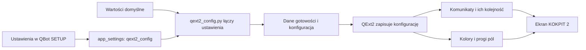

# KOKPIT 2 i ustawienia

## Co to jest

KOKPIT 2 to zestaw dwóch pól QExt2 na ekranie jazdy Karoo: nawigacyjnego i z danymi wysiłku. QBot może przekazać Karoo własne ustawienia komunikatów, ich kolejność oraz reguły kolorów.

W′ oznacza pojemność wysiłku ponad progiem ([słowniczek](../slowniczek.md)); ETA to przewidywany czas przyjazdu ([słowniczek](../slowniczek.md#eta)).

## Po co

Ustawienia z QBotu pozwalają zmienić zachowanie komunikatów i kolorów bez ręcznej zmiany kodu QExt2. Komunikat z centrali QBotu ma zawsze pierwszeństwo.

## Skąd dane

Ustawienia zmienia się w QBot SETUP > QExt2. QBot zapisuje je po swojej stronie. Karoo pobiera gotową konfigurację razem z danymi do jazdy i zapamiętuje lokalnie. Jeśli nie ma zapisanych zmian, QBot przekazuje ustawienia domyślne.

## Jak liczone

1. QBot łączy wartości domyślne z zapisanymi zmianami.
2. Odrzuca nieznane nazwy ustawień i wartości niezgodne z dozwolonym typem.
3. Komunikat centrali pozostaje włączony i pierwszy na liście.
4. Karoo pobiera gotową konfigurację przy pobraniu danych gotowości.
5. QExt2 stosuje reguły przy rysowaniu komunikatów, pól mocy, W′, tętna, prędkości, wiatru i ETA.

Przykład działania z konfiguracji domyślnej: ostrzeżenie o deszczu może uwzględnić prognozę do 30 minut naprzód i minimalną szansę opadu 40%. Te progi są ustawieniami domyślnymi w kodzie QBotu; zapisane nadpisanie może je zmienić.

## Gdzie to widać

Konfigurację edytuje się na stronie SETUP QBota, a jej działanie widać na polach KOKPIT 2 w Karoo. W SETUP QExt2 pokazuje datę zapisanej konfiguracji albo informację o wartościach domyślnych.

## Jak czytać

Informacja ma ciemne tło, ostrzeżenie żółte, a komunikat krytyczny bordowe. Wartość koloru zależy od wybranej reguły i aktualnych danych z jazdy.

## Decyzje i historia

Starszy opis konfiguracji QBota podaje progi z wcześniejszych wersji QExt2 i nie obejmuje późniejszego pola dynamicznego/AERO ani pogody INFO. Bieżące ustawienia potwierdzono w kodzie QBota, a działanie nowych pól w aktualnych materiałach i kodzie projektu QExt2.

## Ograniczenia i pułapki

- Konfiguracja opisuje wybieralne reguły, a nie wszystkie elementy graficzne pola.
- Nie należy zakładać, że zapis pojawi się natychmiast na Karoo; urządzenie pobiera go w trakcie odświeżenia danych gotowości.
- Opis progów i opcji po stronie Karoo w starszym dokumencie QBota może być niepełny.

## Jak zmiana przechodzi na licznik

1. Właściciel otwiera SETUP QBota i zakładkę QExt2 (Karoo). Na dostępnym zrzucie jest ona widoczna w pasku, ale pozostaje zamknięta; zawartości zakładki nie da się z niego odczytać.
2. W zakładce wybiera komunikaty, ich kolejność i reguły kolorów, a następnie zapisuje zmiany.
3. QBot sprawdza, czy wybory należą do dozwolonych pozycji i zakresów. Komunikat centrali pozostaje wymagany i ma pierwszeństwo.
4. Przy następnym pobraniu danych gotowości Karoo otrzymuje przygotowane ustawienia. Dopiero urządzenie używa ich podczas rysowania pól.

Wartość liczbowa z bazy pokazuje skutek innego fragmentu integracji, a nie konfigurację kolorów: 16.10.2026 QBot zachował 4 026 próbek jazdy. To potwierdza odbiór danych FIT, lecz nie dowodzi, jakie ustawienia KOKPIT 2 były wówczas wybrane.

## Jak odróżnić ustawienie od wyniku

Konfiguracja odpowiada na pytanie „jakie komunikaty i kolory mają być użyte”. Bieżąca moc, rezerwa, pogoda oraz nawigacja pochodzą z pomiarów lub innych odpowiedzi QBota. Zmiana koloru nie zmienia samej wartości mocy. Zmiana kolejności może natomiast zdecydować, który komunikat będzie widoczny, gdy kilka konkuruje o pasek.

> DO SPRAWDZENIA: zrzut otwartej zakładki QExt2 po zapisaniu przykładowej konfiguracji oraz odczyt potwierdzający, że aktywne Karoo pobrało tę samą konfigurację.

## Wpływa na

- Treść i kolejność komunikatów KOKPIT 2.
- Kolory wybranych elementów: mocy, W′, tętna, prędkości, wiatru, manewru oraz ETA.

## Zależy od

- Zapisanych ustawień lub wartości domyślnych QBota.
- Pomyślnego pobrania danych do jazdy przez Karoo.

## Powiązane hasła

- [QExt2 i Karoo](index.md)
- [Przepływ danych podczas jazdy](przeplyw-jazdy.md)
- [Pogoda INFO](pogoda-info.md)
- [Słowniczek](../slowniczek.md)

## Zrodla

- `/opt/qbot/app/docs/QEXT2_CONFIG.md` — konfiguracja z 10.10.2026.
- `/opt/qbot/app/qext2_config.py` — `MESSAGES`, `ROTATION`, `COLORS`, `effective`, `for_karoo`.
- `/opt/qbot/app/qbot_web.py` — `setup_qext2_get`, `setup_qext2_save`.
- `/opt/qbot/app/mcp_server.py` — `ride_readiness`, przekazanie `qext2Config`.
- `/opt/qbot/qext2_deploy/docs/KOKPIT.md` — KOKPIT 2 i pole dynamiczne, wersje opisane 10.10–17.10.2026.
