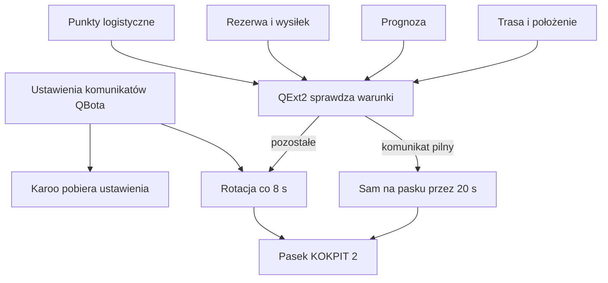

# Komunikaty KOKPIT 2

## Co to jest

Górny pasek KOKPIT 2 pokazuje komunikaty o warunkach, trasie i wysiłku. QBot przekazuje ustawienia ich włączania, kolejności i ważności, a QExt2 na Karoo wybiera treść na podstawie bieżącej trasy oraz pomiarów. Ustawienia zmienia się w zakładce QExt2 w SETUP QBota.

## Po co

Komunikaty mają zwrócić uwagę na rzecz, która może wymagać reakcji: zbliżający się deszcz, niski bilans węglowodanów, podjazd albo stromą część trasy. Nie są listą wszystkich zdarzeń na ekranie. W danej chwili część komunikatów może być ukryta przez pilniejszy komunikat.

## Skąd dane

QBot przekazuje domyślną listę i zapisane zmiany. QExt2 korzysta z pozycji, trasy, czasu przyjazdu, pogody, rezerwy oraz danych nawigacyjnych. Komunikat z centrali QBotu zawsze pozostaje pierwszy. Pozostałe można przestawiać; wyższe pozycje mają pierwszeństwo przy zajętym pasku.

## Jak liczone

Poniższa tabela zawiera wszystkie pozycje komunikatów, które bieżąca konfiguracja QBota udostępnia do wyboru. Progi w tabeli są wartościami domyślnymi z kodu. Użytkownik może zmienić część parametrów w SETUP.

| Komunikat | Kiedy może się pojawić | Wartość domyślna |
|---|---|---|
| Centrala QBota | Gdy QBot wysyła ważny komunikat; przykrywa pozostałe | Włączony, zawsze na początku listy |
| Rezerwa W′ | Gdy zmienia się stan rezerwy opisywany jako BOMBA, ODBUDOWA, TRZYMASZ lub PRZEPAŁ | Włączony; nie rotuje |
| Deszcz teraz | Gdy bieżący opad osiąga próg | 0,1 mm/h |
| Burza nadchodzi | Gdy burza jest w prognozie na trasie | Do 60 minut naprzód |
| Śnieg nadchodzi | Gdy śnieg jest w prognozie na trasie | Do 30 minut naprzód |
| Deszcz nadchodzi | Gdy prognoza wskazuje opad z wymaganą szansą | Do 30 minut naprzód i co najmniej 40% prawdopodobieństwa |
| Jedzenie | Gdy bilans węglowodanów spada do wskazanego poziomu | −30 g |
| Meta po zmroku | Gdy przewidywany czas do mety wypada po zmroku | Włączony |
| Do zmroku | Gdy do zachodu zostało mało czasu | 45 minut |
| Stromy zjazd | Gdy trasa ma odcinek o nachyleniu równym lub większym w dół niż wskazany próg | −6% lub stromiej, w zasięgu 3 km |
| Podjazd | Gdy najbliższy podjazd jest blisko lub nie ma bliższego komunikatu trasowego | W zasięgu 3 km |
| Zmiana nawierzchni | Gdy zbliża się zmiana nawierzchni z danych QBota | W zasięgu 3 km |
| Punkt: woda, sklep lub jedzenie | Gdy zbliża się punkt logistyczny | W zasięgu 2 km; woda ma pierwszeństwo, zamknięte punkty są pomijane |

1. QBot przekazuje domyślne progi oraz kolejność ustawień. Przykładowo próg deszczu „teraz” wynosi 0,1 mm/h, a zapowiedź deszczu obejmuje domyślnie 30 minut i 40% prawdopodobieństwa.
2. Karoo pobiera bieżące położenie, trasę i dostępne prognozy.
3. QExt2 ocenia, które warunki są spełnione, a komunikaty z najbliższych 3 km układa według odległości. Punkty logistyczne korzystają z osobnego zasięgu 2 km.
4. Komunikat pilny może być pokazany sam przez 20 sekund. Pozostałe wracają do rotacji co 8 sekund; pojedynczy komunikat jest widoczny co najmniej 5 sekund.

Te progi są ustawieniami domyślnymi potwierdzonymi w kodzie QBota. Nie odczytano aktywnych ustawień urządzenia ani dziennika rzeczywistych wyświetleń. Przykład z bazy z 18.10.2026 potwierdza 8 743 próbki kontroli wiatru, ale nie potwierdza, że Karoo w tym dniu wyświetliło konkretny komunikat pogodowy.

## Gdzie to widać

Komunikaty pojawiają się na górnym pasku KOKPIT 2 w Karoo. Ich ustawienia są w SETUP QBota > QExt2 (Karoo). Dołączony zrzut SETUP pokazuje tę zakładkę zamkniętą, więc nie widać tam listy ani progów.

## Jak czytać

- Ciemne tło oznacza informację, żółte — ostrzeżenie, a bordowe — komunikat krytyczny.
- Jeśli komunikatu nie ma, warunek może nie być spełniony, pozycja może być wyłączona albo pasek może pokazywać rzecz o wyższym priorytecie.
- Przy trasie komunikaty o zjeździe, podjeździe i nawierzchni są porządkowane według odległości. Bez trasy kod przewiduje tylko grupę komunikatów od rezerwy do zmroku.
- Zmiana kolejności zmienia pierwszeństwo, a nie sam próg pogodowy.

## Ograniczenia

- Tabela opisuje ustawienia przekazywane przez QBot, nie wszystkie komunikaty możliwe do wytworzenia lokalnie przez QExt2.
- Część komunikatów wymaga trasy i działającej prognozy.
- > DO SPRAWDZENIA: przykład komunikatu widocznego na Karoo wraz z ustawieniami z tego samego dnia.

## Wpływa na / Zależy od

- Ustawienia wpływają na ważność, kolejność i widoczność komunikatów na KOKPIT 2.
- Treść zależy od trasy, pozycji, pogody i stanu wysiłku na urządzeniu.

## Powiązane hasła

- [KOKPIT 2 i ustawienia](kokpit2.md)
- [Pogoda INFO](pogoda-info.md)
- [Tryb AUTO](tryb-auto.md)
- [Dane trasowe dla QExt2](dane-trasy.md)
- [Słowniczek](../slowniczek.md)

## Zrodla

- `/opt/qbot/app/qext2_config.py` — `MESSAGES`, `ROTATION`, `LEVELS`, `ORDER_NOTE`.
- `/opt/qbot/app/qbot_web.py` — ustawienia QExt2 w SETUP.
- `/opt/qbot/app/mcp_server.py` — przekazanie konfiguracji do Karoo.
- `/opt/qbot/qext2_deploy/docs/KOKPIT.md` — pasek komunikatów i kolejność priorytetów.
