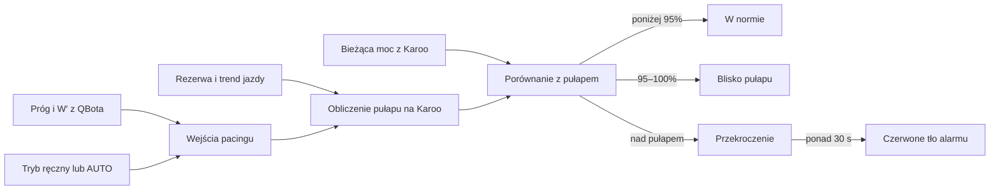
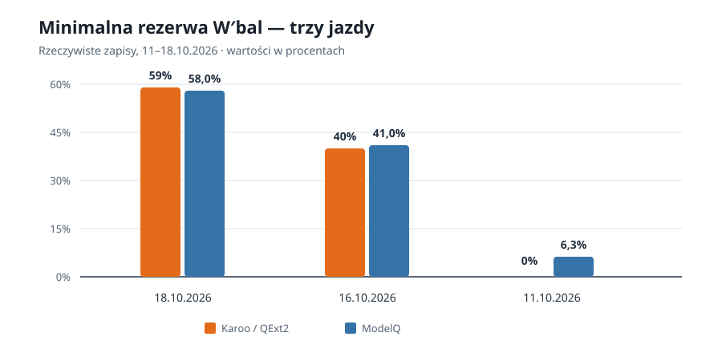

# Pacing na Karoo

## Co to jest

Pacing w QExt2 wyznacza bezpieczny pułap mocy na bieżący odcinek jazdy. QBot przekazuje dane progowe i rezerwę, a QExt2 na Karoo łączy je z aktualnym wysiłkiem i stanem trasy.

## Po co

Pułap pomaga ocenić, czy bieżąca moc mieści się w wybranej strategii jazdy. KOKPIT 2 może oznaczyć zbliżanie się do pułapu lub jego przekroczenie.

## Skąd dane

QBot może przekazać W′ ([pojemność wysiłku ponad progiem](../slowniczek.md)), próg TP ([próg ModelQ](../modelq/tp.md)), LTP (wygładzony próg tlenowy, opisany w [słowniczku](../slowniczek.md#ltp)) i współczynnik dnia ModelQ. Karoo dostarcza własne bieżące pomiary z czujników oraz rezerwę RSRV ([słowniczek](../slowniczek.md#rsrv)). W odpowiedzi urządzenia zachowała się starsza nazwa techniczna pola progu; wartość pochodzi z progu TP ModelQ.

## Jak liczone

QExt2 wyznacza pułap na podstawie ustawionego trybu, bieżącej rezerwy oraz aktualnych pomiarów. Tryby ręczne mają mnożniki 0,88 (ostrożny), 1,00 (normalny) i 1,12 (ofensywny). W AUTO mnożnik dobierany jest przez urządzenie, a malejąca rezerwa obniża pułap w mechanizmie tempa.

Przykład z kodu: gdy moc osiąga co najmniej 95% pułapu, pole mocy może zmienić kolor na żółty; przekroczenie pułapu jest oznaczane jako czerwone. Alarm czerwonego tła wymaga przekroczenia trwającego ponad 30 sekund. To progi kodu QExt2, które mogą zależeć od ustawień.

## Gdzie to widać

Na dolnym polu KOKPIT 2, przy wartości mocy i jej kolorze. Szczegóły pułapu nie są osobnym kaflem QBota.

## Jak czytać

Kolor jest wskazówką względem pułapu wyliczonego przez QExt2, a nie samodzielnym pomiarem progu ModelQ. Krótki zryw ponad pułapem może nie uruchomić czerwonego tła alarmu.

## Decyzje i historia

QExt2 używa wspólnego pułapu do pokazania liczby, koloru i alarmu mocy. Dzięki temu te elementy oceniają tę samą chwilową moc według jednej granicy.

## Ograniczenia i pułapki

- Algorytm pułapu jest po stronie QExt2; QBot nie wylicza go na nowo dla każdego pomiaru.
- Starsza nazwa techniczna w wymianie danych nie oznacza osobnego progu; QBot przekazuje wartość progu TP ModelQ.
- > DO SPRAWDZENIA: bieżące wartości ustawień trybu i pułapu zapisane lokalnie na urządzeniu Karoo.

## Jak przejść od progu do koloru

1. QBot przekazuje próg [TP](../modelq/tp.md) z ModelQ i pojemność W′, jeśli oba wyniki są dostępne. W odpowiedzi odczytanej 18.10.2026 serwer zwrócił próg 240,7 W, próg tlenowy 191,2 W, pojemność W′ 20,0 kJ i współczynnik dnia 0,889. W′bal i pojemność W′ to różne wielkości; szczegóły wyjaśnia [hasło o W′bal](../modelq/wprime-bal.md).
2. Karoo wybiera mnożnik trybu: 0,88 dla ostrożnego, 1,00 dla normalnego albo 1,12 dla ofensywnego. AUTO może dobierać tryb na podstawie rezerwy i ETA.
3. Silnik po stronie Karoo koryguje pułap także wraz ze zmianą rezerwy. Następnie porównuje bieżącą moc z wyliczonym pułapem.
4. Gdy moc osiąga 95% pułapu, pole może stać się żółte. Przekroczenie jest czerwone, a czerwone tło alarmowe wymaga utrzymania przekroczenia dłużej niż 30 sekund.

Są to progi z kodu urządzenia. Wartość z bazy QBota nie wystarcza do odtworzenia koloru, ponieważ podsumowanie po jeździe nie przechowuje historii pułapu ani chwilowych decyzji kolorystycznych. Przykład z 16.10.2026 ma końcowe pole CP QExt2 równe 238 W i minimalną rezerwę 40%, ale nie mówi, jaki kolor widział rowerzysta w danej sekundzie. Odczyt gotowości z 18.10 potwierdza dane początkowe, a nie bieżący pułap z Karoo.

Wykres porównuje minima W′bal zapisane przez Karoo i wyliczone przez ModelQ. Pokazuje, że wartości wejściowe mogą się różnić. Nie pokazuje pułapu mocy ani koloru pola.

Wzór

Kolor zależy od stosunku bieżącej mocy do pułapu obliczonego na Karoo. Granice 95%, przekroczenie i czas 30 sekund są sprawdzonymi regułami implementacji. Nie przeliczam ich na przykład watowy, bo nie mam zapisanego rzeczywistego pułapu z tej jazdy.

> DO SPRAWDZENIA: dostępne zapisy po jeździe nie zawierają równoczesnego zestawu: bieżąca moc, pułap, wybrany tryb i kolor pola. Bez takiego zapisu nie można wyliczyć rzeczywistego progu watowego z konkretnej jazdy.

## Wpływa na

- Kolor i alarm mocy na KOKPIT 2.
- Strategię [trybu AUTO](tryb-auto.md).

## Zależy od

- Danych startowych z QBota, trybu jazdy, pomiarów Karoo i aktualnej rezerwy.

## Powiązane hasła

- [QExt2 i Karoo](index.md)
- [Tryb AUTO](tryb-auto.md)
- [KOKPIT 2 i ustawienia](kokpit2.md)
- [Próg TP](../modelq/tp.md)

## Zrodla

- `/opt/qbot/app/mcp_server.py` — `ride_readiness`, odpowiedź `/ride-readiness` używana przez Karoo.
- `/opt/qbot/app/fitmodel/modelq2/publish.py` — publikacja wartości progu ModelQ.
- `/opt/qbot/app/fitmodel/modelq2/mpa.py` — obliczenie W′bal w ModelQ.
- `/opt/qbot/qext2_deploy/app/src/main/kotlin/com/qext2/primary/active/PacingEngine.kt` — obliczenie pułapu i ocena mocy.
- `/opt/qbot/qext2_deploy/app/src/main/kotlin/com/qext2/primary/kokpit/Kokpit2.kt` — wyświetlenie wyniku.
- `qbot_v2.fitmodel_qext2_ride`, `qbot_v2.modelq2_ride` — wspólne jazdy z 11, 16 i 18.10.2026.
