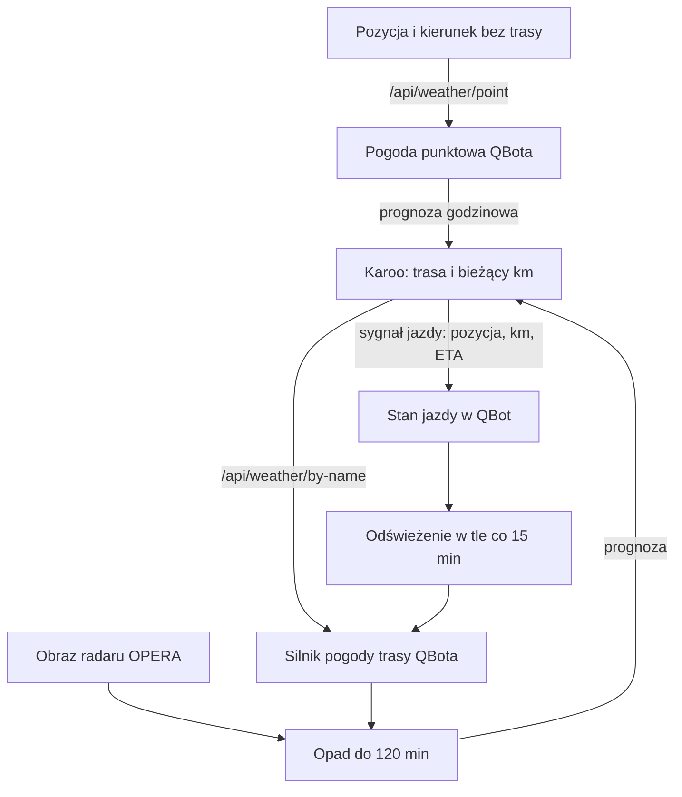

# Pogoda INFO na Karoo

## Co to jest

Pogoda INFO to prognoza dla pola QExt2 na Karoo. Przy trasie QBot wylicza pogodę na pozostałym odcinku; bez trasy przekazuje prognozę godzinową dla bieżącego miejsca.

## Po co

Pole pomaga zobaczyć, jak mogą zmienić się odczuwalna temperatura, opad i wiatr w dalszej części jazdy.

## Skąd dane

Przy trasie QBot korzysta ze swojego silnika pogody trasowej. Bez trasy podaje warunki punktowe dla bieżącego miejsca. Gdy Karoo wysyła położenie i postęp trasy, QBot zapisuje stan jazdy; proces w tle odświeża pogodę trasy co 15 minut.

## Jak liczone

1. Karoo pyta o pogodę trasy, podając jej nazwę i aktualny kilometr.
2. QBot dopasowuje nazwę do zapisanej trasy i oblicza prognozę dla dalszego odcinka.
3. W aktywnym trybie jazdy QBot może dołożyć przewidywany opad z radaru na najbliższe 120 minut. Dalej korzysta z modelu pogody.
4. Karoo rysuje wynik; może zmienić zakres wykresu dotknięciem pola.

Przykład przepływu: Karoo podaje obecny kilometr jako punkt startu prognozy. QBot odrzuca punkty wyraźnie przed tym miejscem i uwzględnia wiek ostatniego wyniku. Rzeczywiste wartości pogodowe zależą od trasy i czasu zapytania; nie podaję przykładowych warunków bez odczytu konkretnej prognozy.

## Gdzie to widać

Na Karoo w polu QExt2 INFO, w sekcji pogody. Zawartość zależy od tego, czy QExt2 ma aktywną trasę.

## Jak czytać

Wartość wiatru względem jazdy jest dodatnia, gdy wieje w twarz, i ujemna, gdy pomaga z tyłu. Opad radarowy jest osobno oznaczony od prognozy modelowej. Radar nie pokazuje mgły.

## Decyzje i historia

W kodzie QBota pogoda na trasie używa tego samego silnika co analiza trasy. W trybie jazdy opad radarowy ma pierwszeństwo dla najbliższych dwóch godzin, a model jest używany dalej.

## Ograniczenia i pułapki

- Dostępność wyniku zależy od poprawnego dopasowania trasy i odpowiedzi usług pogodowych.
- Prognoza punktowa i prognoza na trasie to dwa różne zapytania.
- Starszy opis ustawień QBota nie obejmuje pola INFO. Funkcję potwierdza nowsza dokumentacja QExt2 i aktualny kod QBota.
- QBot może zwrócić dane z pamięci podręcznej; nie oznacza to nowego obliczenia w chwili każdego odświeżenia Karoo.

## Jak odróżnić prognozę trasową od punktowej

1. Jeśli QExt2 ma aktywną trasę, przekazuje jej nazwę i obecny kilometr. QBot dopasowuje ją do zapisanej trasy i buduje pogodę dla dalszego przebiegu.
2. Jeśli trasy nie ma, QExt2 pyta o położenie i może podać kierunek jazdy. QBot zwraca prognozę godzinową dla miejsca.
3. Podczas aktywnej jazdy sygnał z Karoo zawiera położenie, trasę, kilometr i ETA. QBot przechowuje ostatni stan i w pętli odświeża pogodę trasową co 15 minut.
4. Dla najbliższych maksymalnie 120 minut kod może dołączyć prognozę opadu z radaru; dla dalszego czasu używa prognozy modelowej.

Te odstępy są potwierdzone w kodzie. Przykład pogody na dalszym odcinku konkretnej jazdy nie został odnaleziony w tabeli podsumowań QExt2, dlatego nie dopisuję temperatury ani opadu jako rzekomo odebranego przez Karoo. Dane z innego zapisu pogodowego nie potwierdziłyby odpowiedzi pola INFO.

> DO SPRAWDZENIA: przechwycony wynik pogody INFO odebrany przez QExt2 dla konkretnej trasy wraz z godziną pobrania.

## Co oznacza brak danych

- Brak rozpoznanej nazwy trasy może uniemożliwić pogodę trasową; wariant punktowy nadal wymaga pozycji.
- Brak odpowiedzi sieciowej może zostawić poprzedni wynik w pamięci urządzenia lub cache. Nie należy traktować go jako prognozy świeżo pobranej w tej chwili.
- Radar dotyczy krótkiego horyzontu opadu. Nie zastępuje prognozy temperatury i wiatru dla całej trasy.

## Gdzie szukać

Wynik jest na polu INFO Karoo, a nie w zakładce QExt2 strony SETUP QBota. Zrzut SETUP pokazuje jedynie zakładkę konfiguracyjną i nie przedstawia danych pogody z urządzenia.

## Wpływa na

- Obraz pogody na polu INFO i komunikaty pogodowe KOKPIT 2.
- [Pogoda QBota](../pogoda/index.md) — używa wspólnego silnika prognozy.

## Zależy od

- Prognozy modelowej i — w trybie jazdy — dostępności danych radarowych.
- Dla trasy: dopasowanej nazwy trasy oraz podanego kilometra.
- Dla pogody bez trasy: pozycji i opcjonalnego kierunku jazdy.

## Powiązane hasła

- [QExt2 i Karoo](index.md)
- [Przepływ danych podczas jazdy](przeplyw-jazdy.md)
- [Pogoda na trasie](../pogoda/pogoda-na-trasie.md)
- [Wiatr](../pogoda/wiatr.md)

## Zrodla

- `/opt/qbot/app/qbot_api.py` — `_qext2_weather_route`, `_qext2_weather_point`, `_qext2_live_loop`, `/api/weather/by-name`, `/api/weather/point`.
- `/opt/qbot/app/mcp_server.py` — `_qext2_ping`, zapis `qext2_live.json`.
- `/opt/qbot/qext2_deploy/docs/INFO.md` — zachowanie pola INFO, stan na 16.10.2026.
- `/opt/qbot/app/docs/POGODA_SILNIK.md` — silnik pogody tras.
