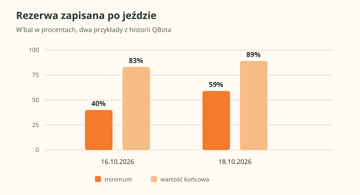
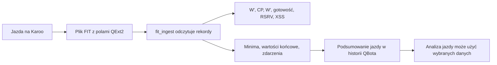

# Pola QExt2 w pliku FIT

## Co to jest

Podczas jazdy QExt2 zapisuje w pliku FIT (formacie pliku aktywności; [słowniczek](../slowniczek.md#fit)) dodatkowe pomiary. QBot odczytuje znane pola i zapisuje podsumowanie dla całej jazdy.

## Po co

Podsumowanie zachowuje informacje o rezerwie W′bal ([pozostałym zapasie](../modelq/wprime-bal.md)), mocy i wybranych wskaźnikach QExt2. Można je później porównać z innymi obliczeniami jazdy.

## Skąd dane

Źródłem jest plik FIT (format zapisu aktywności, opisany w [słowniczku](../slowniczek.md#fit)) dostarczony do QBota. Program odczytujący rozpoznaje między innymi przebieg W′bal, pole CP, pojemność W′, gotowość, rezerwę RSRV i punkty obciążenia. Zna także numer wersji zapisu oraz pięciosekundową moc znormalizowaną. Od 17.10.2026 uzgodniony zestaw obejmuje dodatkowo pola kontroli wiatru.

## Jak liczone

QBot nie odtwarza tu każdej wartości z algorytmu QExt2. Odczytuje próbki z pliku i tworzy skrót jazdy: minimum, wartość końcową, liczbę próbek, czas pierwszego zejścia W′bal do zera, medianę gotowości oraz wybrane podsumowania wiatru. Skrót jest przechowywany w historii QBota.

Przykład z bazy: jazda z 16.10.2026 (`24745225177`) miała 4 026 próbek; minimalny [W′bal](../modelq/wprime-bal.md) wyniósł 40%, końcowy 83%, a końcowa wartość pola [CP](../slowniczek.md#cp) QExt2 238 W. CP to historyczna nazwa techniczna pola QExt2; [TP](../modelq/tp.md) jest nazwą progu w ModelQ. W jeździe z 18.10.2026 zapisano 8 743 próbki kontroli wiatru; mediana wyniosła 2,4 m/s, a udział czasu pod wiatr 11,4%.

Na wykresie wartości z 16.10.2026 to 40% minimum i 83% na końcu. Dla 18.10.2026 są to 59% i 89%. Słupki pokazują tylko dwie liczby z każdego podsumowania, nie przebieg rezerwy w czasie.

## Gdzie to widać

W QBocie wartości są zapisane w podsumowaniu jazdy. Zwykły użytkownik widzi je tylko tam, gdzie dana analiza jawnie korzysta z danych QExt2.

## Jak czytać

Najniższy procent W′bal to najniższa zapisana rezerwa podczas jazdy, a wartość końcowa jest ostatnią dostępną próbką. Pole CP z pliku QExt2 nie należy automatycznie utożsamiać z bieżącym progiem TP QBota.

## Decyzje i historia

Nazwy pól uzgadnia projekt QExt2 i QBot. Nie każde pole zapisane przez nową wersję QExt2 jest już odczytywane i zachowywane przez QBot.

## Ograniczenia i pułapki

- Starszy FIT bez pól QExt2 daje pusty wynik tej części ingestu.
- Niektóre rekordy mają schemat 1, inne schemat 2; porównania wymagają uwzględnienia schematu.
- Dokument wymiany QExt2 wymienia pola AERO, których QBot jeszcze nie zapisuje w podsumowaniu.
- Historia QBota przechowuje również podsumowanie kontroli wiatru, ale nie każda jazda ma te dane. Przykład z 18.10.2026 potwierdza zapis dla nowej jazdy.

## Jak czytać zapis na przykładzie

1. Po jeździe QBot odczytuje tylko próbki, w których występuje co najmniej jedno rozpoznane pole QExt2.
2. Dla jazdy z 16.10.2026 znaleziono 4 026 takich próbek. Wartość minimalna W′bal wyniosła 40%, a końcowa 83%.
3. Dla jazdy z 18.10.2026 zapis kontroli wiatru obejmował 8 743 próbki. Mediana prędkości przyjętego wiatru wyniosła 2,4 m/s; 11,4% próbek wskazywało wiatr w twarz.
4. Podsumowanie zachowuje wybrane wartości krańcowe lub mediany. Nie jest szeregiem wszystkich sekund i nie pozwala narysować pełnego przebiegu pola.

Liczby te są prawdziwymi odczytami zapisanych jazd i dotyczą dwóch różnych dni. Nie należy z nich wyciągać wniosku, że wiatr był stały przez całą jazdę albo że każda jazda ma próbki kontroli wiatru.

> DO SPRAWDZENIA: czy każda obsługiwana ścieżka odbioru FIT po stronie Hammerhead uruchamia ten sam odczyt QExt2. Potwierdzono zapis przykładów, nie pełną listę źródeł plików.

## Czego to podsumowanie nie mówi

Wartość końcowa jest ostatnią dostępną próbką w pliku, a niekoniecznie pomiarem wykonanym dokładnie w chwili zatrzymania. Minimum mówi o najniższym zapisanym wyniku, nie o czasie jego trwania. Mediana wiatru opisuje środkową wartość wśród odczytanych próbek, nie średnią prędkość na całej trasie. Analiza szczegółowa może więc potrzebować oryginalnych próbek jazdy.

## Wpływa na

- Analizę W′bal, jeśli korzysta z zapisanych zdarzeń z FIT QExt2.
- Możliwość porównywania wyników QExt2 z wynikami obliczanymi przez QBot.

## Zależy od

- Pliku FIT zawierającego pola QExt2.
- Zgodności nazw pól po stronie QExt2 i programu odczytującego QBota.

## Powiązane hasła

- [QExt2 i Karoo](index.md)
- [Przepływ danych podczas jazdy](przeplyw-jazdy.md)
- [W′bal w raporcie](../raport-jazdy/wprime-bal.md)
- [W′bal](../modelq/wprime-bal.md)

## Zrodla

- `/opt/qbot/app/fitmodel/fit_ingest.py` — `_QEXT2_FIELDS`, `parse_fit_qext2_records`, `summarize_qext2`, `ensure_qext2_table`, `upsert_qext2_ride`.
- `/opt/qbot/qext2_deploy/docs/KONTRAKT_DANYCH.md` — nazwy i wersje pól FIT, stan 17.10.2026.
- `qbot_v2.fitmodel_qext2_ride` — jazda `24745225177`, 16.10.2026.
