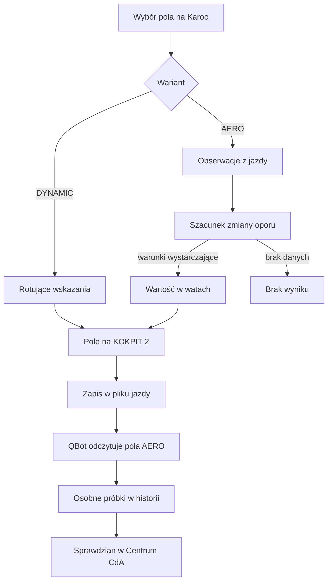
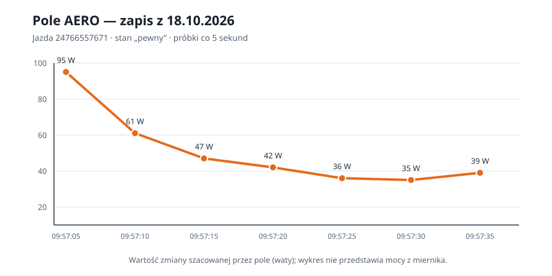

# Pole dynamiczne

## Co to jest

Pole dynamiczne to miejsce na ekranie Karoo, którego zawartość zależy od wybranego wariantu. W trybie DYNAMIC ([rotacja wskazań](../slowniczek.md#dynamic)) pokazuje zmieniające się informacje. W trybie AERO ([szacowanie aerodynamiczne](../slowniczek.md#aero)) pokazuje szacunek zmiany mocy związanej z oporem powietrza. Są to obliczenia QExt2 na liczniku; QBot przekazuje konfigurację KOKPIT 2 i później może otrzymać część zapisu z jazdy.

## Po co

Właściciel może przeznaczyć to samo miejsce na krótkie wskazania albo na informację o pozycji aerodynamicznej. Pole AERO pomaga zauważyć zmianę szacowanego oporu, ale nie mierzy bezpośrednio siły oporu ani mocy na korbie. Liczbę należy traktować jako wskazówkę z modelu, a nie pomiar czujnika.

## Skąd dane

Wariant wybiera się po stronie QExt2 w ustawieniach pola. Wartości AERO są wyprowadzane z obserwacji podczas jazdy. Plik jazdy zachowuje stan pola, szacowaną zmianę w watach i bieżące oraz odniesienia [CdA](../slowniczek.md#cda) (współczynnika oporu aerodynamicznego). QBot odczytuje je z pliku i przechowuje w osobnym archiwum próbek. Nie dodaje ich do krótkiego podsumowania QExt2; może je za to porównać z własnym wynikiem w Centrum CdA. Nie używa pola AERO do własnego wyliczenia CdA.

Zrzut dostępny w WIKI pokazuje stronę SETUP QBota i zakładkę „QExt2 (Karoo)” w pasku. Sama zakładka jest na zrzucie zamknięta; ustawienia DYNAMIC/AERO znajdują się w urządzeniu i ich wyglądu ten obraz nie potwierdza.

## Jak liczone

1. Właściciel wybiera wariant pola w QExt2 na Karoo.
2. Przy DYNAMIC rozszerzenie przełącza przygotowane wskazania w tym miejscu.
3. Przy AERO rozszerzenie zbiera obserwacje i prezentuje szacowaną zmianę w watach, jeśli uzna, że ma warunki do pokazania wyniku.
4. Po jeździe QBot zapisuje próbki AERO osobno. Dla jazdy z 18.10.2026 zachował 8 819 próbek od 08:24:56 do 11:06:23.
5. O 09:57:05 plik zapisał stan 2 („wynik”), zmianę +95 W, bieżący współczynnik oporu 0,795 i odniesienie 0,470. O 09:57:10 zapisał +61 W, 0,680 i to samo odniesienie 0,470.

Wartości z przykładu pochodzą z zapisu FIT, nie z odczytu ekranu Karoo. Opisują to, co pole zapisało, ale sam zapis nie potwierdza, jaki wariant właściciel ustawił w menu.

Wzór

QExt2 szacuje, ile mocy odpowiada oporowi aerodynamicznemu w obserwowanych odcinkach jazdy. Dla każdego odcinka wylicza moc pozostającą po odjęciu szacowanego toczenia, podjazdu i przyspieszania:

`moc na opór = moc z korby × 0,976 − masa × 9,81 × prędkość × (nachylenie w % ÷ 100 + 0,007) − masa × prędkość × przyspieszenie`

Następnie dzieli sumę tej mocy przez sumę `0,5 × gęstość powietrza × prędkość³`. Wynikiem jest [CdA](../slowniczek.md#cda), czyli oszacowanie aerodynamicznego oporu. Zmianę mocy względem odniesienia szacuje jako `0,5 × gęstość powietrza × (CdA bieżące − CdA odniesienia) × prędkość³`.

Model dodaje do masy rowerzysty 9 kg na rower i wyposażenie. Przyjmuje sprawność przeniesienia mocy 0,976 oraz opór toczenia 0,007. Gęstość powietrza uwzględnia temperaturę odczytaną przez Karoo, a gdy jej brak — przyjmuje 12°C. Do obliczeń dopuszcza tylko odcinki spełniające warunki stabilnej jazdy: prędkość co najmniej 18 km/h, moc co najmniej 60 W, nachylenie od −4% do +4%, brak mocnego przyspieszania lub hamowania oraz równą kadencję i moc. Porównuje ostatnie 30 sekund z wcześniejszym oknem do 60 sekund; zmianę zgłasza po utrzymaniu progu co najmniej 0,10 CdA przez 5 sekund. Jeżeli warunki nie są spełnione, pole może pokazać kreskę albo zbieranie danych zamiast wyniku. To model QExt2 na Karoo; QBot nie liczy tych wartości ponownie.

## Gdzie to widać

Na Karoo, w górnym polu KOKPIT 2. Zakładka SETUP w serwisie QBota znajduje się w górnym pasku ustawień; pokazany zrzut nie przedstawia jej otwartej zawartości. Nie ma potwierdzonego widoku wyniku AERO w historii QBota.

## Jak czytać

- Wartość w watach jest szacunkiem zmiany powiązanej z oporem, a nie zapisem zmiany mocy z miernika.
- Oznaczenie zbierania danych lub brak wartości znaczy, że rozszerzenie nie pokazuje jeszcze stabilnego oszacowania.
- DYNAMIC oznacza rotację wskazań; nie należy oczekiwać, że to pole pokaże wówczas wynik AERO.
- Brak AERO w skróconym podsumowaniu jazdy nie dowodzi, że pole nie działało na Karoo. Próbki są zachowane w osobnym archiwum.

## Decyzje i historia

Dokumentacja projektu QExt2 opisuje wybór DYNAMIC/AERO w wersji 0.4.1 z 17.10.2026. Od 18.10.2026 QBot rozpoznaje pola AERO w pliku FIT i zachowuje ich próbki oddzielnie od podsumowania pozostałych pól.

## Ograniczenia i pułapki

- Wynik i jego pewność zależą od pomiarów i warunków jazdy na Karoo.
- QBot nie wylicza AERO; zachowuje jego wynik i porównuje go z własnym modelem.
- Zapis FIT potwierdza próbki pola, ale nie daje zrzutu ekranu ani potwierdzenia wybranego ustawienia w menu Karoo.

## Wpływa na / Zależy od

- Zmienia zawartość jednego pola KOKPIT 2.
- Zależy od wariantu ustawionego na Karoo i próbek dostępnych podczas jazdy.
- Powiązanie z analizą QBota ogranicza się do porównania zapisanego wyniku z własnym obliczeniem CdA; AERO nie jest wejściem do tego obliczenia.

## Powiązane hasła

- [QExt2 i Karoo](index.md)
- [KOKPIT 2 i ustawienia](kokpit2.md)
- [Pola FIT QExt2](pola-fit.md)
- [Przepływ jazdy](przeplyw-jazdy.md)

## Zrodla

- `/opt/qbot/qext2_deploy/docs/KOKPIT.md` — tryby DYNAMIC/AERO, wersja 0.4.1.
- `/opt/qbot/qext2_deploy/app/src/main/kotlin/com/qext2/primary/engine/AeroEstimator.kt` — estymator po stronie QExt2.
- `/opt/qbot/qext2_deploy/app/src/main/kotlin/com/qext2/primary/kokpit/KokpitNavDataType.kt` — wybór danych pola.
- `/opt/qbot/qext2_deploy/docs/KONTRAKT_DANYCH.md` — pola AERO w pliku jazdy.
- `/opt/qbot/app/fitmodel/fit_ingest.py` — rozpoznanie pól AERO w pliku FIT.
- `/opt/qbot/app/fitmodel/qext2_aero.py` — osobny zapis próbek i funkcja sprawdzająca.
- `/opt/qbot/app/fitmodel/cda.py` — porównanie próbek AERO z własnym modelem CdA.
- `qbot_v2.qext2_aero_record` — jazda `24766557671`, 18.10.2026, próbki 09:57:05 i 09:57:10.
