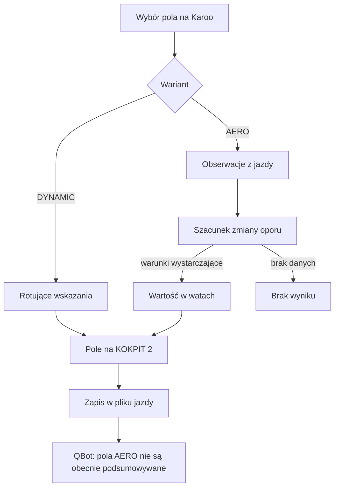

# Pole dynamiczne

## Co to jest

Pole dynamiczne to miejsce na ekranie Karoo, którego zawartość zależy od wybranego wariantu. W trybie DYNAMIC ([rotacja wskazań](../slowniczek.md#dynamic)) pokazuje zmieniające się informacje. W trybie AERO ([szacowanie aerodynamiczne](../slowniczek.md#aero)) pokazuje szacunek zmiany mocy związanej z oporem powietrza. Są to obliczenia QExt2 na liczniku; QBot przekazuje konfigurację KOKPIT 2 i później może otrzymać część zapisu z jazdy.

## Po co

Właściciel może przeznaczyć to samo miejsce na krótkie wskazania albo na informację o pozycji aerodynamicznej. Pole AERO pomaga zauważyć zmianę szacowanego oporu, ale nie mierzy bezpośrednio siły oporu ani mocy na korbie. Liczbę należy traktować jako wskazówkę z modelu, a nie pomiar czujnika.

## Skąd dane

Wariant wybiera się po stronie QExt2 w ustawieniach pola. Wartości AERO są wyprowadzane z obserwacji podczas jazdy. QExt2 przewiduje też zapis części stanu AERO do pliku jazdy. Obecny odczyt QBota rozpoznaje inne ustalone pola QExt2, lecz nie zachowuje pól AERO w podsumowaniu jazdy.

Zrzut dostępny w WIKI pokazuje stronę SETUP QBota i zakładkę „QExt2 (Karoo)” w pasku. Sama zakładka jest na zrzucie zamknięta; ustawienia DYNAMIC/AERO znajdują się w urządzeniu i ich wyglądu ten obraz nie potwierdza.

## Jak liczone

1. Właściciel wybiera wariant pola w QExt2 na Karoo.
2. Przy DYNAMIC rozszerzenie przełącza przygotowane wskazania w tym miejscu.
3. Przy AERO rozszerzenie zbiera obserwacje i prezentuje szacowaną zmianę w watach, jeśli uzna, że ma warunki do pokazania wyniku.
4. Po jeździe część pól może trafić do pliku jazdy. QBot obecnie nie zapisuje tych pól AERO do swojego podsumowania, więc w jego bazie nie ma potwierdzonego przykładu wyniku.

W bazie QBotu są natomiast przykłady innych pól z tych samych plików: 16.10.2026 zapisano 4 026 próbek QExt2, w tym minimum rezerwy 40% i wartość końcową 83%. Te liczby nie są wynikiem AERO i nie pozwalają odtworzyć jego wskazania.

Wzór

Dokładnego wzoru nie podaję, ponieważ nie jest wyliczany ani przechowywany przez QBot. Kod projektu QExt2 opisuje osobny estymator. To hasło wyjaśnia tylko granicę wymiany danych z QBotem.

## Gdzie to widać

Na Karoo, w górnym polu KOKPIT 2. Zakładka SETUP w serwisie QBota znajduje się w górnym pasku ustawień; pokazany zrzut nie przedstawia jej otwartej zawartości. Nie ma potwierdzonego widoku wyniku AERO w historii QBota.

## Jak czytać

- Wartość w watach jest szacunkiem zmiany powiązanej z oporem, a nie zapisem zmiany mocy z miernika.
- Oznaczenie zbierania danych lub brak wartości znaczy, że rozszerzenie nie pokazuje jeszcze stabilnego oszacowania.
- DYNAMIC oznacza rotację wskazań; nie należy oczekiwać, że to pole pokaże wówczas wynik AERO.
- Brak AERO w podsumowaniu QBota nie dowodzi, że pole nie działało na Karoo. Oznacza, że QBot nie zachowuje obecnie tych pól w podsumowaniu.

## Decyzje i historia

Dokumentacja projektu QExt2 opisuje wybór DYNAMIC/AERO w wersji 0.4.1 z 17.10.2026. Po stronie QBota granicę potwierdza lista pól czytanych z pliku jazdy: AERO nie znajduje się wśród nich.

## Ograniczenia i pułapki

- Wynik i jego pewność zależą od pomiarów i warunków jazdy na Karoo.
- QBot nie wylicza ani nie weryfikuje wartości AERO.
- > DO SPRAWDZENIA: rzeczywisty przykład wskazania AERO zapisany w pliku jazdy i odczytany z urządzenia. W bazie QBota nie ma obecnie podsumowania tych pól.

## Wpływa na / Zależy od

- Zmienia zawartość jednego pola KOKPIT 2.
- Zależy od wariantu ustawionego na Karoo i próbek dostępnych podczas jazdy.
- Powiązanie z późniejszą analizą QBota jest ograniczone: obecnie nie ma potwierdzonego zapisu AERO w podsumowaniu.

## Powiązane hasła

- [QExt2 i Karoo](index.md)
- [KOKPIT 2 i ustawienia](kokpit2.md)
- [Pola FIT QExt2](pola-fit.md)
- [Przepływ jazdy](przeplyw-jazdy.md)

## Zrodla

- `/opt/qbot/qext2_deploy/docs/KOKPIT.md` — tryby DYNAMIC/AERO, wersja 0.4.1.
- `/opt/qbot/qext2_deploy/app/src/main/kotlin/com/qext2/primary/engine/AeroEstimator.kt` — estymator po stronie QExt2.
- `/opt/qbot/qext2_deploy/app/src/main/kotlin/com/qext2/primary/kokpit/KokpitNavDataType.kt` — wybór danych pola.
- `/opt/qbot/qext2_deploy/docs/KONTRAKT_DANYCH.md` — pola AERO w pliku jazdy.
- `/opt/qbot/app/fitmodel/fit_ingest.py` — pola rozpoznawane przez QBot; pola AERO nie są obecnie wśród nich.
- `qbot_v2.fitmodel_qext2_ride` — przykład zapisu z 16.10.2026.
