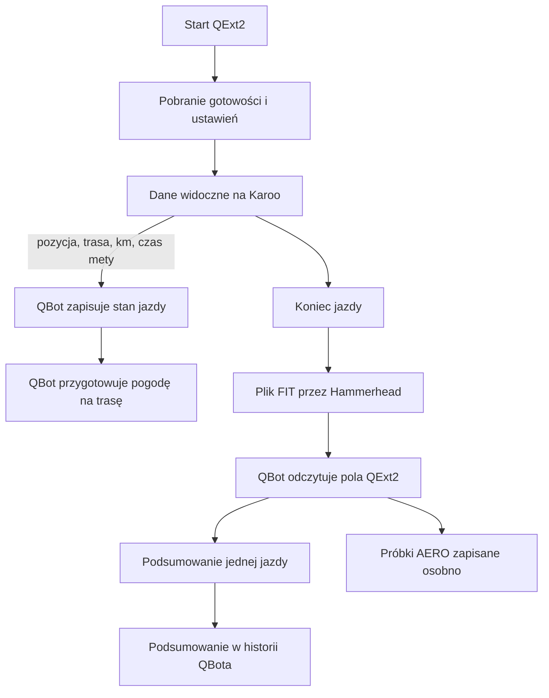

# Przepływ danych podczas jazdy

## Co to jest

To wymiana danych między QBotem, Karoo z QExt2 i serwisem Hammerhead. QBot przekazuje dane potrzebne na ekranie, a po jeździe odczytuje pomiary zapisane w pliku FIT (formacie pliku aktywności; [słowniczek](../slowniczek.md#fit)).

## Po co

Dzięki temu Karoo może pokazać informacje o gotowości, trasie, pogodzie i ustawieniach, a QBot może później uwzględnić część pomiarów QExt2 w historii jazdy.

## Skąd dane

Karoo pobiera z QBota dane gotowości i ustawienia. Szczegóły trasy, pogody i planu pobiera osobno, gdy są potrzebne. Podczas jazdy może wysłać pozycję, nazwę trasy, kilometr trasy i szacowany czas przyjazdu. Harmonogram uruchamia synchronizację Hammerhead→Garmin co 10 minut, a osobny lekki odczyt nowych FIT co 30 minut. To odstępy uruchamiania zadań, nie gwarantowany czas dostarczenia pliku.

## Jak liczone

1. Karoo pobiera gotowość oraz konfigurację kokpitu z QBota.
2. Gdy potrzebuje szczegółów trasy, pyta osobne usługi QBotu: między innymi o nawierzchnię, punkty, plan czasu i pogodę.
3. W trybie jazdy QBot przyjmuje sygnał położenia oraz postępu. Zapisuje aktualną trasę i kilometr.
4. Po otrzymaniu FIT QBot wyszukuje rozpoznane pola QExt2. Dla większości z nich zapisuje skrót jazdy; cztery pola AERO odkłada dodatkowo w osobnym archiwum próbek.

Przykład z bazy: jazda z 16.10.2026, o numerze `24745225177`, miała 4 026 próbek QExt2. Minimalna rezerwa W′bal ([pozostały zapas](../modelq/wprime-bal.md)) wyniosła 40%, a końcowa 83%. To wartości odczytane z pliku jazdy, nie prognoza QBotu.

## Gdzie to widać

Na Karoo dane widać w polach QExt2. W QBocie podsumowanie jest częścią historii jazdy; dalsza analiza zależy od tego, czy korzysta z konkretnego pola.

## Jak czytać

Brak podsumowania QExt2 nie oznacza braku samej jazdy. Starszy plik może nie zawierać pól QExt2; wtedy program odczytujący pomija tę część bez błędu całego importu.

## Decyzje i historia

QBot utrzymuje własny odczyt i zapis podsumowania pól QExt2. QExt2 jest osobnym projektem, więc jego ekran i obliczenia nie są częścią kodu QBota.

## Ograniczenia i pułapki

- Wpisy w tabeli są podsumowaniem. Nie są pełnym zapisem każdej próbki.
- W zapisie mogą występować różne wersje pól FIT. QBot zachowuje numer wersji; brak numeru traktuje jako wersję 1.
- Bieżąca baza przechowuje podsumowanie kontroli wiatru i osobne próbki AERO. Nie zawiera dla tych rekordów czasu zakończenia jazdy ani czasu pierwszego pojawienia się pliku, więc opóźnienia dostarczenia nie da się tu podać.

## Przykład odbioru i odpowiedzi gotowości

1. Jazda z 16.10.2026 została zapisana w QBot pod identyfikatorem `24745225177`.
2. Jej podsumowanie zawiera 4 026 próbek QExt2, minimum W′bal równe 40% i wartość końcową 83%.
3. Inna jazda, z 18.10.2026, zawiera 8 743 próbki kontroli wiatru; środkowy odczyt wynosi 2,4 m/s, a udział próbek pod wiatr 11,4%.
4. Osobny zapis AERO z jazdy z 18.10.2026 ma 8 819 próbek. O 09:57:05 zapisano stan „pewny” i +95 W.
5. Odczyt danych gotowości z tokenem urządzenia 18.10.2026 zwrócił próg 240,7 W, W′ 20,0 kJ i współczynnik dnia 0,889. To odpowiedź serwera przygotowana dla Karoo; nie potwierdza odbioru przez konkretny licznik.

Synchronizacja Hammerhead i importer FIT mają w kodzie harmonogramy co 10 i 30 minut. Zapis podsumowania potwierdza, że plik został przetworzony, ale nie ma w nim daty zakończenia jazdy ani czasu pierwszego pojawienia się pliku. Nie da się zatem policzyć opóźnienia.

## Po czym poznać niepełny przepływ

- Jeśli jazda jest w historii, ale brakuje danych QExt2, plik może nie zawierać obsługiwanych pól albo importer mógł ich nie rozpoznać.
- Jeśli podsumowanie istnieje, ale nie ma próbek wiatru albo AERO, może to być starszy plik, brak tych pól lub brak ich zapisu w tej jeździe.
- Brak sygnału postępu jazdy nie oznacza automatycznie utraty FIT. Sygnał na żywo służy między innymi do kontekstu pogody; odbiór pliku po jeździe jest osobną drogą.

## Wpływa na

- [Pola FIT QExt2](pola-fit.md) — opisują szczegółowo wartości z pliku.
- [Raport jazdy](../raport-jazdy/index.md) — może korzystać z odtworzonego albo zapisanego W′bal.

## Zależy od

- Dostępności usług QBota oraz internetu.
- Poprawnego pliku FIT i obecności w nim pól QExt2.

## Powiązane hasła

- [QExt2 i Karoo](index.md)
- [KOKPIT 2 i ustawienia](kokpit2.md)
- [Pogoda INFO](pogoda-info.md)
- [Pola FIT QExt2](pola-fit.md)

## Zrodla

- `/opt/qbot/app/mcp_server.py` — `ride_readiness`, `_qext2_ping`.
- `/opt/qbot/app/qbot_api.py` — `/api/weather/by-name`, `_qext2_live_loop`.
- `/opt/qbot/app/fitmodel/fit_ingest.py` — `parse_fit_qext2_records`, `summarize_qext2`, `upsert_qext2_ride`.
- `/opt/qbot/app/fitmodel/qext2_aero.py` — zapis próbek AERO.
- `qbot_v2.fitmodel_qext2_ride` — przykład jazdy z 16.10.2026.
- `qbot_v2.qext2_aero_record` — przykład AERO z 18.10.2026.
- `/opt/qbot/qext2_deploy/docs/KONTRAKT_DANYCH.md` — uzgodnione nazwy pól FIT.
