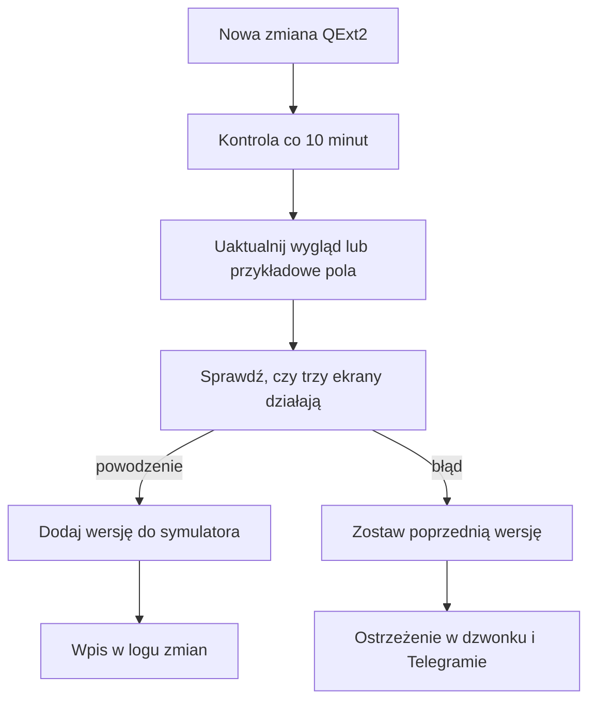

# Symulator pól QExt2 i log zmian

## Co to jest

To podgląd w Garażu, który pokazuje trzy przykładowe ekrany Karoo: KOKPIT 2, STATS v2 i INFO. Możesz wybrać wersję i obejrzeć zapis zmian w QExt2. To symulacja wyglądu i przykładowych danych, a nie podgląd na żywo z licznika.

## Po co

Użyj symulatora, gdy chcesz obejrzeć zmianę wyglądu albo nowych pól, zanim potraktujesz ją jako gotową wersję dla urządzenia. Log pomaga sprawdzić, którego wydania dotyczy podgląd i czy automatyczna aktualizacja symulatora się powiodła.

## Skąd dane

Wizualizacja pól jest przenoszona z kodu ekranów QExt2. Dane w symulowanych polach pochodzą ze scenariusza w przeglądarce. Część wartości jest przykładowa i może być uzupełniona automatycznie po dodaniu nowych pól. Nie pochodzą one wtedy z czujników Karoo ani z bazy QBota.

Automat śledzi nowe zmiany i sprawdza, czy nowy podgląd się uruchamia. Wątek działa razem z usługą WWW i sprawdza zmiany co 10 minut. Błąd aktualizacji zostawia poprzedni wygląd i może dodać ostrzeżenie do dzwonka oraz wysłać wiadomość Telegram.

## Jak liczone

1. Otwórz Garaż i wybierz zakładkę QExt2. Symulator pokazuje trzy ekrany obok siebie oraz scenariusze jazdy.
2. Wybierz wersję w polu „Build w symulatorze”. Lista obejmuje wersje zebrane od rozpoczęcia logu; starsza wersja służy do porównania.
3. Wybierz scenariusz, aby zobaczyć, jak przykładowe dane wpływają na pola i komunikaty. Wartości są obliczane na potrzeby symulacji, więc nie są potwierdzeniem tego, co Karoo wyświetliło podczas jazdy.
4. Przejrzyj „Log zmian QExt2”. Wpis pokazuje dzień, godzinę, wersję lub skrót zmiany, opis oraz stan symulatora.
5. Po zmianie QExt2 automat próbuje odświeżyć port ekranów i przykładowe dane. Jeśli kontrola przejdzie, do logu dochodzi nowa wersja. Jeśli zawiedzie, zostaje poprzednia wersja i oznaczenie problemu.

Nie podaję wyniku liczbowego z bazy, bo podgląd jest generowany ze scenariuszy przykładowych. Nie jest to analiza danych zapisanych po rzeczywistej jeździe.

## Gdzie to widać

Garaż → QExt2 otwiera symulator w ramce na stronie. Zrzut poniżej pokazuje główną stronę Garażu, a nie otwartą zakładkę QExt2. Nie ma zrzutu zawartości symulatora w [indeksie ekranów](../img/ekrany/indeks.md).

## Jak czytać

- „Nowy wygląd w symulatorze” oznacza, że nowy zestaw pól jest dostępny w podglądzie. Nie potwierdza instalacji ani działania tego wydania na Karoo.
- „Wygląd z poprzedniego buildu” oznacza, że automat nie przygotował podglądu dla najnowszej zmiany. Porównanie pokazuje wcześniejszą wersję.
- „Wygląd pól bez zmian” oznacza, że zmiana nie wymagała zmiany rysowania ani danych symulatora.
- Komunikaty i mapa są poglądowe. Zobacz je jako próbkę układu, nie jako zapis prawdziwej trasy czy prognozy.

## Decyzje i historia

Symulator został umieszczony w zakładce QExt2 w Garażu, aby dało się obejrzeć trzy widoki i historię zmian w jednym miejscu. Dla nowych pól dane są przykładowe; ich wygląd warto sprawdzić oddzielnie na urządzeniu.

## Ograniczenia i pułapki

- Ekrany pokazują przeniesiony wygląd, a nie aplikację uruchomioną na urządzeniu.
- Wartości i komunikaty scenariusza są przykładowe. Nie zapisują pomiaru ani decyzji treningowej.
- Numer wydania może nie być od razu znany serwerowi; log może najpierw pokazać skrót zmiany.
- Dostępny zrzut przedstawia Garaż bez otwartej zakładki QExt2. Nie potwierdza widoku działającego symulatora.
- > DO SPRAWDZENIA: otworzyć zakładkę QExt2 na zalogowanej stronie i zapisać zrzut aktualnego symulatora oraz logu zmian.

## Wpływa na / Zależy od

- **Wpływa na:** podgląd zmian ekranów QExt2 i informację o problemie z aktualizacją symulatora.
- **Zależy od:** dostępności katalogu zmian, automatu odświeżającego i przykładowych scenariuszy.

## Powiązane hasła

- [QExt2 i Karoo](index.md)
- [KOKPIT 2 i ustawienia](kokpit2.md)
- [Komunikaty KOKPIT 2](komunikaty.md)
- [Garaż](../garaz/index.md)
- [Automaty](../system/automaty.md)

## Zrodla

- `/opt/qbot/app/docs/QEXT2_SYMULATOR.md` — zakres symulatora i ograniczenia przykładowych danych.
- `/opt/qbot/app/scripts/qext2_watch.py` — harmonogram odświeżania, log zmian i wynik kontroli.
- `/opt/qbot/web/public/garaz-qext2.js` — zakładka QExt2 w Garażu.
- `/opt/qbot/web/public/qext2-makieta.html`, `qext2-makieta.js` — wybór wersji, scenariusze i podgląd ekranów.
- `/opt/qbot/app/qbot_web.py` — wątek kontroli zmian uruchamiany razem z usługą WWW.
