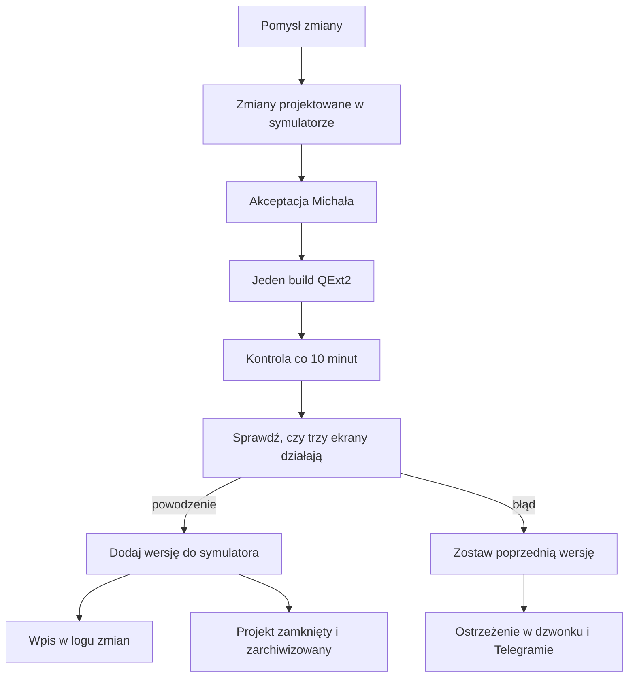

# Symulator pól QExt2 i log zmian

## Co to jest

To podgląd w Garażu, który pokazuje trzy przykładowe ekrany Karoo: KOKPIT 2, STATS v2 i INFO. Możesz wybrać wersję, obejrzeć zapis zmian w QExt2, a od 22.10.2026 także **zmiany projektowane** — wygląd pól, który dopiero ma trafić do buildu. To symulacja wyglądu i przykładowych danych, a nie podgląd na żywo z licznika.

## Po co

Użyj symulatora, gdy chcesz obejrzeć zmianę wyglądu albo nowych pól, zanim trafi na urządzenie. Zmiany projektowane pozwalają ocenić pomysł bez buildów testowych: najpierw akceptacja w QBocie, potem jeden build. Log pomaga sprawdzić, którego wydania dotyczy podgląd i czy automatyczna aktualizacja symulatora się powiodła.

## Skąd dane

Wizualizacja pól jest przenoszona z kodu ekranów QExt2. Dane w symulowanych polach pochodzą ze scenariusza w przeglądarce. Część wartości jest przykładowa i może być uzupełniona automatycznie po dodaniu nowych pól. Nie pochodzą one wtedy z czujników Karoo ani z bazy QBota.

Automat śledzi nowe zmiany i sprawdza, czy nowy podgląd się uruchamia. Wątek działa razem z usługą WWW i sprawdza zmiany co 10 minut. Błąd aktualizacji zostawia poprzedni wygląd i może dodać ostrzeżenie do dzwonka oraz wysłać wiadomość Telegram.

Zmiany projektowane leżą w osobnym miejscu (kopia wersji bazowej), którego automat nie dotyka. Ich lista i warianty do wyboru są w pliku projektu.

## Jak liczone

1. Otwórz Garaż i wybierz zakładkę QExt2. Symulator pokazuje trzy ekrany obok siebie oraz scenariusze jazdy.
2. Wybierz wersję w polu „Build w symulatorze”. Lista obejmuje wersje zebrane od rozpoczęcia logu; starsza wersja służy do porównania.
3. Gdy jest aktywny projekt, u góry pojawia się przełącznik „Obecny build | Zmiany projektowane”. W projekcie widać listę punktów zmian i pigułki wariantów (np. kolor prędkości) — wybór działa od razu. Wybrany scenariusz zostaje przy przełączaniu, więc porównujesz ten sam moment jazdy.
4. Wybierz scenariusz, aby zobaczyć, jak przykładowe dane wpływają na pola i komunikaty.
5. Przejrzyj „Log zmian QExt2”. Wpis pokazuje dzień, godzinę, wersję lub skrót zmiany, opis oraz stan symulatora.
6. Po zaakceptowaniu projektu zmiany są przenoszone do QExt2, powstaje jeden build, automat dodaje go do logu, a projekt jest zamykany i archiwizowany.

## Gdzie to widać

Garaż → QExt2 otwiera symulator w ramce na stronie. Bezpośrednio: `/qext2-makieta.html?b=projekt` (projekt) albo `?b=<skrót>` (build).

## Jak czytać

- „Zmiany projektowane” to wygląd planowany — na Karoo nic się nie zmienia, dopóki projekt nie trafi do buildu.
- Status punktu: „w projekcie”, „zaakceptowane”, „odrzucone”.
- „Nowy wygląd w symulatorze” oznacza, że nowy zestaw pól jest dostępny w podglądzie. Nie potwierdza instalacji ani działania tego wydania na Karoo.
- „Wygląd z poprzedniego buildu” oznacza, że automat nie przygotował podglądu dla najnowszej zmiany.
- Komunikaty i mapa są poglądowe.

## Decyzje i historia

- 18.10.2026: symulator w zakładce QExt2 w Garażu — trzy widoki i historia zmian w jednym miejscu.
- 22.10.2026: zmiany projektowane w tym samym symulatorze — bez buildów testowych; najpierw oglądanie w QBocie, potem jeden build.

## Ograniczenia i pułapki

- Ekrany pokazują przeniesiony wygląd, a nie aplikację uruchomioną na urządzeniu; Karoo 3 jest ok. 2× gęstszy niż monitor.
- Wartości i komunikaty scenariusza są przykładowe.
- Numer wydania może nie być od razu znany serwerowi; log może najpierw pokazać skrót zmiany.

## Wpływa na / Zależy od

- **Wpływa na:** podgląd zmian ekranów QExt2, decyzję o buildzie i informację o problemie z aktualizacją symulatora.
- **Zależy od:** dostępności katalogu zmian, automatu odświeżającego, pliku projektu i przykładowych scenariuszy.

## Powiązane hasła

- [QExt2 i Karoo](index.md)
- [KOKPIT 2 i ustawienia](kokpit2.md)
- [Komunikaty KOKPIT 2](komunikaty.md)
- [Garaż](../garaz/index.md)
- [Automaty](../system/automaty.md)

## Zrodla

- `/opt/qbot/app/docs/QEXT2_SYMULATOR.md` — zakres symulatora, zmiany projektowane, ograniczenia.
- `/opt/qbot/app/scripts/qext2_watch.py` — harmonogram odświeżania, log zmian i wynik kontroli.
- `/opt/qbot/app/scripts/qext2_projekt.py` — start, test, zrzut, różnica i zamknięcie projektu.
- `/opt/qbot/web/public/garaz-qext2.js` — zakładka QExt2 w Garażu.
- `/opt/qbot/web/public/qext2-makieta.html`, `qext2-makieta.js` — wybór wersji, przełącznik projektu, warianty, scenariusze i podgląd ekranów.
- `/opt/qbot/web/public/qext2-sim/projekt/projekt.json` — punkty i warianty bieżącego projektu.
- `/opt/qbot/app/qbot_web.py` — wątek kontroli zmian uruchamiany razem z usługą WWW.
