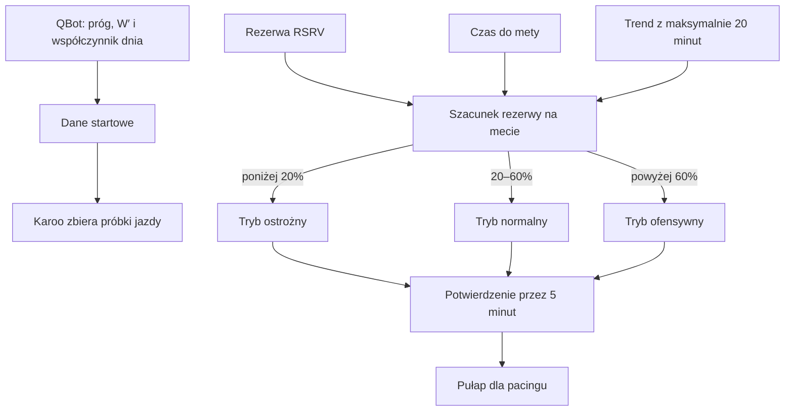

# Tryb AUTO

## Co to jest

AUTO to strategia jazdy w QExt2, która dobiera tryb pułapu mocy podczas jazdy. QBot przekazuje dane początkowe, a decyzję o zmianie podejmuje Karoo. AUTO nie oznacza, że QBot na bieżąco steruje mocą ani że urządzenie zna rzeczywistą przyszłość trasy.

## Po co

Tryb pomaga utrzymać pułap dopasowany do aktualnego tempa zużywania rezerwy i przewidywanego czasu do mety. Właściciel może użyć go zamiast ręcznego przełączania między wariantem ostrożnym, normalnym i ofensywnym. Wynik pozostaje wskazówką treningową; nie zastępuje oceny samopoczucia, warunków ani planu jazdy.

## Skąd dane

Na początku jazdy QBot może przekazać próg mocy, pojemność W′ ([zapas pracy ponad progiem](../modelq/hie.md)) oraz współczynnik dnia wyprowadzony z gotowości ModelQ. Karoo dokłada własne próbki wysiłku, procent rezerwy RSRV, przebytą trasę i szacowany czas do mety. Bez trasy lub czasu do mety prognoza rezerwy na koniec nie ma podstaw.

Skrót RSRV oznacza rezerwę wyliczaną przez QExt2; wyjaśnienie znajduje się w [słowniczku](../slowniczek.md#rsrv). ETA to przewidywany czas przyjazdu ([słowniczek](../slowniczek.md#eta)). W wymianie danych zachowała się starsza nazwa pola progu; QBot wypełnia je wartością progu [TP ModelQ](../modelq/tp.md). Nie jest to odrębny próg.

## Jak liczone

1. QBot przekazuje wartość progu i W′, jeśli ma je dostępne. Jeśli wartość z ModelQ nie istnieje, odpowiednie pole może pozostać puste.
2. Karoo śledzi rezerwę RSRV i czas do mety. Do prognozy używa trendu z maksymalnie ostatnich 20 minut.
3. Gdy prognozowana rezerwa na mecie jest poniżej 20%, kod wybiera wariant ostrożny. Powyżej 60% wybiera ofensywny. Pomiędzy tymi wartościami wybiera normalny.
4. Kandydat musi utrzymać się przez 5 minut, zanim urządzenie zmieni tryb. Ten czas ogranicza przełączanie po krótkim wahaniu pomiarów.
5. Bez trasy, czasu do mety lub 10 minut historii urządzenie pozostaje przy trybie normalnym.

Przykład z bazy pokazuje zakres danych po zakończeniu jazdy, ale nie rejestruje decyzji AUTO: 16.10.2026 zapisano minimum rezerwy 40% i wartość końcową 83% w 4 026 próbkach. Z samych tych dwóch liczb nie da się odtworzyć prognozy na mecie ani ustalić, jaki tryb AUTO obowiązywał. Wartości progów AUTO powyżej pochodzą z kodu urządzenia, nie z tego przykładu.

Wzór

W uproszczeniu urządzenie przedłuża obserwowany trend rezerwy do przewidywanego czasu do mety. Dokładne liczenie trendu i jego zabezpieczenia są częścią kodu QExt2. QBot nie wykonuje tego obliczenia, dlatego nie podaję wzoru udającego, że wynika on z danych QBota.

## Gdzie to widać

Tryb AUTO ustawia się w QExt2 na Karoo. Skutek jest widoczny pośrednio w pułapie oraz kolorze pola mocy na KOKPIT 2. Dostępny zrzut SETUP QBota pokazuje samą zakładkę „QExt2 (Karoo)”, nie ekran ustawień AUTO.

## Jak czytać

- **Ostrożny** oznacza niższy pułap od normalnego. **Ofensywny** oznacza wyższy pułap. W kodzie odpowiadają im mnożniki 0,88 i 1,12; normalny ma 1,00.
- Jeśli rezerwa spada szybko, pułap może obniżyć się także przez działanie samego pacingu. Nie należy zakładać, że każde obniżenie oznacza zmianę AUTO.
- Zmiana wymaga utrzymania nowej decyzji przez pięć minut. Krótki skok wyniku nie powinien od razu przełączyć trybu.
- Brak trasy albo ETA oznacza brak przewidywanego końca jazdy; kod pozostaje wtedy przy trybie normalnym.

## Decyzje i historia

Kod QExt2 opisuje wspólne działanie trendu rezerwy i pułapu. Spadek rezerwy zmniejsza pułap w mechanizmie pacingu, dlatego AUTO nie nakłada dodatkowej kary 0,88 wyłącznie z powodu niskiej rezerwy. To ogranicza podwójne obniżenie pułapu. QBot wysyła współczynnik dnia bez przycinania go do zakresu używanego tylko przez jeden z mechanizmów po stronie Karoo.

## Ograniczenia i pułapki

- Prognoza opiera się na krótkim trendzie i może się zmieniać wraz z trasą oraz wysiłkiem.
- Sam końcowy zapis rezerwy nie pokazuje chwilowych decyzji AUTO.
- Dokładna odpowiedź przekazana aktywnemu urządzeniu nie została przechwycona w tej weryfikacji.
- > DO SPRAWDZENIA: przykład komunikatu diagnostycznego z aktywnego Karoo, który potwierdzi aktualny tryb i prognozowaną rezerwę mety.

## Wpływa na / Zależy od

- Tryb wybrany na Karoo zmienia pułap wykorzystywany w [pacingu](pacing.md), a przez to ocenę koloru mocy.
- Zależy od danych początkowych QBota, rezerwy, trasy, ETA i wystarczająco długiej historii pomiarów.
- Sam tryb nie zmienia zapisanych danych treningowych ani planu w QBot.

## Powiązane hasła

- [QExt2 i Karoo](index.md)
- [Przepływ jazdy](przeplyw-jazdy.md)
- [Pacing](pacing.md)
- [KOKPIT 2 i ustawienia](kokpit2.md)
- [Próg TP](../modelq/tp.md)
- [Słowniczek](../slowniczek.md)

## Zrodla

- `/opt/qbot/app/qbot_api.py` — `_modelq_ftp_ltp`, `_modelq_today_factor`, budowa odpowiedzi `/ride-readiness`.
- `/opt/qbot/app/fitmodel/readiness.py` — źródło `readiness_score`.
- `/opt/qbot/qext2_deploy/app/src/main/kotlin/com/qext2/primary/active/AdaptiveModeTracker.kt` — progi AUTO, okno i potwierdzenie zmiany.
- `/opt/qbot/qext2_deploy/app/src/main/kotlin/com/qext2/primary/engine/RideDataAggregator.kt` — przekazanie trybu do jazdy.
- `qbot_v2.fitmodel_qext2_ride` — zapis jazdy z 16.10.2026, przykład rezerwy, bez historii decyzji AUTO.
