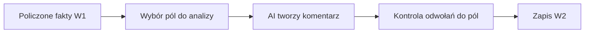

# Analiza AI raportu

## Co to jest

Analiza AI to tekstowy komentarz generowany na podstawie gotowych danych W1. Nie jest zrodlem pomiarow ani alternatywnym kalkulatorem raportu.

## Po co

Uklada dane o obciazeniu, zapasie W′, tempie, terenie, sprzecie i samopoczuciu w czytelne podsumowanie.

## Skad dane

Modul W2 przekazuje AI ograniczony zestaw danych W1 i wymaga cytowania pol zrodlowych. Odpowiedz ma werdykt, najwazniejsze fakty, sekcje syntezy i wnioski na kolejny raz.

## Jak liczone

W odczycie z 18.10.2026 najnowszy raport jazdy (`24766557671`) ma zapisane W2. Siedem poprzednich wierszy nie ma W2, więc obecność analizy nie jest potwierdzona dla każdej jazdy.

## Gdzie to widac

W panelu analizy jazdy, jesli dla danej aktywnosci jest zapisane W2.

## Jak czytac

AI ma opisywac fakty z W1. Brak bloku AI nie znaczy, ze brak danych liczbowych. Warto sprawdzic cytowane wartosci w kartach raportu.

## Decyzje i historia

Kod jest podstawa tego opisu. Jezeli starsza dokumentacja opisuje inna regule, rozstrzyga aktualny kod.

## Ograniczenia i pulapki

Instrukcja AI i format odpowiedzi sa w kodzie. Sam fakt, ze modul istnieje, nie potwierdza, ze analiza powstaje dla kazdej jazdy lub ze jest zawsze dostepna.

## Wplywa na / Zalezy od

- Wplywa na: ekran raportu jazdy, a w czesci przypadkow opis publikowany na Stravie.
- Zalezy od: danych FIT, zapisanego raportu oraz danych ModelQ lub dodatkowego zrodla wskazanego przy wyniku.

## Jak czytać werdykt

1. Wybierz ikonę informacji lub analizę przy raporcie. Zrzut z 18.10.2026 pokazuje werdykt pod podstawowymi liczbami.
2. Werdykt mówi m.in. o tym, czy plan dystansu i obciążenia został trafiony. Na przykładzie ekranowym tekst odnotowuje nierówną jazdę po porannej gotowości −0,96 i świeżości −16,5.
3. Otwórz szczegóły i porównaj każde stwierdzenie z liczbą lub odcinkiem jazdy. Analiza ma opisywać fakty z raportu; nie zastępuje pomiarów.
4. Dla jazdy z 18.10.2026 w bazie W2 istnieje. Nie oznacza to, że każda jazda ma taki komentarz.

## Powiazane hasla

- [Raport jazdy](index.md)
- [Plik FIT](plik-fit.md)
- [Analiza jazdy](analiza-jazdy.md)
- [W′bal](../modelq/wprime-bal.md)
- [TP](../modelq/tp.md)

## Zrodla

['`/opt/qbot/app/qbot3/rides/ride_report_w2.py` — `W2_SYSTEM`, `build_w2`', '`/opt/qbot/app/qbot3/rides/ride_report_builder.py` — zapis `w2_json`', '`qbot_v2.ride_report_data` — `w2_json`']
