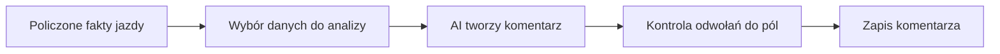
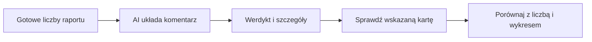

# Analiza AI raportu

## Co to jest

Analiza AI (sztuczna inteligencja; [słowniczek](../slowniczek.md#ai-sztuczna-inteligencja)) to tekstowy komentarz generowany na podstawie gotowych danych. [W1 i W2 raportu jazdy](../slowniczek.md#w1-i-w2-raportu-jazdy) to odpowiednio część liczbowa oraz jej opcjonalny komentarz. Analiza nie jest źródłem pomiarów ani osobnym kalkulatorem raportu.

## Po co

Uklada dane o obciazeniu, zapasie W′, tempie, terenie, sprzecie i samopoczuciu w czytelne podsumowanie.

## Skad dane

Moduł analizy przekazuje sztucznej inteligencji ograniczony zestaw danych liczbowych i wymaga odwołania do ich źródeł. Odpowiedź ma werdykt, najważniejsze fakty, syntezę i wnioski na kolejny raz.

## Jak liczone

W odczycie z 18.10.2026 raport jazdy ma zapisany komentarz AI. Siedem poprzednich raportów w badanym zestawie go nie miało, więc obecność analizy nie jest potwierdzona dla każdej jazdy.

## Gdzie to widac

W panelu analizy jazdy, jesli dla danej aktywnosci jest zapisane W2.

## Jak czytac

AI ma opisywac fakty z W1. Brak bloku AI nie znaczy, ze brak danych liczbowych. Warto sprawdzic cytowane wartosci w kartach raportu.

## Decyzje i historia

Kod jest podstawa tego opisu. Jezeli starsza dokumentacja opisuje inna regule, rozstrzyga aktualny kod.

## Ograniczenia i pulapki

Instrukcja AI i format odpowiedzi sa w kodzie. Sam fakt, ze modul istnieje, nie potwierdza, ze analiza powstaje dla kazdej jazdy lub ze jest zawsze dostepna.

## Wplywa na / Zalezy od

- Wplywa na: ekran raportu jazdy, a w czesci przypadkow opis publikowany na Stravie.
- Zalezy od: danych FIT, zapisanego raportu oraz danych ModelQ lub dodatkowego zrodla wskazanego przy wyniku.

## Jak czytać werdykt

1. Wybierz ikonę informacji lub analizę przy raporcie. Zrzut z 18.10.2026 pokazuje werdykt pod podstawowymi liczbami.
2. Werdykt mówi m.in. o tym, czy plan dystansu i obciążenia został trafiony. Na przykładzie ekranowym tekst odnotowuje nierówną jazdę po porannej gotowości −0,96 i świeżości −16,5.
3. Otwórz szczegóły i porównaj każde stwierdzenie z liczbą lub odcinkiem jazdy. Analiza ma opisywać fakty z raportu; nie zastępuje pomiarów.
4. Dla jazdy z 18.10.2026 w bazie W2 istnieje. Nie oznacza to, że każda jazda ma taki komentarz.

## Po co i jak korzystać

Komentarz ma skrócić drogę od wielu wykresów do kilku rzeczy wartych sprawdzenia. Zacznij od werdyktu, a potem otwórz wspomnianą kartę. Jeśli tekst mówi o zapasie, porównaj go z serią zapasu; jeśli mówi o nawierzchni, sprawdź pokrycie i klasę trasy. Werdykt sam w sobie nie jest czujnikiem.

Przykład z raportu 18.10.2026: AI opisuje, że plan jazdy został wykonany niemal dokładnie, ale jazda rozpoczęła się ze zmęczeniem. Baza potwierdza osobno plan 50,4 km i wykonanie 53,9 km, a raport zapisuje świeżość −16,5. To są trzy różne dane. Nie należy odczytywać komentarza jako stwierdzenia, że każda część planu została wykonana co do kilometra.

## Jak sprawdzać zdanie po zdaniu

1. Zaznacz w komentarzu konkretną liczbę lub nazwę odcinka.
2. Otwórz kartę, której dotyczy, i sprawdź jednostkę oraz źródło.
3. Jeśli komentarz opisuje trend, obejrzyj serię na całej osi jazdy, nie tylko punkt minimum.
4. Gdy karta i komentarz się różnią, pierwszeństwo ma zapis liczbowy raportu. Zapisz rozbieżność jako ograniczenie; tekst może być skrótem lub zawierać błąd.

W2 (opis AI drugiej warstwy raportu; [słowniczek](../slowniczek.md#w2)) nie musi istnieć dla każdej aktywności. Odczyt bazy wykazał, że najnowszy raport z 18.10.2026 ma W2; siedem wcześniejszych raportów w tym sprawdzeniu go nie miało. To migawka odczytu, nie gwarancja przyszłej dostępności.

## Ograniczenia

Analiza opisuje dane, które dostała. Gdy dany fragment nie ma pomiaru, a klasyfikacja nawierzchni jest niepewna, sam płynny tekst nie usuwa tej niepewności. Opis Strava jest odrębnym, krótszym tekstem publikacyjnym i ma własne zasady prywatności.

## Powiazane hasla

- [Raport jazdy](index.md)
- [Plik FIT](plik-fit.md)
- [Analiza jazdy](analiza-jazdy.md)
- [W′bal](../modelq/wprime-bal.md)
- [TP](../modelq/tp.md)

## Zrodla

- `/opt/qbot/app/qbot3/rides/ride_report_w2.py` — instrukcja W2 i `build_w2`.
- `/opt/qbot/app/qbot3/rides/ride_report_builder.py` — zapis raportu.
- `qbot_v2.ride_report_data` — gotowe fakty i komentarz W2.
