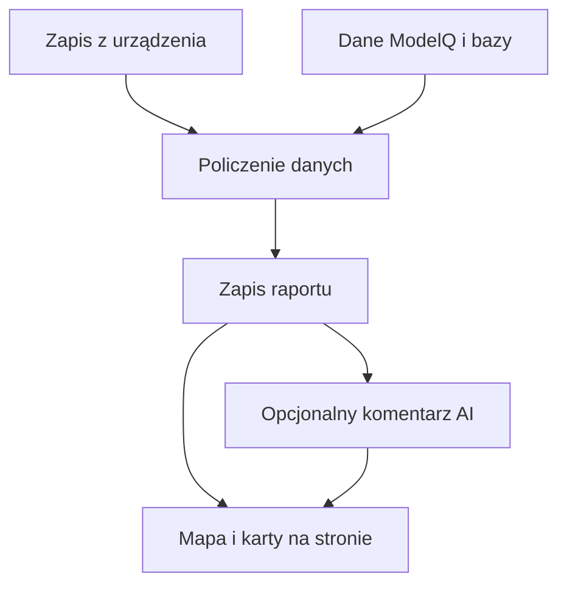
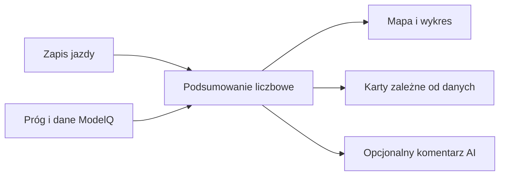

# Analiza jazdy

## Co to jest

Raport jazdy zbiera pomiary z jednej aktywności, obliczone wskaźniki i dodatkowe informacje o trasie. [W1 i W2 raportu jazdy](../slowniczek.md#w1-i-w2-raportu-jazdy) to odpowiednio część liczbowa oraz opcjonalny komentarz AI.

## Po co

Pozwala obejrzec wysilek, przebieg jazdy, warunki i wybrane szczegoly sprzetu w jednym miejscu.

## Skad dane

QBot odczytuje plik FIT (zapis aktywności; [słowniczek](../slowniczek.md#fit)) oraz dołącza dane ModelQ i inne dostępne źródła. Następnie zapisuje raport liczbowy. Komentarz AI powstaje osobno i może go nie być.

## Jak liczone

1. QBot odczytuje zapis jazdy. Dla przykładu 18.10.2026 urządzenie dostarczyło pomiary mocy, tętna i pozycji.
2. QBot dołącza próg ModelQ oraz dostępne informacje z innych źródeł.
3. Raport wylicza między innymi średnią moc 154 W, NP (moc znormalizowaną; [słowniczek](../slowniczek.md#np)) 175 W i IF (stosunek NP do progu; [słowniczek](../slowniczek.md#if)) 0,72. Obciążenie wynosi 126,6 punktu, wyświetlane po zaokrągleniu jako 127.
4. Od 18.10.2026 fakty aerodynamiczne raportu korzystają ze wspólnego kanonu CdA/Crr. Podział energii zależny od substratu używa TP (próg mocy; [hasło TP](../modelq/tp.md)) ModelQ zamiast stałej wartości 253 W.
4. Strona rysuje mapę, wykres i dostępne karty. Komentarz AI jest oddzielny i może pojawić się później.

## Gdzie to widac

Na stronie `/raport-jazdy.html`, w widoku mapy i widoku analizy.

## Jak czytac

Wyniki mają opis źródła. Sprawdź go, zwłaszcza gdy karta łączy pomiar z urządzenia i obliczenie ModelQ. Liczby to dane raportu; komentarz AI może ich streścić, ale nie zastępuje ich.

## Decyzje i historia

Kod jest podstawa tego opisu. Jezeli starsza dokumentacja opisuje inna regule, rozstrzyga aktualny kod.

## Ograniczenia i pulapki

Nie każda jazda ma wszystkie sekcje. W odczycie z 18.10.2026 raport z tego dnia miał komentarz AI, a siedem wcześniejszych wierszy w badanym zestawie go nie miało. Karty są tworzone zależnie od dostępnych danych.

## Wplywa na / Zalezy od

- Wplywa na: ekran raportu jazdy, a w czesci przypadkow opis publikowany na Stravie.
- Zalezy od: danych FIT, zapisanego raportu oraz danych ModelQ lub dodatkowego zrodla wskazanego przy wyniku.

## Jak przejść przez ekran

1. Wybierz jazdę z listy u góry po lewej. Zrzut pokazuje zapis z 18.10.2026, rozpoczęty o 10:24 w Markach.
2. Przeczytaj podstawowe liczby. W tym raporcie dystans wynosi 53,9 km, czas ruchu 2:26, a prędkość ruchu 22,1 km/h. Czas całkowity wynosi 2:41, bo obejmuje 15 minut postojów.
3. Otwórz wybraną ikonę obok podsumowania, aby zobaczyć kartę ze szczegółami. Dostępne dane zależą od tego, co zapisano dla jazdy.
4. Zmieniaj serie na wykresie i warstwę mapy. Kliknięcie odcinka pozwala porównać jego liczby z całą jazdą.

Mapa i wykres nie są osobnymi pomiarami: pokazują pozycje i próbki zapisane podczas jazdy. Pionowy pasek ikon otwiera karty, a górny selektor mapy wybiera kolor śladu. Na telefonie układ jest węższy, ale zrzut mobilny pokazuje tę samą stronę: [raport jazdy na telefonie](../img/ekrany/raport-jazdy__mobile.png).

Przykład wykonania krok po kroku: zrzut z 18.10.2026 pokazuje 53,9 km, czas ruchu 2:26 i czas całkowity 2:41. Różnica około 15 minut to postoje. Średnia prędkość w ruchu wynosi 22,1 km/h; liczona przez cały czas daje 20,0 km/h. Przy porównaniu dwóch jazd używaj tego samego rodzaju czasu i prędkości.

## Po co i jak czytać

Raport odpowiada na pytania: jak długa była jazda, jak zmieniała się moc, gdzie odbywał się wysiłek i jakie dodatkowe dane udało się dopasować. Zacznij od daty i nazwy aktywności. Następnie sprawdź źródło interesującej cię wartości i dopiero potem wyciągaj wniosek.

Werdykt może wspomnieć o planie, gotowości albo terenie. Otwórz wskazaną kartę, aby sprawdzić liczby. Jeśli widzisz tylko wykonanie, nie zakładaj, że raport ma dopasowany plan. Jeśli brakuje karty, może brakować danych wejściowych dla tej jazdy.

Wzór

Średnia prędkość całkowita to dystans podzielony przez cały czas. Średnia w ruchu używa czasu, w którym urządzenie rejestrowało prędkość powyżej progu postoju. Dla 18.10.2026: 53,9 km ÷ 2,69 h ≈ 20,0 km/h oraz 53,9 km ÷ 2,44 h ≈ 22,1 km/h.

## Powiazane hasla

- [Raport jazdy](index.md)
- [Plik FIT](plik-fit.md)
- [Analiza jazdy](analiza-jazdy.md)
- [W′bal](../modelq/wprime-bal.md)
- [TP](../modelq/tp.md)

## Zrodla

- `/opt/qbot/app/qbot3/rides/ride_report_builder.py` — budowanie i zapis raportu.
- `/opt/qbot/app/scripts/rebuild_ride_reports.py` — przebudowa raportów.
- `/opt/qbot/web/public/raport-jazdy.html` — widoki mapy i analizy.
- `qbot_v2.ride_report_data` — zapisane liczby i komentarz AI.
