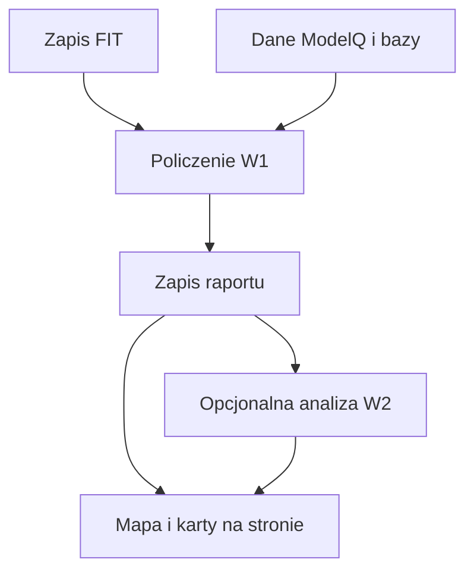

# Analiza jazdy

## Co to jest

Raport jazdy to zapis podsumowania pomiarow i dodatkowych obliczen dla jednej aktywnosci. Strona odczytuje gotowy raport z bazy.

## Po co

Pozwala obejrzec wysilek, przebieg jazdy, warunki i wybrane szczegoly sprzetu w jednym miejscu.

## Skad dane

Kod buduje blok W1 z pliku FIT oraz bazy QBota, zapisuje go w `qbot_v2.ride_report_data`. Blok W2 z analiza AI jest osobny i moze nie istniec.

## Jak liczone

Krok po kroku: QBot odczytuje rekordy FIT; dolacza dane ModelQ i inne dostepne zrodla; liczy bloki raportu; zapisuje raport; strona rysuje mape, wykres i karty. Przyklad z bazy: jazda 16.10.2026, klucz `24745225177`, ma dystans 24,2 km, NP 179 W, IF 0,75 i XSS 69,7. Raport zbudowano 17.10.2026.

## Gdzie to widac

Na stronie `/raport-jazdy.html`, w widoku mapy i widoku analizy.

## Jak czytac

Wyniki maja oznaczenie zrodla i poziomu danych. W1 to policzone dane; W2 to komentarz AI.

## Decyzje i historia

Kod jest podstawa tego opisu. Jezeli starsza dokumentacja opisuje inna regule, rozstrzyga aktualny kod.

## Ograniczenia i pulapki

Nie kazda jazda ma wszystkie sekcje. Przyklad z 16.10.2026 nie mial zapisanego W2 w chwili odczytu. Automatyczna przebudowa moze zachowac poprzednie W2, ale zwykle zapisanie nowego W1 bez przekazania W2 usuwa analize AI.

## Wplywa na / Zalezy od

- Wplywa na: ekran raportu jazdy, a w czesci przypadkow opis publikowany na Stravie.
- Zalezy od: danych FIT, zapisanego raportu oraz danych ModelQ lub dodatkowego zrodla wskazanego przy wyniku.

## Jak przejść przez ekran

1. Wybierz jazdę z listy u góry po lewej. Zrzut pokazuje zapis z 18.10.2026, rozpoczęty o 10:24 w Markach.
2. Przeczytaj podstawowe liczby. W tym raporcie dystans wynosi 53,9 km, czas ruchu 2:26, a prędkość ruchu 22,1 km/h. Czas całkowity wynosi 2:41, bo obejmuje 15 minut postojów.
3. Otwórz wybraną ikonę obok podsumowania, aby zobaczyć kartę ze szczegółami. Dostępne dane zależą od tego, co zapisano dla jazdy.
4. Zmieniaj serie na wykresie i warstwę mapy. Kliknięcie odcinka pozwala porównać jego liczby z całą jazdą.

Mapa i wykres nie są osobnymi pomiarami: pokazują pozycje i próbki zapisane podczas jazdy. Pionowy pasek ikon otwiera karty, a górny selektor mapy wybiera kolor śladu. Na telefonie układ jest węższy, ale zrzut mobilny pokazuje tę samą stronę: [raport jazdy na telefonie](../img/ekrany/raport-jazdy__mobile.png).

## Powiazane hasla

- [Raport jazdy](index.md)
- [Plik FIT](plik-fit.md)
- [Analiza jazdy](analiza-jazdy.md)
- [W′bal](../modelq/wprime-bal.md)
- [TP](../modelq/tp.md)

## Zrodla

['`/opt/qbot/app/qbot3/rides/ride_report_builder.py` — `build_w1`, `save_report`', '`/opt/qbot/app/scripts/rebuild_ride_reports.py` — zachowanie `w2_json` podczas przebudowy', '`/opt/qbot/web/public/raport-jazdy.html` — widoki mapy i analizy', '`qbot_v2.ride_report_data` — `w1_json`, `w2_json`, `built_at`']
