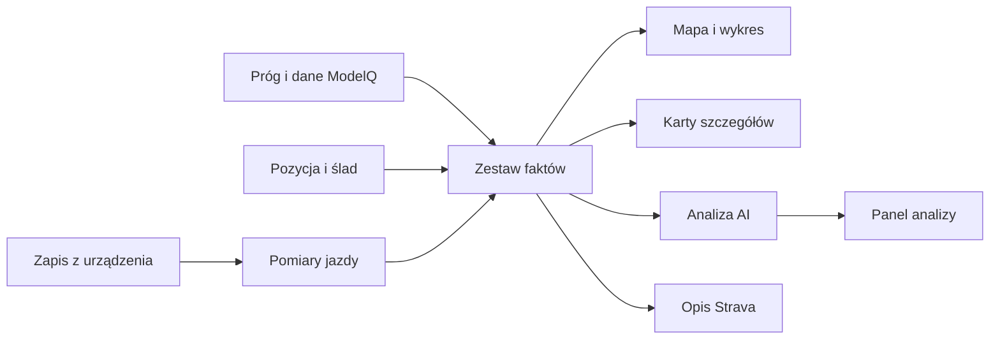

# Raport jazdy

Raport jazdy pokazuje, co zarejestrowało urządzenie, jak wyglądał wysiłek na trasie i które dodatkowe informacje udało się dołączyć. Główna część ekranu łączy mapę z wykresem; panel po lewej podaje podsumowanie, a pionowy pasek ikon otwiera szczegóły.

Na zrzucie jest jazda z Marek z 18.10.2026. W lewym panelu widać dystans 53,9 km, czas 2:26, prędkość 22,1 km/h, moc 154 W, próg 241 W i obciążenie. Werdykt jest pod kartą z danymi. Kolorowy ślad na mapie pokazuje wybraną warstwę „strefa mocy”. Dolny wykres ma wspólną oś odległości: przyciski nad nim pozwalają włączać serie, a po prawej wybiera się warstwy i korelację. Dokładne znaczenie obciążenia i mocy opisują [NP i IF](np-if.md) oraz [W′bal](wprime-bal.md).

## Droga od jazdy do ekranu

W1 oznacza policzone fakty jazdy. AI może osobno przygotować W2, czyli opisową analizę tych faktów. Brak W2 nie usuwa mapy ani pomiarów.

## Co widzisz na ekranie

| Na ekranie | Co to mówi | Hasło |
|---|---|---|
| Dystans, czas, prędkość, moc | Podstawowe podsumowanie jazdy | [Analiza jazdy](analiza-jazdy.md) |
| Wysokość i przewyższenie | Profil wysokości w czasie jazdy oraz suma podejść | [Przewyższenie](przewyzszenie.md) |
| Tętno i próg tętna | Zarejestrowane tętno; próg służy do czytania stref, jeśli jest dostępny | [Plik FIT](plik-fit.md) |
| Próg i procent zapasu | Porównanie wysiłku z progiem oraz stan zapasu | [NP i IF](np-if.md), [W′bal](wprime-bal.md) |
| Zapas i jego przebieg | Wartość minimalna albo seria w czasie; źródło może się różnić | [W′bal](wprime-bal.md) |
| Praca i tempo jej wydatkowania | Energia wykonanej pracy oraz średnia na godzinę | [Analiza jazdy](analiza-jazdy.md), [Plik FIT](plik-fit.md) |
| Kadencja i biegi | Obrót pedałów oraz przełożenie, gdy pomiary są dostępne | [Plik FIT](plik-fit.md) |
| Temperatura i wiatr | Warunki zapisane lub dołączone do jazdy; wiatr może być wyliczony względem kierunku śladu | [Analiza jazdy](analiza-jazdy.md) |
| Kolorowy ślad i wybór „warstwy” | Miejsce jazdy i wybrana informacja rysowana na śladzie | [Analiza jazdy](analiza-jazdy.md) |
| Dolny wykres i kolorowe przyciski | Pomiary wzdłuż trasy; widoczne serie można włączać i wyłączać | [Plik FIT](plik-fit.md) |
| Werdykt | Krótka synteza planu, wysiłku i kontekstu | [Analiza AI](analiza-ai.md) |
| Ikony po prawej stronie panelu | Dodatkowe karty, m.in. moc, tętno, pogoda, sprzęt | [Analiza jazdy](analiza-jazdy.md) |
| „Z kim jechałem” oraz „Ubiór / rower” | Dane towarzyszy oraz sprzęt przypisany do aktywności | [Analiza jazdy](analiza-jazdy.md) |
| Prędkość, kadencja, temperatura, rozwinięcie, momenty | Przyciski serii wykresu; włączają i wyłączają dostępne przebiegi | [Plik FIT](plik-fit.md) |
| Przewyższenie | Suma podejść przypisana do wykonanej jazdy | [Przewyższenie](przewyzszenie.md) |
| Nawierzchnia | Udział rozpoznanych typów podłoża | [Nawierzchnia jazdy](nawierzchnia-jazdy.md) |
| Porównanie planu z jazdą | Pokazuje się, gdy uda się dopasować zapisany plan | [Plan a wykonanie](plan-wykonanie.md) |
| Tekst opublikowany przy aktywności | Krótszy opis z wybranych faktów raportu | [Opis Strava](opis-strava.md) |

> DO SPRAWDZENIA: pełna lista kart przypisanych do ikon na zrzucie i ich kolejność, ponieważ część opisów powstaje dynamicznie dla wybranej jazdy.

## Jak korzystać

Najpierw sprawdź datę i nazwę jazdy w lewym górnym rogu. Następnie wybierz serię na wykresie i porównaj jej przebieg z mapą. Jeśli interesuje Cię fragment, kliknij wykres lub ślad; panel odcinka pokazuje statystyki zaznaczonego zakresu. Wartości z jazdy mogą pochodzić z różnych źródeł, dlatego czytaj także podpis pod kartą.

Przykład z 18.10.2026: ekran pokazuje moc średnią 154 W, NP 175 W i próg 241 W. IF wynosi 0,72, bo 175 ÷ 241 ≈ 0,73 (różnica wynika z zaokrągleń wartości wyświetlanych). Prędkość ruchu to 22,1 km/h, a brutto 20,0 km/h, bo czas brutto uwzględnia postoje.

## Powiązane hasła

- [Analiza jazdy](analiza-jazdy.md)
- [Plik FIT](plik-fit.md)
- [NP i IF](np-if.md)
- [W′bal](wprime-bal.md)
- [Nawierzchnia jazdy](nawierzchnia-jazdy.md)
- [Plan a wykonanie](plan-wykonanie.md)
- [Analiza AI](analiza-ai.md)
- [Opis Strava](opis-strava.md)

## Wpływa na / Zależy od

- Wpływa na: widok raportu, karty i wykres jazdy; wybrane fakty mogą być użyte w analizie AI i opisie Strava.
- Zależy od: pomiarów aktywności, śladu GPS, zapisanych danych ModelQ oraz dostępności opcjonalnych analiz.

## Zrodla

- `/opt/qbot/app/qbot3/rides/ride_report_builder.py` — `build_w1`, `save_report`, sekcje `load`, `trace`, `surface`, `plan_vs_actual`.
- `/opt/qbot/app/qbot3/rides/ride_report_w2.py` — `build_w2`.
- `/opt/qbot/web/public/raport-jazdy.html` — układ raportu i karty.
- `/opt/qbot/web/public/raport-jazdy2-ws.js` — mapa, serie wykresu, warstwy i wybór odcinka.
- `/opt/qbot/web/public/raport-jazdy3-rail.js` — pasek ikon i panele.
- `qbot_v2.ride_report_data` — zapisany raport W1/W2.
