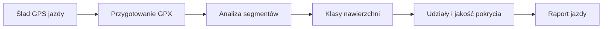
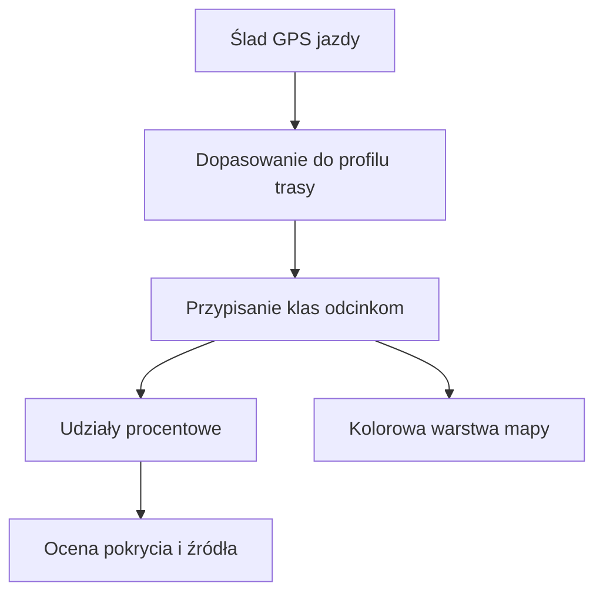

# Nawierzchnia jazdy

## Co to jest

Raport szacuje udzial roznych rodzajow nawierzchni na podstawie sladu GPS wykonanej jazdy.

## Po co

Pozwala zobaczyc, jaka czesc sladu przypadla na asfalt, gravel lub trudniejsze odcinki.

## Skad dane

Silnik nawierzchni analizuje GPX przygotowany ze sladu GPS. Wynik ma piec klas, a kazdy raport zapisuje tez zrodlo oraz udzial odcinkow oznaczonych, wnioskowanych i nieznanych.

## Jak liczone

W raporcie z jazdy 16.10.2026 wynik wynosil: twarda szybka 80,3%, zwykly gravel 1,7%, trudna/wolna 3,5%, ryzyko/niepewne 14,5%. Udzial oznaczony wyniosl 81,2%, nieznany 6,1%, a wnioskowany 12,7%.

## Gdzie to widac

Karta nawierzchni, mapa oraz rozklad wysilku wedlug typu nawierzchni.

## Jak czytac

Procenty klas nawierzchni to udzial dystansu, a nie czasu jazdy. Czytaj razem z udzialem oznaczonym/nieznanym.

## Decyzje i historia

Kod jest podstawa tego opisu. Jezeli starsza dokumentacja opisuje inna regule, rozstrzyga aktualny kod.

## Ograniczenia i pulapki

Dokumentacja Strava grupuje klasy inaczej: asfalt, szuter i „ujeby”. To warstwa opisu publikacji i nie jest identyczna z piecioma klasami surowego raportu. Dla czesci odcinkow silnik wnioskuje klase, zamiast miec bezposredni tag.

## Wplywa na / Zalezy od

- Wplywa na: ekran raportu jazdy, a w czesci przypadkow opis publikowany na Stravie.
- Zalezy od: danych FIT, zapisanego raportu oraz danych ModelQ lub dodatkowego zrodla wskazanego przy wyniku.

## Jak czytać warstwę

1. Wybierz warstwę nawierzchni na mapie lub ikonę szczegółów. Na zrzucie głównym mapa jest ustawiona na strefę mocy, a nie nawierzchnię.
2. Raport z 16.10.2026 rozdzielił dystans na: twardą szybką 80,3%, zwykły gravel 1,7%, trudną/wolną 3,5% i ryzyko/niepewne 14,5%.
3. Te cztery udziały sumują się do 100%. Osobne 81,2% oznaczone, 12,7% wnioskowane i 6,1% nieznane opisują pewność/pochodzenie klasyfikacji, nie dodatkowe rodzaje drogi.
4. Jeśli duży fragment jest nieznany lub niepewny, traktuj podział jako niepełny opis podłoża, a nie gwarancję warunków na drodze.

## Co dokładnie oznaczają procenty

W raporcie z 18.10.2026 klasy zajmują: twarda szybka 54,7%, zwykły gravel 20,1%, trudna/wolna 20,2% oraz ryzyko/niepewne 5,0%. Suma wynosi 100%. To podział odległości przypisanej do klas.

W tym samym raporcie przy danych nawierzchni zapisano, że 96,4% śladu znalazło się w odległości do 60 m od dopasowanej trasy. Klasyfikacja ma źródło w profilu tej trasy. Wartość 100% oznaczonych danych nie występuje tu: kod zapisał pełne pokrycie oznaczone 100% w jednym polu dla tego przykładu, a nieznane 0% w polu odrębnym. Pokrycie dopasowania GPS opisuje inną rzecz niż podział klas.

## Jak użyć przy wyborze trasy

1. Otwórz mapę i wybierz warstwę nawierzchni, jeśli jest dostępna dla tej jazdy.
2. Zobacz udział trudnej/wolnej oraz ryzyka. W przykładzie 18.10 te dwie klasy razem stanowią 25,2% dystansu.
3. Porównaj z opisem odcinków na mapie. Procent sam nie mówi, gdzie znajduje się trudny fragment.
4. Sprawdź pole nieznane i notę źródła. Gdy brakuje danych, nie traktuj pozostałych udziałów jako opisu całej drogi bez zastrzeżeń.

Klasy w krótkim opisie Strava są grupowane na potrzeby publikacji. Tam trudna/wolna i ryzyko/niepewne mogą wejść do jednej grupy określonej w dokumencie publikacji jako „ujeby”. Jest to tekstowy skrót i nie zmienia nazw klas na wykresie raportu.

Wzór

Udział klasy = długość segmentów tej klasy ÷ łączna długość sklasyfikowanych segmentów × 100%. Dla przykładu z 18.10 suma klas raportu to 54,7 + 20,1 + 20,2 + 5,0 = 100,0%.

## Powiazane hasla

- [Raport jazdy](index.md)
- [Plik FIT](plik-fit.md)
- [Analiza jazdy](analiza-jazdy.md)
- [W′bal](../modelq/wprime-bal.md)
- [TP](../modelq/tp.md)

## Zrodla

- `/opt/qbot/app/qbot3/rides/ride_report_builder.py` — `_surface_and_wind`, `_surface_wind_from_track`, `_surface_from_route_canonical`.
- `/opt/qbot/app/tools/rwgps/route_surface_engine.py` — analiza śladu jazdy.
- `qbot_v2.ride_report_data` — zapisane źródło, udziały i pokrycie nawierzchni.
