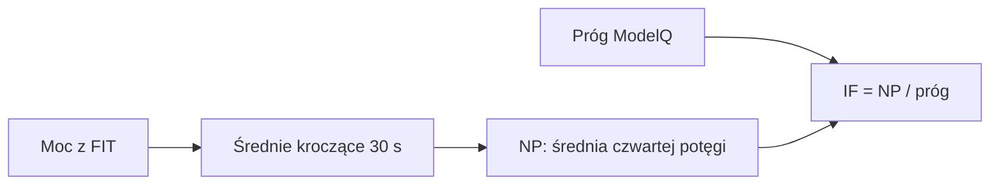

# NP i IF

## Co to jest

NP to moc znormalizowana: wynik z wygladzonej mocy, ktory silniej uwzglednia dluzsze mocne odcinki. IF porownuje NP z progiem uzytym przez raport.

## Po co

Pomaga rozroznic jazde rowna od jazdy z mocnymi zrywami i ocenic intensywnosc wzgledem progu.

## Skad dane

Moc jest czytana z FIT, a prog raport pobiera z ModelQ. W kodzie pole nazywa sie `ftp_w`, ale komentarz raportu wyjasnia, ze wartosc jest progiem TP ModelQ.

## Jak liczone krok po kroku

Dla jazdy 16.10.2026 baza zawiera NP 179 W, prog 238 W i IF 0,75. Dzielenie 179 przez 238 daje okolo 0,75. To przyklad z jednego dnia, nie stala wartosc progu.

## Gdzie to widac

W karcie intensywnosci i obciazenia w analizie raportu; rowniez w analizie AI, jesli jest dostepna.

## Jak czytac

IF 0,75 znaczy, ze NP tej jazdy wyniosla okolo 75% progu zapisanego dla obliczenia. Sam IF nie opisuje calego wysilku: warto patrzec tez na czas, XSS i wykres.

## Decyzje i historia

Kod jest podstawa tego opisu. Jezeli starsza dokumentacja opisuje inna regule, rozstrzyga aktualny kod.

## Ograniczenia i pulapki

Kod uzywa starej nazwy pola `ftp_w`, lecz wartosc pobiera z `fitmodel_daily.ftp_est_w`; dokumentacja ModelQ nazywa ten prog TP. Minimum krotsze niz 30 probek ma w obliczeniu NP uproszczony sposob.

## Wplywa na / Zalezy od

- Wplywa na: ekran raportu jazdy, a w czesci przypadkow opis publikowany na Stravie.
- Zalezy od: danych FIT, zapisanego raportu oraz danych ModelQ lub dodatkowego zrodla wskazanego przy wyniku.

## Jak liczone

1. Raport odczytuje próbki mocy z jazdy z 18.10.2026. W tej jeździe średnia moc wynosi 154 W.
2. Dla NP (mocy znormalizowanej, która mocniej uwzględnia dłuższe mocne fragmenty; [słowniczek](../slowniczek.md#np)) raport zapisuje 175 W.
3. Próg użyty dla tej jazdy wynosi 241 W. Dzielenie widocznych, zaokrąglonych wartości 175 ÷ 241 daje 0,726, czyli około 0,73. Ekran i zapisany raport podają IF 0,72. Nie mam dokładniejszych liczb wejściowych, które pozwoliłyby wyjaśnić różnicę.
4. Użyty próg jest oznaczony jako ModelQ. Nie nazywamy go FTP; starsze nazwy pól w danych nie zmieniają znaczenia wyświetlanej wartości.

Porównanie trzech wartości z raportu: [wykres mocy i progu z 18.10.2026](../img/raport-jazdy-moc-20261018.svg). Długość słupka pokazuje liczbę watów, nie czas trwania wysiłku.

> DO SPRAWDZENIA: rozbieżność 0,72 wobec dzielenia zaokrąglonych 175/241; do wyjaśnienia trzeba odczytać niezaokrąglone wejścia dla tej jazdy.

## Powiazane hasla

- [Raport jazdy](index.md)
- [Plik FIT](plik-fit.md)
- [Analiza jazdy](analiza-jazdy.md)
- [W′bal](../modelq/wprime-bal.md)
- [TP](../modelq/tp.md)

## Zrodla

['`/opt/qbot/app/qbot3/rides/ride_report_builder.py` — `_np`, `_load`, `_modelq_form`', '`qbot_v2.fitmodel_daily` — `ftp_est_w`', '`qbot_v2.ride_report_data` — `load.np_w`, `load.if`']
