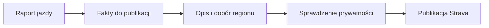
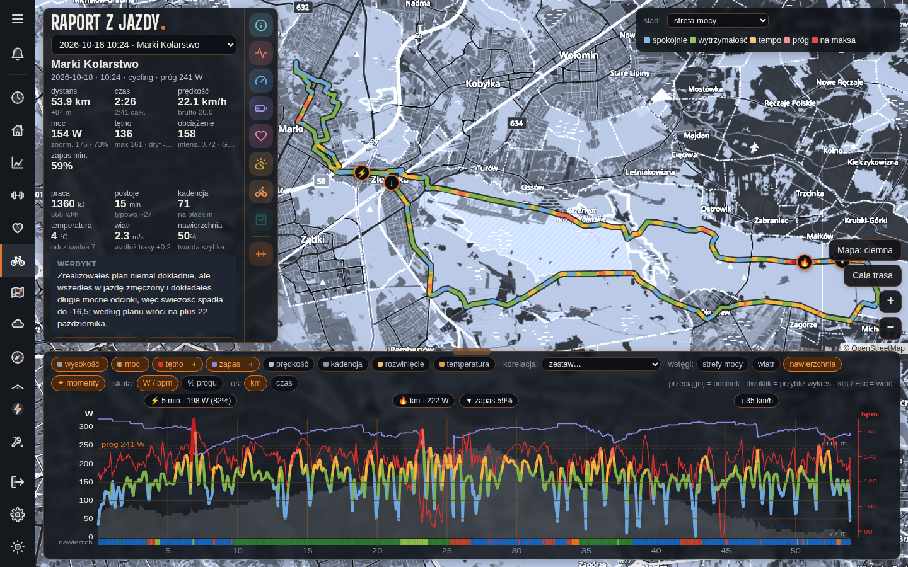

# Opis jazdy na Stravie

## Co to jest

Automat QBot moze uzupelniac opis aktywnosci Strava krotkim podsumowaniem jazdy. Opis Strava ma inne zasady niz pelny raport i analiza AI.

## Po co

Pozwala dodac do aktywnosci region, dystans, przewyzszenie, udzial nawierzchni i krotka ocene wysilku.

## Skad dane

`qbot_strava_publish.py` czerpie fakty z raportu jazdy, dobiera region i atrakcje z dostepnych list, a AI wybiera tylko sposrod tych danych. Automat nadpisuje pole opisu. Regula prywatnosci wyklucza W′bal oraz informacje zdrowotne.

## Jak liczone

Dokumentacja `STRAVA_PUBLISH.md` podaje przyklad z 04.10.2026 i progi klasyfikacji, ale nie weryfikowalem tego przykladu ponownie w bazie. W dokumencie pojawia sie FTP; aktualny kod raportu pobiera prog ModelQ i nie odczytuje FTP jako osobnego wyniku.

## Gdzie to widac

W polu opisu aktywnosci Strava; status publikacji zapisywany jest osobno.

## Jak czytac

To skrocony opis publiczny, nie kopia wszystkich wykresow i wnioskow raportu. Moze brakowac opisu lub roweru, gdy automat czeka na dane albo rozpoznanie jest niepewne.

## Decyzje i historia

Kod jest podstawa tego opisu. Jezeli starsza dokumentacja opisuje inna regule, rozstrzyga aktualny kod.

## Ograniczenia i pulapki

`docs/STRAVA_PUBLISH.md` opisuje mechanizm z 09.10.2026. Aktualny kod ma tez nowe reguly dla jazd bez czujnikow. Sam dokument nie potwierdza bieżącego harmonogramu uslugi. Do publikacji potrzebne sa zgody Strava i wlaczony automat.

## Wplywa na / Zalezy od

- Wplywa na: ekran raportu jazdy, a w czesci przypadkow opis publikowany na Stravie.
- Zalezy od: danych FIT, zapisanego raportu oraz danych ModelQ lub dodatkowego zrodla wskazanego przy wyniku.

## Jak powstaje opis

1. Automat zbiera wybrane fakty gotowej jazdy, między innymi dystans, podejścia i dostępny opis nawierzchni.
2. Dla 18.10.2026 raport zawiera 53,9 km i 1360 kJ pracy; to przykład danych wejściowych, nie potwierdzenie, że opis tej jazdy został opublikowany.
3. Tekst na Stravie jest krótszy od raportu i nie zawiera wszystkich wykresów ani każdej karty.
4. Nie wolno wnioskować o publikacji tylko z obecności raportu. Stan publikacji jest osobnym zapisem i wymaga sprawdzenia przy konkretnej aktywności.

## Powiazane hasla

- [Raport jazdy](index.md)
- [Plik FIT](plik-fit.md)
- [Analiza jazdy](analiza-jazdy.md)
- [W′bal](../modelq/wprime-bal.md)
- [TP](../modelq/tp.md)

## Zrodla

['`/opt/qbot/app/qbot_strava_publish.py` — `build_facts`, `assemble`, `classify_bike`, `set_bike`', '`/opt/qbot/app/docs/STRAVA_PUBLISH.md` — format i zasady publikacji', '`qbot_v2.ride_report_data` — zrodlo danych raportu', '`qbot_v2.strava_publish` — stan publikacji']
