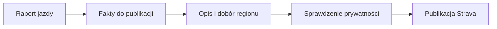
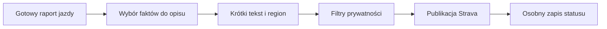

# Opis jazdy na Stravie

## Co to jest

Automat QBot moze uzupelniac opis aktywnosci Strava krotkim podsumowaniem jazdy. Opis Strava ma inne zasady niz pelny raport i analiza AI.

## Po co

Pozwala dodac do aktywnosci region, dystans, przewyzszenie, udzial nawierzchni i krotka ocene wysilku.

## Skad dane

Automat publikacyjny czerpie fakty z raportu jazdy, dobiera region i atrakcje z dostępnych list, a sztuczna inteligencja (AI; [słowniczek](../slowniczek.md#ai-sztuczna-inteligencja)) wybiera tylko spośród tych danych. Automat nadpisuje pole opisu. Reguła prywatności wyklucza W′bal oraz informacje zdrowotne.

## Jak powstaje opis krok po kroku

1. Automat dopasowuje jazdę QBota do aktywności Strava po czasie startu. Dla przykładu z 18.10.2026 odczyt bazy ma stan publikacji „ok” i czas wysłania 15:52.
2. Z gotowego raportu pobiera wybrane fakty. Jazda z 18.10 miała 53,9 km i 216 m podejść; jej raport zawiera też opis nawierzchni.
3. Klasy nawierzchni są grupowane do krótszych nazw publikacyjnych. Wysilku opis nie odtwarza z jednego kafla: kod używa własnych percentyli z historii.
4. Wartości W′bal (zapas wysiłku podczas jazdy; [słowniczek](../slowniczek.md#w-prime-bal)) i dane zdrowotne są wykluczone z tekstu publicznego.
5. Automat zapisuje osobny status. Dla jazdy 18.10.2026 status to „ok”, jedna próba, publikacja o 15:52. Obecność raportu sama w sobie nie dowodzi publikacji; w tym przykładzie dowód pochodzi z odrębnego rekordu stanu.

## Gdzie to widac

W polu opisu aktywnosci Strava; status publikacji zapisywany jest osobno.

## Jak czytac

To skrocony opis publiczny, nie kopia wszystkich wykresow i wnioskow raportu. Moze brakowac opisu lub roweru, gdy automat czeka na dane albo rozpoznanie jest niepewne.

## Decyzje i historia

Kod jest podstawa tego opisu. Jezeli starsza dokumentacja opisuje inna regule, rozstrzyga aktualny kod.

## Ograniczenia i pulapki

Opis przeznaczony na Stravę nie pokazuje zapasu W′bal ani danych zdrowotnych. Wymagania połączenia i działania automatu opisuje dokumentacja publikacji; rekord „ok” potwierdza konkretną publikację, ale nie bieżącą autoryzację na przyszłość.

## Wplywa na / Zalezy od

- Wplywa na: ekran raportu jazdy, a w czesci przypadkow opis publikowany na Stravie.
- Zalezy od: danych FIT, zapisanego raportu oraz danych ModelQ lub dodatkowego zrodla wskazanego przy wyniku.

## Po co i jak czytać

Opis na Stravie jest krótką wizytówką aktywności. Ma pomóc innym szybko zobaczyć dystans, podejścia, wybrane informacje o podłożu i ogólny charakter wysiłku. Pełny wykres i szczegóły pozostają na stronie raportu.

Przed wyciąganiem wniosków sprawdź aktywność i jej datę. Jeśli nie ma opisu, możliwe, że automat jeszcze czeka na dane albo publikacja zakończyła się błędem. Jeśli stan jest „ok”, konkretny zapis mówi, że automat zakończył publikację; nie potwierdza, że wszystkie opcjonalne fakty znalazły się w tekście.

Nie publikuj w opisie wskaźników prywatnych. Kod wyłącza z niego W′bal i informacje zdrowotne. Opis nie zawiera też surowego szeregu mocy ani danych z każdej sekundy.

## Jak powstaje opis

1. Automat zbiera wybrane fakty gotowej jazdy, między innymi dystans, podejścia i dostępny opis nawierzchni.
2. Dla 18.10.2026 raport zawiera 53,9 km i 1360 kJ pracy; to przykład danych wejściowych, nie potwierdzenie, że opis tej jazdy został opublikowany.
3. Tekst na Stravie jest krótszy od raportu i nie zawiera wszystkich wykresów ani każdej karty.
4. Nie wolno wnioskować o publikacji tylko z obecności raportu. Stan publikacji jest osobnym zapisem i wymaga sprawdzenia przy konkretnej aktywności.

## Powiazane hasla

- [Raport jazdy](index.md)
- [Plik FIT](plik-fit.md)
- [Analiza jazdy](analiza-jazdy.md)
- [W′bal](../modelq/wprime-bal.md)
- [TP](../modelq/tp.md)

## Zrodla

- `/opt/qbot/app/qbot_strava_publish.py` — `build_facts`, `assemble`, `classify_bike`, `set_bike`.
- `/opt/qbot/app/docs/STRAVA_PUBLISH.md` — format, filtry prywatności i publikacja.
- `qbot_v2.ride_report_data` — źródło faktów jazdy.
- `qbot_v2.strava_publish` — status konkretnej publikacji.
