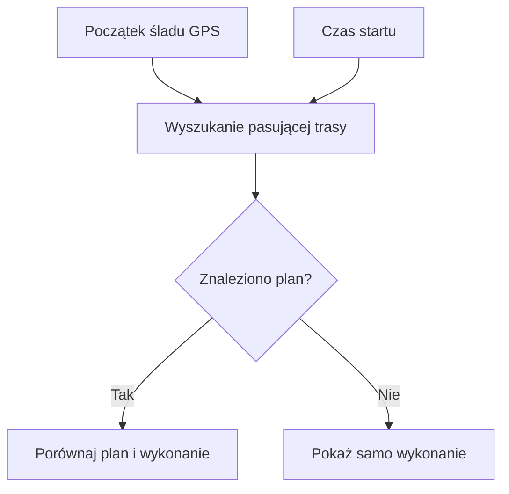
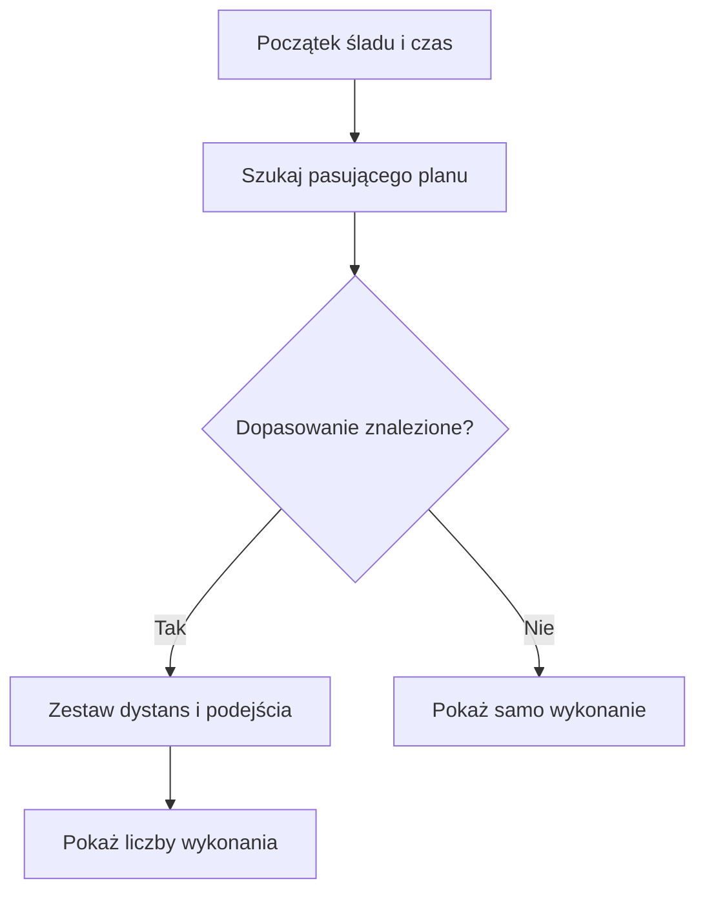

# Plan a wykonanie

## Co to jest

Raport moze zestawic wykonana jazde z pasujacym, zapisanym raportem planowanej trasy.

## Po co

Pomaga porownac dlugosc i przewyzszenie planu z tym, co zostalo zarejestrowane.

## Skad dane

Raport szuka planu na podstawie początkowego położenia GPS (system określania położenia; [słowniczek](../slowniczek.md#gps)) i czasu. Gdy znajdzie dopasowanie, pobiera jego zapisane podsumowanie. Wykonanie obejmuje dystans, przewyższenie, NP, obciążenie i średnią prędkość.

## Jak liczone krok po kroku

Przykład z bazy dotyczy jazdy 18.10.2026.

1. Raport bierze pierwszą dostępną pozycję GPS z jazdy i jej czas. Szuka zaplanowanej trasy zaczynającej się blisko tego miejsca i pasującej czasowo.
2. Dla jazdy z 18.10.2026 dopasowano plan „Wola 6.10”. W planie zapisano 50,4 km i 222 m podejść.
3. Zapis wykonanej jazdy podaje 53,9 km oraz 216 m podejść. Różnica dystansu to 3,5 km więcej niż w planie; różnica podejść to 6 m mniej.
4. Wykonanie pokazuje też NP (moc znormalizowaną; [słowniczek](../slowniczek.md#np)) 175 W, obciążenie 127 punktów i średnią prędkość w ruchu 22,1 km/h. W tym przykładzie zapis planu nie zawiera liczbowego celu mocy.
5. Dla jazdy 04.10.2026 baza także ma oznaczenie dopasowania planu. Nie używam jej jako drugiego przykładu liczbowego, bo odczyt nie obejmował wszystkich potrzebnych wartości planu i wykonania.

Drugi odczyt uzupełnia ten przykład: jazda „Zakroczym Kolarstwo” z 04.10.2026 ma dopasowany plan 104,4 km i 554 m podejść. Wykonanie wynosi 107,2 km i 618 m. Raport podaje też NP 184 W i IF 0,77. Dane potwierdzają, że sekcja planu i wykonania działa dla tej jazdy; nie dowodzą, że każde automatyczne dopasowanie jest trafne.

## Gdzie to widac

Sekcja „Plan vs realny” w analizie raportu. Gdy nie ma dopasowania, widok pokazuje tylko wykonanie.

## Jak czytać

Brak danych planu nie oznacza braku raportu jazdy. To opcjonalne porownanie i wymaga zgodnej trasy w zapisanych raportach.

## Decyzje i historia

Kod jest podstawa tego opisu. Jezeli starsza dokumentacja opisuje inna regule, rozstrzyga aktualny kod.

## Ograniczenia i pulapki

Dopasowanie jest wyszukiwaniem po pozycji startowej i czasie. Kod nie gwarantuje, ze kazda jazda do zaplanowanej trasy zostanie skojarzona.

## Wplywa na / Zalezy od

- Wplywa na: ekran raportu jazdy, a w czesci przypadkow opis publikowany na Stravie.
- Zalezy od: danych FIT, zapisanego raportu oraz danych ModelQ lub dodatkowego zrodla wskazanego przy wyniku.

## Po co i jak czytać

To porównanie pomaga odpowiedzieć na proste pytanie: czy wykonana jazda miała podobny dystans i sumę podejść do trasy, którą QBot uznał za pasującą? Nie jest oceną jakości jazdy. W przykładzie 18.10 dystans był dłuższy o 3,5 km, ale samo to nie mówi, czy zmieniono trasę, czy ślad GPS przeciął start w innym miejscu.

Jeżeli planu nie ma, czytaj tylko kolumnę wykonania. Jeżeli pojawi się niespodziewany plan, sprawdź nazwę trasy oraz datę. Dopasowanie jest automatyczne i oparte na początku śladu oraz czasie; użytkownik może faktycznie przejechać inną trasę.

`TSS` (punkty obciążenia treningowego; [słowniczek](../slowniczek.md#tss)) w przykładzie wynosi 127. To liczba dotycząca wykonanego wysiłku. Nie jest planowanym celem, bo pole planu w tym raporcie go nie zawiera.

Wzór

Różnica dystansu = wykonany dystans − dystans planu. Dla 18.10.2026: 53,9 km − 50,4 km = 3,5 km. Różnica podejść = 216 m − 222 m = −6 m. Raport nie wylicza z tego wspólnej oceny realizacji.

## Co pokazuje porównanie

1. Raport szuka zapisanego planu pasującego do początku śladu i czasu jazdy.
2. Gdy dopasowanie istnieje, zestawia dystans i podejścia planu z wartościami wykonania; może też pokazać moc, obciążenie i prędkość.
3. Gdy planu nie znaleziono, raport nadal pokazuje wykonaną jazdę. Brak porównania nie oznacza, że aktywność jest niekompletna.
4. Nie podaję przykładu liczbowego dopasowanego planu: odczyt bazy w tym etapie nie potwierdził takiego przypadku. Wartości z planu i jazdy nie powinny być porównywane bez pewnego dopasowania.

## Powiazane hasla

- [Raport jazdy](index.md)
- [Plik FIT](plik-fit.md)
- [Analiza jazdy](analiza-jazdy.md)
- [W′bal](../modelq/wprime-bal.md)
- [TP](../modelq/tp.md)

## Wplywa na / Zalezy od

- Wpływa na: opcjonalną sekcję porównania w raporcie jazdy.
- Zależy od: pozycji i czasu początku jazdy oraz zapisanego raportu planu.

## Zrodla

- `/opt/qbot/app/qbot3/rides/ride_report_builder.py` — `_plan_vs_actual`, `_find_matching_route`.
- `qbot_v2.route_report_snapshots` — zapisany plan trasy.
- `qbot_v2.activity_record` — początkowa pozycja GPS.
- `qbot_v2.training_sessions` — dystans, obciążenie i przewyższenie jazdy.
