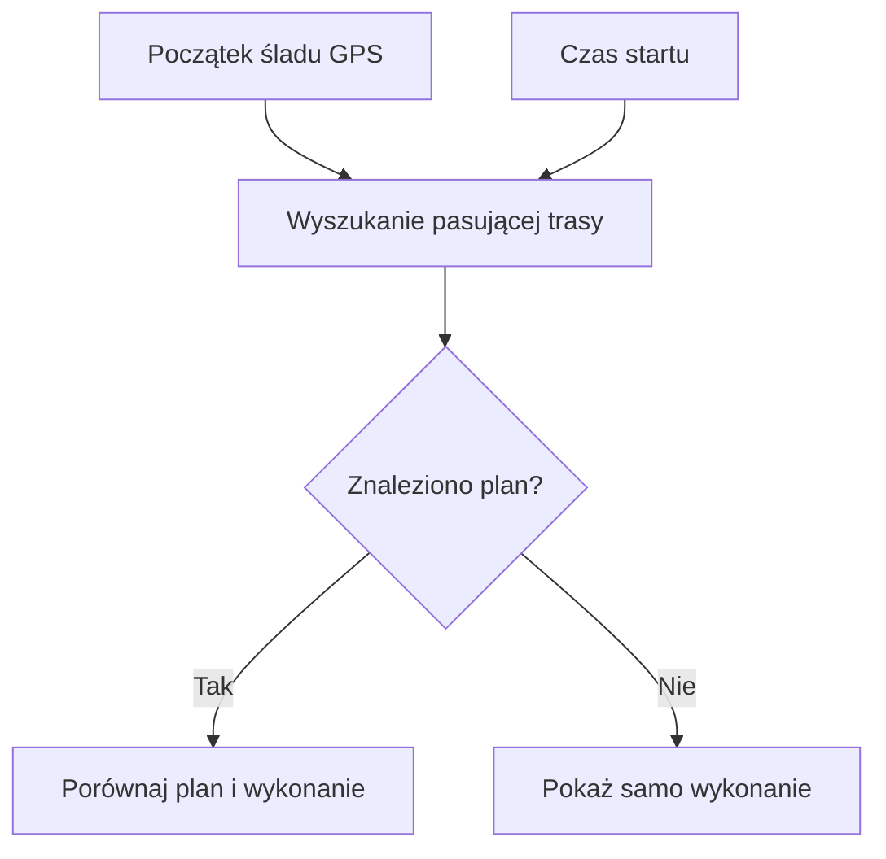

# Plan a wykonanie

## Co to jest

Raport moze zestawic wykonana jazde z pasujacym, zapisanym raportem planowanej trasy.

## Po co

Pomaga porownac dlugosc i przewyzszenie planu z tym, co zostalo zarejestrowane.

## Skad dane

Kod szuka trasy na podstawie poczatkowego polozenia GPS i czasu. Gdy znajdzie dopasowanie, pobiera zapisany zrzut planu. Wykonanie obejmuje dystans, przewyzszenie, NP, obciazenie i srednia predkosc.

## Jak liczone

> DO SPRAWDZENIA: nie potwierdzono w odczycie bazy konkretnego przykladu z dopasowanym planem i wykonaniem, dlatego nie podaje liczb.

## Gdzie to widac

Sekcja „Plan vs realny” w analizie raportu. Gdy nie ma dopasowania, widok pokazuje tylko wykonanie.

## Jak czytac

Brak danych planu nie oznacza braku raportu jazdy. To opcjonalne porownanie i wymaga zgodnej trasy w zapisanych raportach.

## Decyzje i historia

Kod jest podstawa tego opisu. Jezeli starsza dokumentacja opisuje inna regule, rozstrzyga aktualny kod.

## Ograniczenia i pulapki

Dopasowanie jest wyszukiwaniem po pozycji startowej i czasie. Kod nie gwarantuje, ze kazda jazda do zaplanowanej trasy zostanie skojarzona.

## Wplywa na / Zalezy od

- Wplywa na: ekran raportu jazdy, a w czesci przypadkow opis publikowany na Stravie.
- Zalezy od: danych FIT, zapisanego raportu oraz danych ModelQ lub dodatkowego zrodla wskazanego przy wyniku.

## Co pokazuje porównanie

1. Raport szuka zapisanego planu pasującego do początku śladu i czasu jazdy.
2. Gdy dopasowanie istnieje, zestawia dystans i podejścia planu z wartościami wykonania; może też pokazać moc, obciążenie i prędkość.
3. Gdy planu nie znaleziono, raport nadal pokazuje wykonaną jazdę. Brak porównania nie oznacza, że aktywność jest niekompletna.
4. Nie podaję przykładu liczbowego dopasowanego planu: odczyt bazy w tym etapie nie potwierdził takiego przypadku. Wartości z planu i jazdy nie powinny być porównywane bez pewnego dopasowania.

## Powiazane hasla

- [Raport jazdy](index.md)
- [Plik FIT](plik-fit.md)
- [Analiza jazdy](analiza-jazdy.md)
- [W′bal](../modelq/wprime-bal.md)
- [TP](../modelq/tp.md)

## Zrodla

['`/opt/qbot/app/qbot3/rides/ride_report_builder.py` — `_plan_vs_actual`, `_find_matching_route`', '`qbot_v2.route_report_snapshots` — zapisany plan', '`qbot_v2.activity_record` — pozycja startowa', '`qbot_v2.training_sessions` — `tss`, `elevation_m`']
