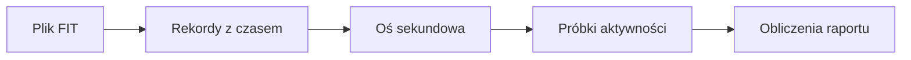
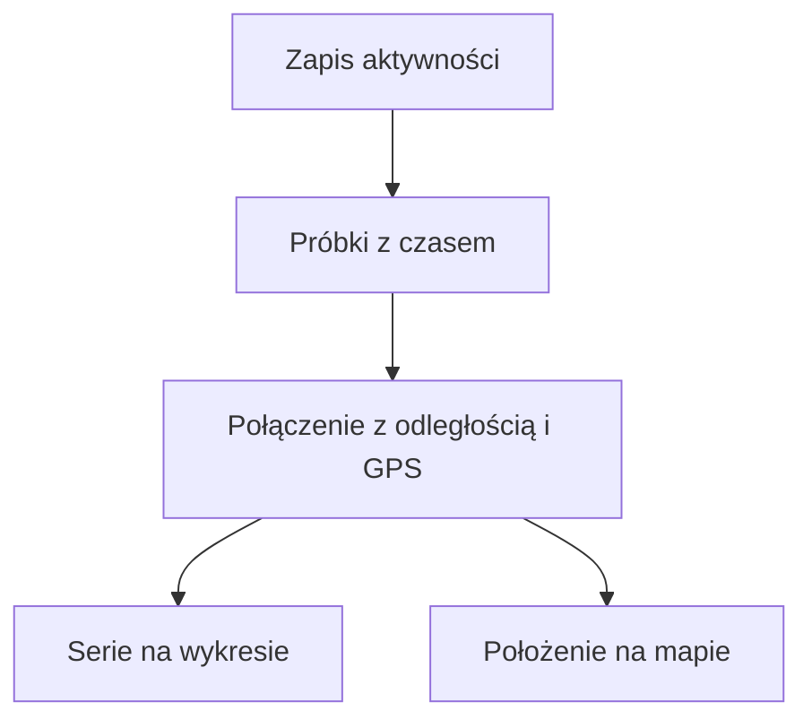

# Plik FIT

## Co to jest

FIT to plik zapisu aktywnosci z urzadzenia. Zawiera pomiary oznaczone czasem, na przyklad moc, tetno, predkosc i polozenie GPS.

## Po co

To podstawowe zrodlo przebiegu jazdy i wielu obliczen w raporcie.

## Skad dane

Importer odczytuje rekordy i układa je na osi czasu co sekundę. Raport obsługuje też dodatkowe pola QExt2 (rozszerzenie danych Karoo; [pola QExt2](../qext2/pola-fit.md)).

## Jak liczone

Przyklad: w raporcie z 16.10.2026 dystans 24,2 km, srednia moc 146 W i NP 179 W maja zrodlo FIT. Raport odczytal takze informacje o biegach i probki GPS tej jazdy.

## Gdzie to widac

Posrednio na stronie raportu: wykres mocy, tetna, predkosci, polozenie, biegi i wartosci podsumowujace.

## Jak czytac

Etykieta zrodla pokazuje, czy liczba pochodzi z FIT, ModelQ lub innego modulu. Brak pomiaru w FIT moze oznaczac brak danej sekcji.

## Decyzje i historia

Kod jest podstawa tego opisu. Jezeli starsza dokumentacja opisuje inna regule, rozstrzyga aktualny kod.

## Ograniczenia i pulapki

Kod importu tworzy os sekundowa; brakujace sekundy pozostawia z pustymi pomiarami. Nie wynika z tego, ze kazdy czujnik dostarczyl wartosc w kazdej sekundzie. Plik moze tez zawierac dodatkowe pola urzadzenia.

## Wplywa na / Zalezy od

- Wplywa na: ekran raportu jazdy, a w czesci przypadkow opis publikowany na Stravie.
- Zalezy od: danych FIT, zapisanego raportu oraz danych ModelQ lub dodatkowego zrodla wskazanego przy wyniku.

## Jak czytać próbki

1. Wybierz na wykresie przebieg mocy. W podsumowaniu jazdy z 18.10.2026 moc średnia to 154 W, a najwyższa zarejestrowana wartość — 671 W.
2. Porównaj go z tętnem, prędkością i kadencją. Brak linii oznacza, że raport nie ma tej serii dla wybranej jazdy.
3. Sprawdź oś odległości i mapę. Położenia w wykresie są łączone z pozycjami GPS, więc można znaleźć, gdzie na trasie wystąpił dany fragment.
4. Traktuj pojedynczy skok jako pomiar z urządzenia, nie jako opis całej jazdy. Średnia za jazdę nie oznacza, że przez cały czas utrzymywała się taka wartość.

## Po co i kiedy

Ten zapis jest przydatny, gdy chcesz ustalić, co działo się w konkretnym miejscu jazdy. Na wykresie ustaw kursor w pobliżu odcinka, a następnie odczytaj odpowiadające mu położenie na mapie. Wspólna oś pozwala powiązać czas i odległość; nie oznacza jednak, że każdy czujnik raportował wartość w każdej sekundzie.

Przykład z 18.10.2026: raport zawiera moc średnią 154 W, maksymalną 671 W i NP (moc znormalizowaną; [słowniczek](../slowniczek.md#np)) 175 W. Maksymalna moc opisuje najwyższą próbkę, a średnia obejmuje całą serię w raporcie. Nie wnioskuj z pojedynczego maksimum, że taki wysiłek trwał dłużej.

## Jak rozpoznać brak pomiaru

1. Wybierz serię, którą chcesz obejrzeć, na przykład tętno.
2. Sprawdź, czy wykres ma linię na interesującym fragmencie. Brak linii może oznaczać brak pomiaru lub brak danej serii w tym raporcie.
3. Sprawdź kartę źródła. Wartość wyliczona albo dołączona z innego systemu może być dostępna mimo braku bezpośredniej próbki w FIT.
4. Przy porównaniu z inną jazdą sprawdź jednostkę, czas ruchu i to, czy obie jazdy mają ten sam typ źródła.

FIT (format zapisu aktywności; [słowniczek](../slowniczek.md#fit)) może zawierać dodatkowe pola producenta. W QBot część pól z rozszerzenia urządzenia jest rozpoznawana, ale sam fakt rozpoznania pola nie potwierdza, że dane urządzenie zawsze je zapisuje.

## Powiazane hasla

- [Raport jazdy](index.md)
- [Plik FIT](plik-fit.md)
- [Analiza jazdy](analiza-jazdy.md)
- [W′bal](../modelq/wprime-bal.md)
- [TP](../modelq/tp.md)

## Zrodla

- `/opt/qbot/app/fitmodel/fit_ingest.py` — `parse_fit_to_seconds`, `_QEXT2_FIELDS`.
- `/opt/qbot/app/qbot3/rides/ride_report_builder.py` — `_parse_fit`, `_load`.
- `qbot_v2.activity_record` — próbki aktywności z oznaczeniem czasu.
