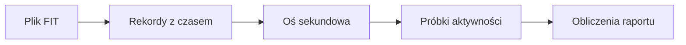

# Plik FIT

## Co to jest

FIT to plik zapisu aktywnosci z urzadzenia. Zawiera pomiary oznaczone czasem, na przyklad moc, tetno, predkosc i polozenie GPS.

## Po co

To podstawowe zrodlo przebiegu jazdy i wielu obliczen w raporcie.

## Skad dane

`fit_ingest` odczytuje rekordy i uklada je na osi czasu co sekunde do tabeli probek. Budowniczy raportu czyta FIT i obsluguje tez dodatkowe pola QExt2.

## Jak liczone

Przyklad: w raporcie z 16.10.2026 dystans 24,2 km, srednia moc 146 W i NP 179 W maja zrodlo FIT. Raport odczytal takze informacje o biegach i probki GPS tej jazdy.

## Gdzie to widac

Posrednio na stronie raportu: wykres mocy, tetna, predkosci, polozenie, biegi i wartosci podsumowujace.

## Jak czytac

Etykieta zrodla pokazuje, czy liczba pochodzi z FIT, ModelQ lub innego modulu. Brak pomiaru w FIT moze oznaczac brak danej sekcji.

## Decyzje i historia

Kod jest podstawa tego opisu. Jezeli starsza dokumentacja opisuje inna regule, rozstrzyga aktualny kod.

## Ograniczenia i pulapki

Kod importu tworzy os sekundowa; brakujace sekundy pozostawia z pustymi pomiarami. Nie wynika z tego, ze kazdy czujnik dostarczyl wartosc w kazdej sekundzie. Plik moze tez zawierac dodatkowe pola urzadzenia.

## Wplywa na / Zalezy od

- Wplywa na: ekran raportu jazdy, a w czesci przypadkow opis publikowany na Stravie.
- Zalezy od: danych FIT, zapisanego raportu oraz danych ModelQ lub dodatkowego zrodla wskazanego przy wyniku.

## Jak czytać próbki

1. Wybierz na wykresie przebieg mocy. W podsumowaniu jazdy z 18.10.2026 moc średnia to 154 W, a najwyższa zarejestrowana wartość — 671 W.
2. Porównaj go z tętnem, prędkością i kadencją. Brak linii oznacza, że raport nie ma tej serii dla wybranej jazdy.
3. Sprawdź oś odległości i mapę. Położenia w wykresie są łączone z pozycjami GPS, więc można znaleźć, gdzie na trasie wystąpił dany fragment.
4. Traktuj pojedynczy skok jako pomiar z urządzenia, nie jako opis całej jazdy. Średnia za jazdę nie oznacza, że przez cały czas utrzymywała się taka wartość.

## Powiazane hasla

- [Raport jazdy](index.md)
- [Plik FIT](plik-fit.md)
- [Analiza jazdy](analiza-jazdy.md)
- [W′bal](../modelq/wprime-bal.md)
- [TP](../modelq/tp.md)

## Zrodla

['`/opt/qbot/app/fitmodel/fit_ingest.py` — `parse_fit_to_seconds`, `_QEXT2_FIELDS`', '`/opt/qbot/app/qbot3/rides/ride_report_builder.py` — `_parse_fit`, `_load`', '`qbot_v2.activity_record` — probki aktywnosci co sekunde']
