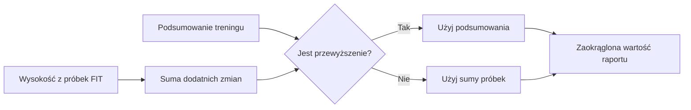

# Przewyzszenie

## Co to jest

Przewyższenie to suma podejść podczas jazdy. Raport pokazuje wartość z podsumowania aktywności, jeśli jest dostępna. FIT (format zapisu aktywności; [słowniczek](../slowniczek.md#fit)) może zawierać pomiary wysokości.

## Po co

Daje skrotowa informacje o tym, ile wzniesien bylo na trasie.

## Skad dane

Raport może policzyć wzrosty wysokości z próbek FIT (zapis aktywności; [słowniczek](../slowniczek.md#fit)). Jeśli ma wartość z podsumowania aktywności, używa jej zamiast własnej sumy.

## Jak liczone

Jazda 18.10.2026 ma 215,713 m w danych źródłowych, a ekran pokazuje 216 m po zaokrągleniu.

## Gdzie to widac

W podsumowaniu jazdy oraz porownaniu planu z wykonaniem.

## Jak czytac

Czytaj jako sume podejsc wybrana przez raport, a nie roznice wysokosci miedzy startem i meta.

## Decyzje i historia

Kod jest podstawa tego opisu. Jezeli starsza dokumentacja opisuje inna regule, rozstrzyga aktualny kod.

## Ograniczenia i pulapki

Wysokość z urządzenia może być niedokładna. W raporcie wartość z podsumowania aktywności ma pierwszeństwo przed sumą policzoną z próbek.

## Wplywa na / Zalezy od

- Wplywa na: ekran raportu jazdy, a w czesci przypadkow opis publikowany na Stravie.
- Zalezy od: danych FIT, zapisanego raportu oraz danych ModelQ lub dodatkowego zrodla wskazanego przy wyniku.

## Jak czytać tę liczbę

1. Odszukaj wartość przewyższenia w podsumowaniu lub porównaniu wykonania.
2. Dla przykładowej jazdy 16.10.2026 zapisany raport podaje 108 m podejść.
3. To suma podejść, a nie wysokość końcowa minus wysokość początkowa. Trasa może więc mieć wiele podejść i zjazdów, mimo że start i meta są na podobnej wysokości.
4. Gdy dostępna jest wartość z podsumowania treningu, raport używa jej zamiast sumy wzrostów wysokości z próbek. Nie należy ręcznie dodawać obu wyników.

## Skąd bierze się wartość

Raport najpierw potrafi zsumować wzrost wysokości w kolejnych próbkach zapisu jazdy. Jeśli podsumowanie aktywności zawiera przewyższenie, raport używa tej wartości zamiast własnej sumy.

Przykład z 18.10.2026 pokazuje wartość źródłową 215,713 m, wyświetlaną jako 216 m. Różnica wynika z zaokrąglenia do pełnego metra. Nie jest to 216 m różnicy między wysokością mety i startu.

W porównaniu z planem ta sama jazda ma planowane 222 m i wykonane 216 m, a więc wykonanie pokazuje o 6 m mniej. To zestawienie podsumowań, nie pomiar wysokości z dokładnością do jednego metra.

Wzór

Jeśli nie ma wartości podsumowania, kod dodaje tylko dodatnie różnice wysokości między kolejnymi próbkami: wzrosty. Zjazdy nie odejmują metrów od sumy podejść. Jeśli wartość podsumowania jest dostępna, używa jej raport zamiast tej sumy.

## Powiazane hasla

- [Raport jazdy](index.md)
- [Plik FIT](plik-fit.md)
- [Analiza jazdy](analiza-jazdy.md)
- [W′bal](../modelq/wprime-bal.md)
- [TP](../modelq/tp.md)

## Zrodla

- `/opt/qbot/app/qbot3/rides/ride_report_builder.py` — `_plan_vs_actual`.
- `qbot_v2.training_sessions` — wysokość podejść z podsumowania aktywności.
- `qbot_v2.ride_report_data` — zapisane podejścia wykonania.
