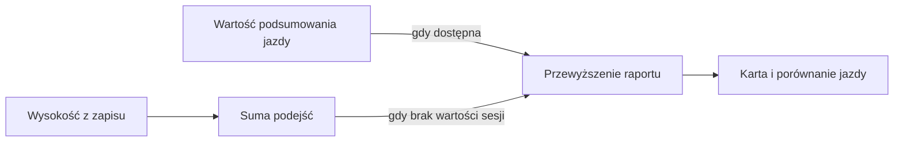

# Przewyzszenie

## Co to jest

Przewyzszenie to suma zarejestrowanych podejsc podczas jazdy. Raport jazdy korzysta z wartosci `elevation_m` zapisanej przy sesji treningowej, gdy jest dostepna.

## Po co

Daje skrotowa informacje o tym, ile wzniesien bylo na trasie.

## Skad dane

W `_plan_vs_actual` kod najpierw potrafi zsumowac wzrost wysokosci z rekordow FIT, a nastepnie zastepuje te sume wartoscia `training_sessions.elevation_m`, jesli baza ja zawiera. Komentarz w kodzie wskazuje, ze to poprawka na zanizanie okolo dwukrotne.

## Jak liczone

Dla jazdy 16.10.2026, klucz `24745225177`, raport zapisal 108 m przewyzszenia.

## Gdzie to widac

W podsumowaniu jazdy oraz porownaniu planu z wykonaniem.

## Jak czytac

Czytaj jako sume podejsc wybrana przez raport, a nie roznice wysokosci miedzy startem i meta.

## Decyzje i historia

Kod jest podstawa tego opisu. Jezeli starsza dokumentacja opisuje inna regule, rozstrzyga aktualny kod.

## Ograniczenia i pulapki

FIT moze miec bledy wysokosci. Wartosci ze sesji i suma probek FIT nie sa w tym kodzie rownorzedne, gdy `elevation_m` jest dostepne.

## Wplywa na / Zalezy od

- Wplywa na: ekran raportu jazdy, a w czesci przypadkow opis publikowany na Stravie.
- Zalezy od: danych FIT, zapisanego raportu oraz danych ModelQ lub dodatkowego zrodla wskazanego przy wyniku.

## Jak czytać tę liczbę

1. Odszukaj wartość przewyższenia w podsumowaniu lub porównaniu wykonania.
2. Dla przykładowej jazdy 16.10.2026 zapisany raport podaje 108 m podejść.
3. To suma podejść, a nie wysokość końcowa minus wysokość początkowa. Trasa może więc mieć wiele podejść i zjazdów, mimo że start i meta są na podobnej wysokości.
4. Gdy dostępna jest wartość z podsumowania treningu, kod raportu używa jej zamiast sumy wzrostów wysokości z próbek FIT. Nie należy ręcznie dodawać obu wyników.

## Powiazane hasla

- [Raport jazdy](index.md)
- [Plik FIT](plik-fit.md)
- [Analiza jazdy](analiza-jazdy.md)
- [W′bal](../modelq/wprime-bal.md)
- [TP](../modelq/tp.md)

## Zrodla

['`/opt/qbot/app/qbot3/rides/ride_report_builder.py` — `_plan_vs_actual`', '`qbot_v2.training_sessions` — `elevation_m`', '`qbot_v2.ride_report_data` — `plan_vs_actual._real.ascent_m`']
