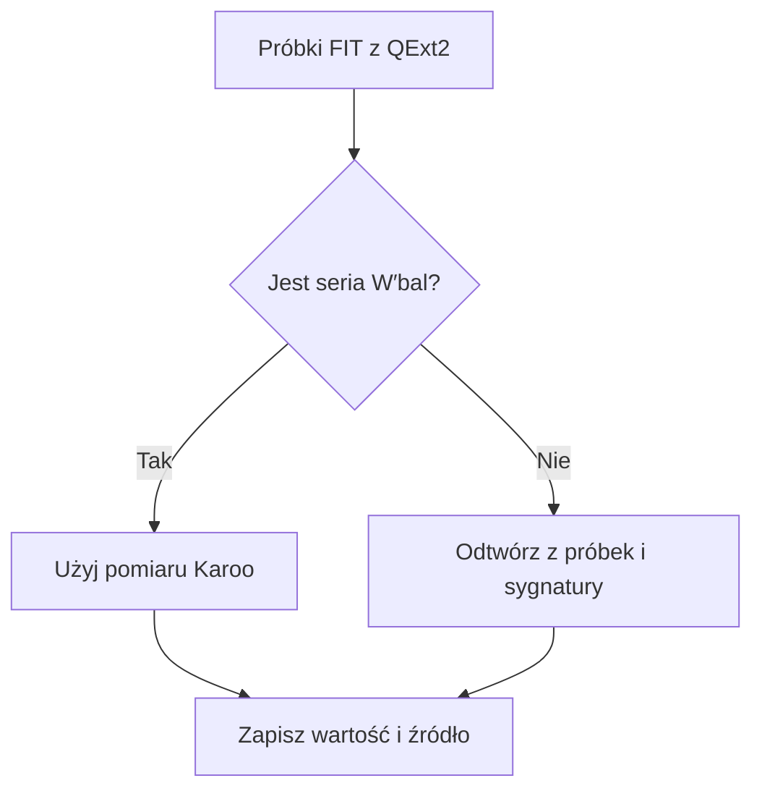

# W′bal Karoo i ModelQ

## Co to jest

W′bal opisuje, jaka czesc zapasu wysilku ponad progiem pozostala w trakcie jazdy. Raport moze pokazac pomiar Karoo/QExt2 albo odtworzenie z probek w bazie.

## Po co

Pomaga zobaczyc, kiedy zapas byl najbardziej zuzyty i czy w trakcie jazdy odtwarzal sie.

## Skad dane

Budowniczy najpierw odczytuje wartosci W′bal z pol FIT przekazanych przez QExt2. Gdy ich brak, kod ma tez sciezki odtworzenia na podstawie `activity_record` i sygnatury ModelQ. Raport zapisuje etykiete zrodla.

## Jak liczone

W raporcie jazdy 16.10.2026 minimum zapisane przez ModelQ2 w polu obciazenia wynosi 41%. Seria Karoo/QExt2 w tej jezdzie ma minimum 40%. To dwa rozne pola i sciezki w jednym raporcie; nie nalezy ich utozsamiac.

## Gdzie to widac

Karta zapasu i wykres raportu. W′bal jest ukrywane w publicznym opisie Strava ze wzgledu na prywatnosc.

## Jak czytac

Zawsze sprawdz oznaczenie zrodla przy wartosci. Procent oznacza czesc zapasu, a nie procent FTP ani mocy.

## Decyzje i historia

Kod jest podstawa tego opisu. Jezeli starsza dokumentacja opisuje inna regule, rozstrzyga aktualny kod.

## Ograniczenia i pulapki

Rownolegly wynik ModelQ2 `min_wbal_pct` i seria Karoo/QExt2 nie musza byc zgodne. W′ to wielkosc z sygnatury ModelQ, W′bal to zmienny stan podczas jazdy.

## Wplywa na / Zalezy od

- Wplywa na: ekran raportu jazdy, a w czesci przypadkow opis publikowany na Stravie.
- Zalezy od: danych FIT, zapisanego raportu oraz danych ModelQ lub dodatkowego zrodla wskazanego przy wyniku.

## Dwa wyniki, które łatwo pomylić

1. W raporcie z 18.10.2026 próg wynosi 241 W, a ModelQ odtwarza osobną serię zapasu z próbek mocy.
2. Jeśli urządzenie przekazało własny zapis W′bal, raport może pokazać także tę serię. Są to dwa źródła danych, nie dwa pomiary tego samego urządzenia.
3. Podpis źródła przy karcie wskazuje, którą drogą powstał wynik. Porównuj tylko wartości z tej samej serii.
4. Na wykresie wybierz serię zapasu; minimum oznacza najniższy stan oszacowany podczas jazdy. Samo minimum nie mówi, jak długo trwało ani jak szybko zapas się odbudował.

## Powiazane hasla

- [Raport jazdy](index.md)
- [Plik FIT](plik-fit.md)
- [Analiza jazdy](analiza-jazdy.md)
- [W′bal](../modelq/wprime-bal.md)
- [TP](../modelq/tp.md)

## Zrodla

['`/opt/qbot/app/qbot3/rides/ride_report_builder.py` — `_wprime`, `_wprime_karoo`', '`/opt/qbot/app/qbot3/rides/ride_report_w2.py` — zasady zrodla W′', '`qbot_v2.modelq2_ride` — `min_wbal_pct`', '`qbot_v2.activity_record` — probki do odtworzenia']
