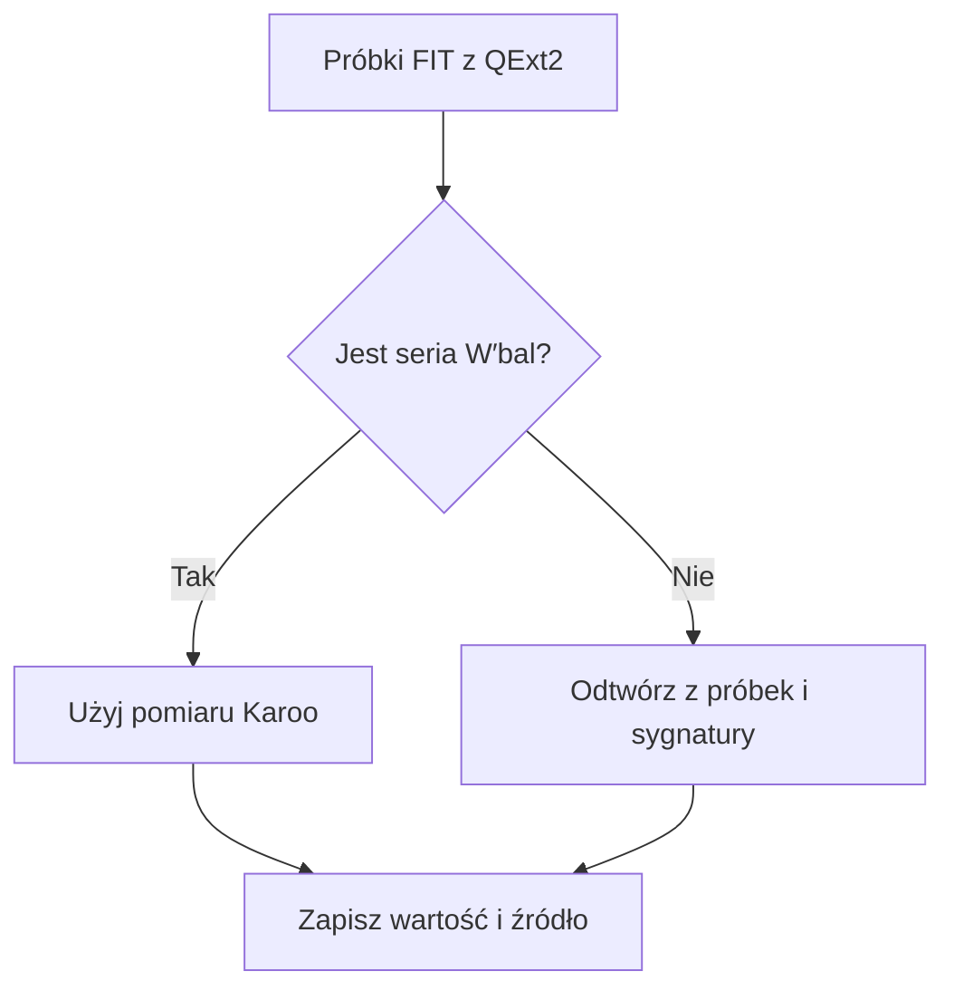
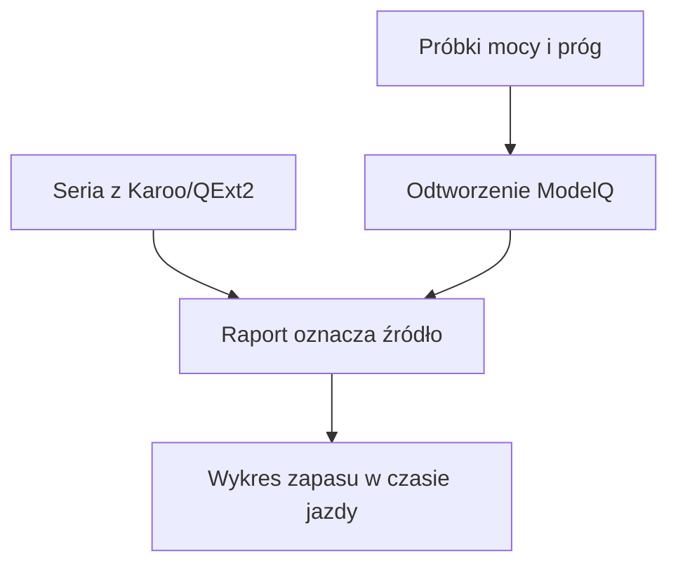

# W′bal Karoo i ModelQ

## Co to jest

W′bal (zmienny zapas pracy ponad progiem; [słowniczek](../slowniczek.md#w-prime-bal)) opisuje, jaka część zapasu została w trakcie jazdy. Raport może pokazać pomiar Karoo/QExt2 albo odtworzenie z próbek.

## Po co

Pomaga zobaczyc, kiedy zapas byl najbardziej zuzyty i czy w trakcie jazdy odtwarzal sie.

## Skad dane

Raport najpierw sprawdza, czy urządzenie przekazało serię W′bal. Gdy jej brakuje, może odtworzyć ją z próbek mocy i sygnatury ModelQ. Przy wyniku podaje źródło.

## Jak liczone krok po kroku

1. Próg TP (moc graniczna modelu; [słowniczek](../slowniczek.md#tp)) dla jazdy 18.10.2026 wynosi 241 W. W′ (zapas pracy ponad progiem; [słowniczek](../slowniczek.md#w-prime)) użyty w raporcie to 19,89 kJ.
2. Raport sprawdza, czy plik aktywności zawiera serię W′bal (zmienny stan tego zapasu; [słowniczek](../slowniczek.md#w-prime-bal)) z Karoo/QExt2. Dla tej jazdy jest ona dostępna.
3. Zapisany wynik podaje minimum 59%. Oznacza to najniższy odczyt zarejestrowanej serii w trakcie jazdy, nie średnią ani poziom na mecie.
4. Raport ma także osobne odtworzenie ModelQ z próbek mocy. W tej jeździe jego minimum wynosi 58%, ale pochodzi z innego obliczenia. Bliska zgodność w jednym przykładzie nie dowodzi zgodności dla wszystkich jazd.
5. Na ekranie należy sprawdzić podpis źródła. Gdy widzisz Karoo/QExt2, czytasz serię urządzenia; gdy ModelQ/replay, czytasz wynik odtworzony z próbek.

## Gdzie to widac

Karta zapasu i wykres raportu. W′bal jest ukrywane w publicznym opisie Strava ze wzgledu na prywatnosc.

## Jak czytac

Zawsze sprawdź oznaczenie źródła przy wartości. Procent oznacza część zapasu, a nie procent mocy.

## Decyzje i historia

Kod jest podstawa tego opisu. Jezeli starsza dokumentacja opisuje inna regule, rozstrzyga aktualny kod.

## Ograniczenia i pulapki

Równoległy wynik ModelQ i seria Karoo/QExt2 nie muszą być zgodne. W′ (zapas pracy ponad progiem; [słowniczek](../slowniczek.md#w-prime)) to wielkość zapisana w sygnaturze, a W′bal to zmienny stan podczas jazdy.

## Wplywa na / Zalezy od

- Wplywa na: ekran raportu jazdy, a w czesci przypadkow opis publikowany na Stravie.
- Zalezy od: danych FIT, zapisanego raportu oraz danych ModelQ lub dodatkowego zrodla wskazanego przy wyniku.

## Dwa wyniki, które łatwo pomylić

1. W raporcie z 18.10.2026 próg wynosi 241 W, a ModelQ odtwarza osobną serię zapasu z próbek mocy.
2. Jeśli urządzenie przekazało własny zapis W′bal, raport może pokazać także tę serię. Są to dwa źródła danych, nie dwa pomiary tego samego urządzenia.
3. Podpis źródła przy karcie wskazuje, którą drogą powstał wynik. Porównuj tylko wartości z tej samej serii.
4. Na wykresie wybierz serię zapasu; minimum oznacza najniższy stan oszacowany podczas jazdy. Samo minimum nie mówi, jak długo trwało ani jak szybko zapas się odbudował.

## Po co i jak czytać

W′bal pomaga znaleźć moment największego zużycia zapasu podczas jazdy. Jeśli wykres zbliża się do zera, wysiłek ponad progiem mocno zużył obliczony zapas. Warto wtedy sprawdzić, czy po wysiłku linia rośnie, czyli czy zapas odbudowuje się w spokojniejszym fragmencie.

W raporcie z 18.10.2026 minimum wynosi 59%, a osobne odtworzenie ModelQ daje 58%. To dwa wyniki z odrębnych źródeł. Z samego procentu nie należy wyprowadzać decyzji o bezpieczeństwie ani o tym, czy trzeba kontynuować jazdę.

Wzór

ModelQ odtwarza zmianę zapasu z próbek mocy względem CP (mocy krytycznej; [słowniczek](../slowniczek.md#cp)) i TP oraz parametrów sygnatury. Karoo może dostarczyć własną serię. Ponieważ szczegóły zależą od źródła, porównuj przede wszystkim podpis i przebieg serii.

## Powiazane hasla

- [Raport jazdy](index.md)
- [Plik FIT](plik-fit.md)
- [Analiza jazdy](analiza-jazdy.md)
- [W′bal](../modelq/wprime-bal.md)
- [TP](../modelq/tp.md)

## Zrodla

- `/opt/qbot/app/qbot3/rides/ride_report_builder.py` — `_wprime`, `_wprime_karoo`.
- `/opt/qbot/app/qbot3/rides/ride_report_w2.py` — zasady użycia źródła W′.
- `qbot_v2.modelq2_ride` — dzienne dane ModelQ dla jazdy.
- `qbot_v2.activity_record` — próbki do odtworzenia.
