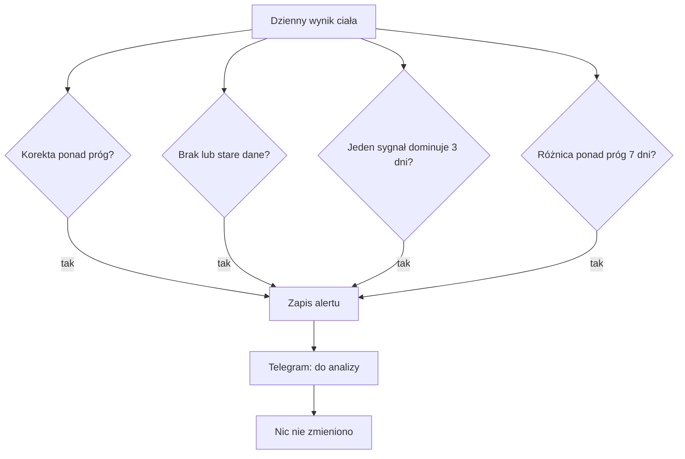

# Strażnik korekty ciała

## Co to jest

To kontrola wyniku zmęczenia i świeżości, który uwzględnia stan ciała. ATL oznacza obciążenie krótkie, CTL długie, a TSB świeżość (wyjaśnienia w [słowniczku](../slowniczek.md)). Strażnik sprawdza, czy korekta nie opiera się na brakujących, przestarzałych lub zbyt rozbieżnych sygnałach.

## Po co

Ma wskazać sytuacje, w których warto przyjrzeć się danym albo wynikowi. To powiadomienie „do analizy w sesji”. Nie poprawia danych i nie wyłącza korekty.

## Skąd dane

Kontrola jest częścią nocnego przebiegu około 04:45. Korzysta z dziennych wyników zmęczenia, świeżości, gotowości, akumulatora Body Battery, tętna spoczynkowego, wpisu o chorobie i samopoczucia. Uwzględnia treningi długie, by nie alarmować z powodu spodziewanej reakcji po kilku dniach jazdy.

## Jak liczone

1. **Duża korekta (`SILA`).** Alarm pojawia się, gdy różnica między zmęczeniem skorygowanym i z samych treningów przekracza 60% długiego obciążenia. Nie alarmuje podczas choroby ani po serii co najmniej dwóch jazd po 3 h w pięciu dniach.
2. **Braki (`DANE`).** Oczekiwane są co najmniej dwa sygnały ciała. Brak gotowości lub Body Battery, albo brak któregoś z nich przez co najmniej 2 dni, daje ostrzeżenie.
3. **Jeden sygnał dominuje (`DOMINACJA`).** Ten sam sygnał musi dominować przez 3 dni; jego wkład musi wynosić co najmniej 1,0, przekraczać 60% sumy, a pozostałe wkłady nie mogą przekraczać 0,3.
4. **Trwała różnica (`ROZBIEŻNOŚĆ`).** Świeżość skorygowana i wynik samych treningów muszą różnić się o ponad 15 punktów przez 7 kolejnych dni. Choroba wstrzymuje tę kontrolę.
5. **Ogranicz powtórki.** Ten sam typ wiadomości wysyłany jest najwyżej raz na 7 dni.
6. **Przykład z bazy.** 16.10.2026 log zawierał „korekta ciała +55 przy formie 55 (>60% formy)”. Zapis ten potwierdza konkretny alarm, ale nie dowodzi, że korekta była błędna. Dnia 18.10.2026 wartości wynosiły: korekta zmęczenia 74,5, obciążenie długie 58, różnica świeżości −16,5 wobec −2 z samych treningów. Nie ma siedmiu kolejnych dni w tym odczycie, więc nie wnioskuję, że uruchomiła się reguła trwałej różnicy.

Wzor

Próg siły korekty = 0,60 × obciążenie długie. Wartość 16.10.2026 była większa od tego progu, co potwierdza treść zapisanego alertu. Pozostałe reguły również wymagają spełnienia czasu lub warunków jakości opisanych w krokach.

## Gdzie to widać

Telegram zawiera kategorię alertu, datę i krótkie uzasadnienie. Na stronie Forma widzisz wartości zmęczenia i świeżości, ale log strażnika nie jest osobną zakładką. Zrzut [Formy](../img/ekrany/forma.png) pokazuje stronę z wynikami formy; nie pokazuje archiwum wiadomości.

## Jak czytać

Jeśli pojawi się `DANE`, sprawdź synchronizację zegarka i świeżość pomiarów. Przy `SILA` uwzględnij chorobę i długie jazdy, które mogą wyjaśnić korektę. `DOMINACJA` prosi o sprawdzenie, czy jeden pomiar nie steruje wynikiem. `ROZBIEŻNOŚĆ` oznacza utrzymującą się różnicę, nie automatyczny błąd. Żaden z komunikatów nie nakazuje zmiany treningu.

## Decyzje i historia

Kontrolę dodano 29.09.2026 jako zabezpieczenie korekty o stan ciała. Po przeglądzie 16.10 zmieniono składniki: gotowość z trzech dni i bilans nocnego ładowania Body Battery są rozdzielone, a tętno nie jest liczone po raz drugi jako osobny wkład. W kodzie zwiększono też wagę sygnału infekcji. Wcześniejsze opisy mogą pokazywać poprzedni sposób liczenia.

## Ograniczenia i pułapki

- Brak alertu nie oznacza, że pomiary są kompletne; kontrola nie obejmuje każdego błędu czujnika.
- „Forma” w wiadomości oznacza w tym module długie obciążenie, nie ocenę sportową.
- Przykład z 18.10 jest odczytem jednego dnia, nie trendem. Nie należy samodzielnie ekstrapolować go na cały tydzień.
- Telegram jest jedynym opisanym kanałem wysyłki; nie potwierdzono odczytania wiadomości przez użytkownika.

## Wpływa na / Zależy od

- **Wpływa na:** tylko decyzję o sprawdzeniu korekty; nie zapisuje zmian w ModelQ.
- **Zależy od:** dziennych danych treningowych i wellness, kalendarza choroby oraz logu deduplikacji.

## Powiązane hasła

- [Forma](../forma/index.md)
- [Gotowość](../zdrowie/gotowosc.md)
- [Strażnicy QBota](index.md)
- [Słowniczek](../slowniczek.md)

## Zrodla

- `/opt/qbot/app/fitmodel/real_load_guard.py` — progi i kody ostrzeżeń.
- `/opt/qbot/app/fitmodel/real_load.py` — skład korekty ciała.
- `/opt/qbot/app/fitmodel/daily_job.py` — codzienny krok kontroli.
- `qbot_v2.real_load_guard_log`, `qbot_v2.fitmodel_daily`, `qbot_v2.wellness_daily`, `qbot_v2.training_sessions` — przykłady z 16–18.10.2026.
- `/opt/qbot/app/docs/audit/sygnaly_ciala_2026-10-16.md` — historia zmiany składników.
