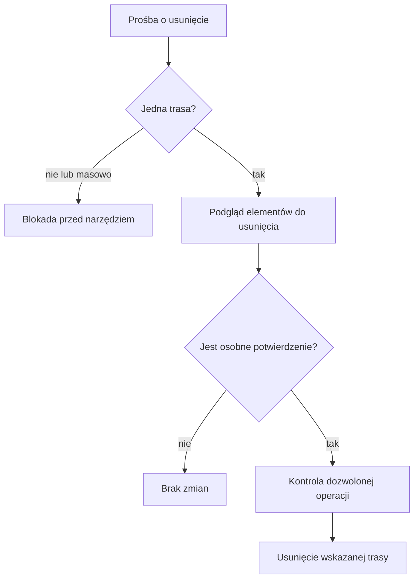

# Ochrona przed destrukcyjnymi poleceniami

## Co to jest

To kontrola próśb, które mogą usunąć albo poważnie zmienić dane. Odrzuca część destrukcyjnych poleceń przed przekazaniem ich Albertowi. Wąski wyjątek pozwala obsłużyć kasowanie jednej wskazanej trasy, ale wymaga dwuetapowego potwierdzenia.

## Po co

Zmniejsza ryzyko przypadkowego usunięcia wielu tras lub danych. Przy pojedynczej trasie najpierw pokazuje, co zostanie usunięte, aby właściciel mógł sprawdzić zakres.

## Skąd dane

Kontrola analizuje treść polecenia i typ żądanej operacji. Dla tras porównuje rozpoznane polecenie z wyjątkiem dotyczącym pojedynczej trasy. Właściwy zapis jest dodatkowo ograniczany przez listę dozwolonych czynności i reguły bezpieczeństwa.

## Jak liczone

1. **Rozpoznaj żądanie.** Frazy typu „usuń wszystko” i prośby o masowe kasowanie są klasyfikowane jako destrukcyjne.
2. **Zablokuj masową operację.** Jeśli prośba dotyczy wielu tras albo całego zbioru, Albert zwraca blokadę i nie uruchamia narzędzia.
3. **Pojedyncza trasa przechodzi do podglądu.** Polecenie wskazujące jedną trasę może zostać obsłużone przez narzędzie kasowania.
4. **Wymagaj drugiego kroku.** Pierwsze wywołanie pokazuje podgląd i prosi o zgodę. Dopiero drugie, z potwierdzeniem, wykonuje kasowanie.
5. **Przykład udokumentowany.** Dla trasy `55798129` podgląd wykazał jeden rekord bazowy, 1 423 elementy osi, 1 424 próbki wysokości, warstwy i plik. Zapis dokumentacji stwierdza, że po samym podglądzie nic nie usunięto.

## Gdzie to widać

W rozmowie z Albertem: przy blokadzie pojawia się odmowa; przy pojedynczej trasie — podgląd i prośba o potwierdzenie. To nie jest przełącznik ani ekran ustawień.

## Jak czytać

Jeśli prośba została zablokowana, zawęź ją do jednej wskazanej trasy, jeśli to jest Twoim zamiarem. Sprawdź podgląd uważnie. Samo pokazanie podglądu nie oznacza kasowania. Potwierdź dopiero wtedy, gdy zakres jest właściwy.

## Decyzje i historia

Kasowanie tras z rozmowy zostało dopuszczone wąsko przez trzy warstwy: strażnika poleceń, listę realnych zapisów i walidator. Operacja pozostaje dwustopniowa, a masowe kasowanie jest nadal blokowane. Szczegóły decyzji i dowodu podglądu opisuje dokumentacja Route Store.

## Ograniczenia i pułapki

- Kontrola rozpoznaje wzorce tekstowe; nie jest ogólnym zabezpieczeniem przed każdą możliwą stratą danych.
- Uprawnienie do skasowania jednej trasy nie oznacza zgody na masową operację.
- Inne rodzaje usuwania, na przykład wpisów żywienia, mają własną obsługę i nie są opisane jako tożsame z kasowaniem tras.
- Nie wykonano kasowania podczas tego przeglądu; przykład jest historycznym podglądem z dokumentacji.

## Wpływa na / Zależy od

- **Wpływa na:** dostępność operacji kasowania tras przez rozmowę z Albertem.
- **Zależy od:** rozpoznania zakresu polecenia, listy dozwolonych zapisów i potwierdzenia drugiego kroku.

## Powiązane hasła

- [Route Store](../trasy/store-i-wersje.md)
- [Ograniczenia Alberta](../albert/ograniczenia.md)
- [Bezpieczniki](../system/bezpieczniki.md)
- [Strażnicy QBota](index.md)

## Zrodla

- `/opt/qbot/app/qbot3/agent_runtime.py` — `_is_destructive_query`, `_looks_like_route_delete_request`.
- `/opt/qbot/app/qbot3/safety.py` — allowlista operacji.
- `/opt/qbot/app/docs/ROUTE_STORE.md` — trzy warstwy ochrony i przykład podglądu.
